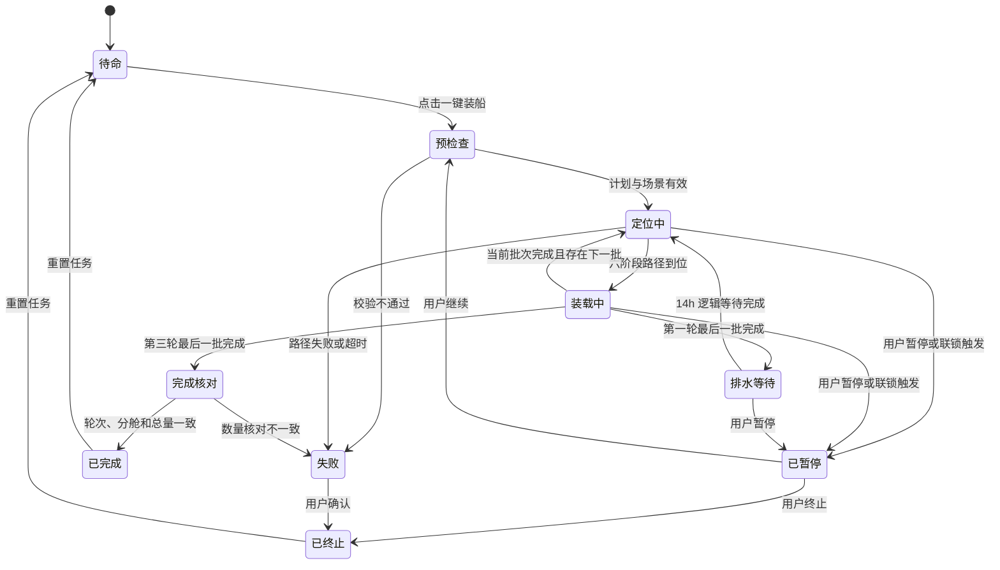

# 一键装船全流程模拟 PRD

> 文档状态：P0 已实现 / 本地验证通过 / 待业务与工程验收  
> 版本：v1.1  
> 创建日期：2026-07-28  
> 最近更新：2026-07-28  
> 适用项目：黄骅 8000 t/h 装船机多自由度运动模拟软件  
> 当前机型：SL15  
> 需求来源：用户提供的“华元503”配载图  
> 关联能力：舱口网格目标点自动定位、六阶段安全路径、皮带状态仿真、三维场景

---

## 1. 执行摘要

本功能在现有三维装船机模拟器的右侧控制栏增加一个醒目的“一键装船”按钮。用户点击后，系统基于预置配载计划完成整船预检查，并自动按照参考配载图规定的轮次、舱序和吨位执行装船模拟。

本次默认演示计划面向“华元503”，总装货量为 `52,100 t`，涉及 5 个货舱、三轮装载和一次首轮后的排水等待。系统需要自动完成跨舱安全换位、皮带启停、吨位累计、轮次切换、等待倒计时和最终核对，并在右侧控制栏与三维场景中持续显示当前舱、当前批次、已装吨位、总进度和任务状态。

本功能建立在当前已经实现的“单个舱口网格目标自动定位”能力之上。整船装船任务负责高层编排，每次跨舱定位继续复用现有六阶段安全路径；后端状态机作为唯一真实状态源，前端只负责发起命令和呈现状态。

### 1.1 一句话定义

点击一次“一键装船”，系统便可按配载图自动、可视、可暂停地模拟完成 52,100 吨煤炭的整船装载流程。

### 1.2 快速事实

| 项目 | 内容 |
|---|---|
| 主要用户 | 仿真演示人员、装船机操作员、装船工艺人员、联调工程师 |
| 需求提出时的核心问题 | 当时只能逐目标定位，无法按配载图自动执行完整跨舱装船流程 |
| 核心价值 | 一键复现标准舱序、吨位和等待规则，降低手动操作量并提高演示一致性 |
| 北极星指标 | 默认配载计划一键完整执行成功率 |
| P0 目标 | 在默认场景中自动完成三轮、12 批、52,100 t 的装船模拟 |

---

## 2. 背景与问题

### 2.1 需求提出时的系统状态

本需求提出时，系统已经具备：

- SL15 装船机大车行走、臂架回转、俯仰、伸缩和溜筒回转五个运动轴。
- 浏览器三维场景和右侧仿真控制栏。
- 船舶、货舱、舱盖和 `10 × 8` 舱口网格数据。
- “选择船舶、舱口、网格 → 预览路径 → 开始移动”的单目标定位流程。
- 安全抬升、安全回缩、安全回转、大车行走、目标俯仰和最终定位六阶段路径。
- 路径任务的开始、暂停、恢复、取消和状态查询。
- 皮带启停状态，但尚未将皮带运行与真实装载吨位、轮次和整船任务关联。

当前系统尚不具备：

- 配载计划和装载批次数据模型。
- 按轮次和舱序自动创建连续路径任务的编排器。
- 装载吨位随仿真时间增长的过程模型。
- 首轮完成后等待排水的业务状态。
- 分舱吨位、轮次吨位和整船总吨位的实时核对。
- 面向整船任务的“一键装船”、暂停、恢复、终止和重置交互。

### 2.2 用户问题

若完全依赖当前单目标功能，用户需要对每个装载批次重复选择舱口、选择网格、预览路径、开始移动、控制皮带和记录吨位。参考图所示计划包含 12 个批次和一次 14 小时等待，手动操作容易出现以下问题：

- 舱序或轮次执行错误。
- 单批吨位、分舱吨位或总吨位不一致。
- 跨舱移动时忘记停止皮带。
- 第一轮完成后遗漏排水等待。
- 中断后无法准确恢复到原批次和已装吨位。
- 不同演示人员得到的过程和结果不一致。

### 2.3 为什么现在做

现有路径规划已经解决“如何安全到达一个装料点”，具备实现整船流程编排的关键基础。当前阶段新增整船任务状态机，可以把路径规划、皮带仿真和三维表现串成完整业务闭环，同时为后续配载计划导入、自动布料、PLC/HMI 联调和真实吨位反馈奠定接口基础。

---

## 3. 产品目标与非目标

### 3.1 产品目标

1. 用户从右侧控制栏点击一次“一键装船”即可启动完整流程。
2. 系统严格按照配载计划的轮次、舱序和目标吨位执行，不得自动重排。
3. 每次跨舱定位复用现有六阶段安全路径，定位到位后才能启动皮带。
4. 装载中实时累计当前批次、当前舱和整船吨位，且不得超过目标值。
5. 第一轮完成后自动进入 14 小时逻辑排水等待，并在演示模式下可视化压缩等待。
6. 支持暂停、恢复、终止和重置，且状态转换可预测、可追踪。
7. 完成后自动核对 12 个批次、5 个货舱和 52,100 t 总量。
8. 默认场景中所有步骤均可通过三维动画和右侧进度面板观察。

### 3.2 用户目标

- 不再逐批手动选择舱口和控制皮带。
- 清楚知道当前处于哪一轮、哪一舱、哪一个动作。
- 看见装船机安全跨舱移动和货物流动效果。
- 随时了解已装吨位、剩余吨位和预计演示剩余时间。
- 在需要讲解或检查时暂停，再从同一状态继续。
- 在异常发生时停止流程，并看到明确、可操作的原因。

### 3.3 非目标

P0 不包含：

- 真实船舶稳性、纵强度、中拱/中垂、TPC 或吃水计算。
- 根据吃水反馈自动调整第三轮 `700 t` 的实际值。
- 真实压载水泵、排水流量或水舱液位物理仿真。
- 从纸质图片自动 OCR 生成配载计划。
- 真实煤炭堆形、颗粒碰撞和舱内容积占用的高精度物理仿真。
- 根据煤温判断自燃风险；P0 仅显示安全提示。
- 自动寻找最优舱序或修改配载图。
- 多台装船机协同作业。
- 直接驱动现场 PLC、皮带或装船机设备。
- 把本功能作为真实生产控制或船舶配载决策依据。

---

## 4. 用户角色

### 4.1 主要用户：仿真演示人员

**职责：**

- 加载默认场景并启动完整装船演示。
- 在演示过程中讲解轮次、舱序、吨位和设备动作。
- 必要时暂停、继续或重新开始。

**核心诉求：**

- 操作少，最好点击一次即可运行。
- 进度直观，当前步骤不能含糊。
- 演示时长可控，不需要等待真实的 20 余小时。

### 4.2 次要用户：装船机操作员与工艺人员

**职责：**

- 核对计划是否与配载图一致。
- 检查跨舱安全顺序和偏中前/偏中后装载位置。
- 观察异常处理是否符合预期。

**核心诉求：**

- 舱序和吨位必须准确。
- 任何跨舱移动期间皮带必须停止。
- 系统不得擅自跳过等待或变更计划。

### 4.3 次要用户：仿真与联调工程师

**职责：**

- 调试装船任务状态机、路径子任务和吨位模型。
- 通过 API 检查任务状态、事件日志和恢复行为。
- 为后续 PLC/HMI 或真实计量数据对接预留接口。

---

## 5. 参考配载计划

### 5.1 船舶与货物元数据

| 字段 | 参考值 | P0 用途 |
|---|---:|---|
| 船名 | 华元503 | 计划和 UI 展示 |
| 航次 | 2525 | 计划和 UI 展示 |
| 配载日期 | 2025-10-17 | 计划和 UI 展示 |
| 货物 | 煤 | 计划和安全提示展示 |
| 装货港 | 黄骅 | 计划和 UI 展示 |
| 卸货港 | 靖江 | 计划和 UI 展示 |
| 总装货量 | 52,100 t | 整船任务目标 |
| 装船机额定能力 | 8,000 t/h | 默认逻辑装载速率 |
| 第一轮后排水 | 14 h | 轮次间等待规则 |

说明：参考图中的海水密度、抵离港吃水和 TPC 作为配载图元数据保留，不参与 P0 计算。

### 5.2 分舱目标

| 货舱 | 参考舱容 `VOL`（m³） | 第一轮（t） | 第二轮（t） | 第三轮（t） | 分舱合计（t） |
|---|---:|---:|---:|---:|---:|
| No.1 | 11,363.9 | 5,000 | 4,600 | 700 | 10,300 |
| No.2 | 13,671.6 | 6,000 | 5,100 | 0 | 11,100 |
| No.3 | 13,684.3 | 4,000 | 4,300 | 0 | 8,300 |
| No.4 | 13,684.3 | 6,000 | 5,200 | 0 | 11,200 |
| No.5 | 13,001.2 | 6,000 | 4,500 | 700 | 11,200 |
| **合计** | — | **27,000** | **23,700** | **1,400** | **52,100** |

舱容只用于展示和未来容量检查。P0 不在缺少煤炭积载因数时用 `m³` 推导可装吨位。

### 5.3 冻结执行顺序

#### 第一轮

| 全局批次 | 轮内顺序 | 货舱 | 目标吨位（t） | 装载区域 |
|---:|---:|---|---:|---|
| 1 | 1 | No.4 | 6,000 | 偏中后 |
| 2 | 2 | No.2 | 6,000 | 偏中前 |
| 3 | 3 | No.5 | 6,000 | 中部 |
| 4 | 4 | No.3 | 4,000 | 偏中前 |
| 5 | 5 | No.1 | 5,000 | 中部 |

第一轮完成后，系统必须进入 `14 h` 逻辑排水等待，未完成等待不得自动开始第二轮。

#### 第二轮

| 全局批次 | 轮内顺序 | 货舱 | 目标吨位（t） | 装载区域 |
|---:|---:|---|---:|---|
| 6 | 1 | No.4 | 5,200 | 偏中后 |
| 7 | 2 | No.2 | 5,100 | 偏中前 |
| 8 | 3 | No.5 | 4,500 | 中部 |
| 9 | 4 | No.1 | 4,600 | 中部 |
| 10 | 5 | No.3 | 4,300 | 偏中前 |

#### 第三轮

| 全局批次 | 轮内顺序 | 货舱 | 目标吨位（t） | 用途 |
|---:|---:|---|---:|---|
| 11 | 1 | No.1 | 700 | 调吃水预留量 |
| 12 | 2 | No.5 | 700 | 调吃水预留量 |

参考图未规定第三轮 No.1 与 No.5 的先后顺序。P0 为保证可复现，默认按 `No.1 → No.5` 执行；计划配置允许后续调整，但运行过程中不得临时重排。

### 5.4 货舱与场景映射

默认演示使用右侧船舶 `Vessel-R`，业务舱号与现有场景货舱 ID 映射如下：

| 业务舱号 | 场景货舱 ID |
|---|---|
| No.1 | R1 |
| No.2 | R2 |
| No.3 | R3 |
| No.4 | R4 |
| No.5 | R5 |

映射必须存放在配载计划或场景配置中，编排器不得依赖 DOM 顺序或三维对象创建顺序推断舱号。

### 5.5 装载区域到网格的默认映射

现有舱口网格采用 `10 × 8`、列号由艏向艉增长、行号由左舷向右舷增长。P0 使用确定性代表点模拟每个批次的落料位置：

| 装载区域 | 默认代表网格 | 说明 |
|---|---|---|
| 偏中前 | `(4,4)` | 纵向位于中部偏艏，横向靠近中心 |
| 中部 | `(5,4)` | 纵横向均靠近中心 |
| 偏中后 | `(7,4)` | 纵向位于中部偏艉，横向靠近中心 |

以上网格是仿真默认值，不等同于现场工艺指令。计划数据必须允许逐批覆盖网格目标。P1 再扩展为同一批次内的多点蛇形布料。

---

## 6. 核心业务流程

### 6.1 主流程

1. 页面加载默认场景和“华元503”配载计划。
2. 系统在后台校验计划总量、分舱合计、场景舱号映射和所有目标网格。
3. 右侧控制栏显示计划摘要，校验通过后启用“一键装船”按钮。
4. 用户点击“一键装船”。
5. 系统创建唯一整船装船任务并执行运行前预检查。
6. 编排器读取第一批任务：第一轮 No.4，`6,000 t`。
7. 编排器停止皮带并调用现有六阶段路径，将溜筒移动到 No.4 的目标网格。
8. 路径确认到位后启动皮带和货流可视化，按逻辑装载速率累计吨位。
9. 当前批次达到目标吨位时精确停止皮带，批次状态变为“已完成”。
10. 编排器按冻结顺序执行第一轮其余批次。
11. 第一轮达到 `27,000 t` 后进入 14 小时逻辑排水等待。
12. 等待完成后，编排器按顺序执行第二轮五个批次。
13. 第二轮达到 `23,700 t` 后，执行第三轮 No.1 和 No.5 各 `700 t`。
14. 所有批次完成后，系统核对每舱合计、每轮合计和整船合计。
15. 核对全部通过时，任务状态变为“装船完成”，显示完成摘要。

### 6.2 流程状态图



### 6.3 单批次执行规则

每个装载批次严格执行：

1. 锁定当前批次，记录目标舱、目标网格和目标吨位。
2. 确认皮带已停止。
3. 为目标舱和目标网格生成路径计划。
4. 执行六阶段路径并等待“已到位”。
5. 再次检查当前批次、舱盖、场景版本和皮带控制权。
6. 启动皮带和货流动画。
7. 按逻辑速率累计批次吨位。
8. 最后一个仿真步按剩余吨位截断，保证不超装。
9. 达到目标吨位时停止皮带。
10. 记录完成事件并推进下一批次。

跨舱时不得在路径移动过程中继续落料。即使两个连续批次属于同一货舱，P0 仍重新校验目标和状态；若目标点相同，允许路径阶段被判定为已到位并快速完成，但不得跳过皮带停止和批次边界记录。

### 6.4 时间压缩

真实逻辑装载时间约为：

```text
52,100 t ÷ 8,000 t/h = 6.5125 h
加第一轮后排水 14 h
= 20.5125 h（不含机械换位）
```

为保证演示可用，P0 支持两套时间：

- **逻辑业务时间：** 用于吨位计算、14 小时等待和审计记录。
- **演示墙钟时间：** 用户实际等待的时间。

默认演示配置：

- 机械定位动画保持可观察速度，不随业务时间倍速无限加快。
- 装载吨位使用 `600×` 业务时间倍率，预计纯装载演示约 39 秒。
- 14 小时排水等待压缩为 14 秒，但 UI 必须同时显示“逻辑等待 14h”和演示倒计时。
- 测试环境允许注入更高倍率，但不得改变步骤顺序和最终吨位。

生产仿真模式可配置为 `1×`，不得把演示压缩时间误标为真实业务时长。

---

## 7. 功能需求

### 7.1 P0 功能需求

| 编号 | 需求 | 验收摘要 |
|---|---|---|
| FR-001 | 系统必须在右侧控制栏提供“一键装船”主按钮 | 计划就绪时按钮可用，点击后立即创建整船任务 |
| FR-002 | 系统必须内置或加载“华元503”配载计划 | 计划包含 3 轮、12 批、5 个货舱和一次等待 |
| FR-003 | 系统必须在启动前校验配载计划 | 批次合计、轮次合计、分舱合计和总量全部一致 |
| FR-004 | 系统必须校验计划与场景的货舱映射 | 任一舱缺失时不得启动任何运动 |
| FR-005 | 系统必须按冻结顺序逐批执行 | 事件日志中的 12 批顺序与第 5.3 节完全一致 |
| FR-006 | 每个批次必须先定位后装载 | 未收到路径“已到位”不得启动皮带 |
| FR-007 | 跨舱定位必须复用六阶段安全路径 | 路径阶段顺序不可交换 |
| FR-008 | 路径移动期间皮带必须停止 | 任一运动阶段检测到皮带运行则任务暂停并告警 |
| FR-009 | 系统必须按逻辑速率累计吨位 | 默认逻辑速率为 8,000 t/h，可配置且大于 0 |
| FR-010 | 单批吨位不得超过目标 | 最后一个时间步截断到精确目标值 |
| FR-011 | 系统必须实时计算批次、货舱、轮次和整船进度 | 四级进度均来自后端状态快照 |
| FR-012 | 第一轮后必须执行 14 小时逻辑等待 | 等待事件位于批次 5 和批次 6 之间 |
| FR-013 | 等待期间所有装船机轴和皮带保持停止 | 任一轴或皮带运行则触发失败或暂停 |
| FR-014 | 系统必须支持演示时间压缩 | UI 同时显示逻辑时间和演示倒计时 |
| FR-015 | 系统必须支持用户暂停 | 暂停后轴、皮带、吨位累计和等待倒计时均停止 |
| FR-016 | 系统必须支持继续 | 继续前重新校验场景、舱盖、控制权和当前批次 |
| FR-017 | 系统必须支持终止 | 终止后皮带和所有轴停止，未完成批次保持未完成 |
| FR-018 | 系统必须支持终态重置 | 重置后任务进度和模拟货量归零，配载计划保留 |
| FR-019 | 自动任务运行时必须拒绝冲突的手动轴、路径和皮带命令 | 返回明确冲突原因，不得出现双控制源 |
| FR-020 | 系统必须可视化活动货舱和货物流 | 三维视图中当前货舱高亮，装载时显示连续货流 |
| FR-021 | 系统必须展示模拟装载量变化 | 当前舱填充表现随累计吨位单调增长 |
| FR-022 | 系统必须在完成时执行三层核对 | 轮次、分舱、整船合计均匹配才可显示完成 |
| FR-023 | 系统必须记录装船事件 | 至少记录任务、轮次、批次、定位、皮带、等待、暂停和异常事件 |
| FR-024 | 重复启动请求必须幂等 | 相同 `request_id` 返回原任务，不重复装载 |
| FR-025 | 系统必须显示安全声明 | 明确标注“仅用于仿真演示，不用于现场控制或真实配载决策” |

### 7.2 P1 功能需求

| 编号 | 需求 |
|---|---|
| FR-101 | 支持在 UI 中编辑轮次、舱序、吨位和等待时间并重新校验 |
| FR-102 | 支持 JSON/CSV 导入与导出配载计划 |
| FR-103 | 支持单批次内多个网格点的蛇形布料 |
| FR-104 | 支持真实累计秤/皮带秤反馈替代逻辑吨位 |
| FR-105 | 支持在第三轮前输入吃水反馈并人工确认调整吨位 |
| FR-106 | 支持回放已完成任务和导出过程报告 |

---

## 8. 用户故事

### US-001：一键启动完整装船

**用户故事：**

```text
作为仿真演示人员，
我希望点击右侧的“一键装船”后自动执行完整配载计划，
从而不需要逐舱、逐批重复操作。
```

**验收标准：**

- 给定默认场景和有效计划，当用户点击“一键装船”，系统创建一个整船任务。
- 任务严格从第一轮 No.4 `6,000 t` 开始。
- 页面立即显示任务状态、当前批次和总进度。
- 已存在活动整船任务时再次点击不得创建第二个任务。

### US-002：观察当前进度

**用户故事：**

```text
作为操作员，
我希望随时看到当前轮次、货舱、动作和吨位，
从而判断系统正在做什么以及还需要多久。
```

**验收标准：**

- 定位时显示六阶段中的当前阶段。
- 装载时显示批次目标、批次已装、当前舱累计和整船累计。
- 排水时显示逻辑 14 小时和演示倒计时。
- 进度数值由后端快照提供，刷新页面后可恢复显示。

### US-003：安全暂停和继续

**用户故事：**

```text
作为演示或联调人员，
我希望在任意阶段暂停并从原状态继续，
从而可以讲解、检查或处理异常。
```

**验收标准：**

- 定位、装载或等待期间均可暂停。
- 暂停后轴值、皮带状态、吨位和等待进度保持不变。
- 继续前执行重新校验；校验失败时保持暂停并显示原因。
- 继续成功后不得重复累计已完成吨位。

### US-004：终止异常任务

**用户故事：**

```text
作为操作员，
我希望终止当前装船任务，
从而确保异常流程不会继续运动或累计吨位。
```

**验收标准：**

- 终止命令使皮带和所有运动轴停止。
- 当前任务进入不可自动恢复的“已终止”状态。
- 已装吨位和事件日志保留，直到用户执行重置。
- 终止后必须重置才能重新点击“一键装船”。

### US-005：获得准确完成结果

**用户故事：**

```text
作为装船工艺人员，
我希望完成时看到分轮、分舱和总量核对结果，
从而确认演示忠实执行了配载图。
```

**验收标准：**

- 第一轮显示 `27,000 t`，第二轮显示 `23,700 t`，第三轮显示 `1,400 t`。
- 5 个货舱合计分别为 `10,300 / 11,100 / 8,300 / 11,200 / 11,200 t`。
- 整船合计精确为 `52,100 t`。
- 任一数值不一致时状态为“核对失败”，不得显示“装船完成”。

---

## 9. UI/UX 需求

### 9.1 右侧控制栏布局

“一键装船”区域位于右侧控制栏顶部、现有“运行/暂停/复位”命令行下方、单目标路径规划区上方。桌面端首次进入页面时，主按钮应在无需滚动的位置可见。

```text
┌────────────── 右侧控制栏 ──────────────┐
│ 黄骅装船机 · SL15             t=0.0s │
│ [运行] [暂停] [复位]                    │
├───────────────────────────────────────┤
│ 华元503 · 52,100 t · 煤                │
│ 三轮 / 12批 · 第一轮后排水14h           │
│ [            一键装船             ]    │
│ 状态：待命                              │
│ [暂停装船] [继续装船] [终止] [重置]     │
├───────────────────────────────────────┤
│ 总进度      27,000 / 52,100 t   51.8% │
│ 当前：第2轮  No.4  定位阶段 4/6         │
│ 当前批次         0 / 5,200 t            │
│ No.1  5,000 / 10,300 t                 │
│ No.2  6,000 / 11,100 t                 │
│ No.3  4,000 /  8,300 t                 │
│ No.4  6,000 / 11,200 t                 │
│ No.5  6,000 / 11,200 t                 │
├───────────────────────────────────────┤
│ 当前批次与后续时间线                    │
│ ✓ R1-01 No.4  6,000 t                  │
│ … R2-01 No.4  5,200 t                  │
│ ○ R2-02 No.2  5,100 t                  │
└───────────────────────────────────────┘
```

### 9.2 主按钮状态

| 任务状态 | 主按钮文案 | 行为 |
|---|---|---|
| 计划加载中 | 加载计划中… | 禁用 |
| 计划无效 | 计划不可执行 | 禁用，并显示原因 |
| 待命 | 一键装船 | 可点击并启动 |
| 预检查/运行中 | 装船进行中… | 禁用，防止重复启动 |
| 已暂停 | 装船已暂停 | 禁用，使用“继续装船” |
| 已完成 | 装船完成 | 禁用，允许查看摘要或重置 |
| 失败/已终止 | 装船未完成 | 禁用，允许查看原因或重置 |

### 9.3 进度展示

右侧控制栏至少显示：

- 船名、货物、计划总吨位。
- 当前任务状态。
- 当前轮次及轮次进度。
- 当前全局批次，例如 `7/12`。
- 当前货舱和当前动作。
- 当前批次吨位 `已装 / 目标`。
- 当前舱吨位 `已装 / 分舱目标`。
- 整船吨位 `已装 / 52,100 t` 和百分比。
- 五舱吨位汇总。
- 当前及后续步骤时间线。
- 逻辑业务时间、演示时间倍率和预计剩余墙钟时间。

吨位统一显示为整数吨；内部允许使用更高精度，最终按目标值精确截断。

### 9.4 三维视图

- 定位期间沿用现有目标网格、目标点、实际落料点和路径阶段显示。
- 当前目标货舱使用橙色描边或半透明高亮。
- 皮带启动后显示从溜筒出口到货舱的煤流动画。
- 活动舱的模拟填充高度或填充颜色随已装比例单调变化。
- 切换货舱时先停止煤流，再播放安全定位动作。
- 排水等待期间不显示煤流，装船机保持静止，并显示“首轮完成，等待排水”覆盖提示。
- 完成后五个货舱显示各自最终装载比例，视图保留最终状态。

### 9.5 交互与可访问性

- 主按钮高度不小于 `44 px`，颜色和层级高于普通控制按钮。
- 所有按钮必须支持键盘焦点和回车/空格触发。
- 状态和错误信息使用 `aria-live`，不得只依赖颜色表达。
- 运行中禁止修改船舶、货舱、网格和手动轴控制。
- “终止”和“重置”属于破坏当前进度的操作，点击后需要二次确认。
- 窄屏时控制栏移动到三维视图下方，主按钮仍位于该面板顶部。

---

## 10. 数据需求

### 10.1 配载计划

建议新增 `LoadingPlan`：

```json
{
  "plan_id": "hy503-voy2525-20251017",
  "name": "华元503 航次2525 配载计划",
  "vessel_id": "Vessel-R",
  "vessel_name": "华元503",
  "voyage_no": "2525",
  "cargo": "煤",
  "total_target_t": 52100,
  "nominal_rate_tph": 8000,
  "hold_mapping": {
    "No.1": "R1",
    "No.2": "R2",
    "No.3": "R3",
    "No.4": "R4",
    "No.5": "R5"
  },
  "rounds": [
    {
      "round_no": 1,
      "target_t": 27000,
      "batches": [
        {"hold_no": "No.4", "target_t": 6000, "grid": [7, 4]},
        {"hold_no": "No.2", "target_t": 6000, "grid": [4, 4]},
        {"hold_no": "No.5", "target_t": 6000, "grid": [5, 4]},
        {"hold_no": "No.3", "target_t": 4000, "grid": [4, 4]},
        {"hold_no": "No.1", "target_t": 5000, "grid": [5, 4]}
      ],
      "after_round_wait": {
        "type": "drainage",
        "logical_duration_s": 50400,
        "demo_duration_s": 14
      }
    }
  ]
}
```

实际计划必须包含全部三轮；上述 JSON 仅展示字段结构和第一轮样例。

### 10.2 装船任务

建议新增 `LoadingTask`：

```text
task_id
request_id
plan_id
scene_revision
status
current_round_no
current_batch_index
current_phase
current_path_task_id
loaded_total_t
round_progress[]
hold_progress[]
batch_progress[]
logical_elapsed_s
wall_elapsed_s
time_scale
pause_reason
failure_code
failure_message
created_at
started_at
completed_at
```

任务状态：

```text
ready
prechecking
positioning
loading
waiting_drainage
paused
verifying
completed
cancelled
failed
```

当前阶段 `current_phase` 至少包含：

```text
validate
path_safe_luff
path_safe_retract
path_safe_slew
path_travel
path_target_luff
path_final_approach
belt_starting
loading_cargo
belt_stopping
drainage_wait
final_verification
```

### 10.3 状态快照

现有 `SimulationSnapshot` 增加可选 `loading_task` 摘要，确保前端通过现有轮询即可同时更新：

- 运动轴和关键点。
- 当前路径任务。
- 当前装船任务。
- 皮带和货流状态。
- 各舱模拟填充状态。

刷新页面后，前端必须通过当前任务接口恢复进度，不得仅依赖浏览器内存。

### 10.4 事件日志

每条事件至少包含：

```text
event_id
task_id
plan_id
sim_time
logical_business_time
wall_time
round_no
batch_index
hold_no
event_type
loaded_batch_t
loaded_hold_t
loaded_total_t
details
```

事件类型至少包括：

```text
task_created
precheck_passed
precheck_failed
batch_started
path_started
path_arrived
belt_started
tonnage_updated
batch_completed
round_completed
drainage_started
drainage_completed
task_paused
task_resumed
task_cancelled
task_failed
verification_passed
verification_failed
task_completed
```

`tonnage_updated` 可按固定间隔降采样，避免每个仿真步产生一条日志。

---

## 11. API 需求

### 11.1 获取当前配载计划

```http
GET /api/loading-plans/current
```

返回计划详情、校验结果、场景兼容性和不可执行原因。

### 11.2 校验计划

```http
POST /api/loading-plans/{plan_id}/validate
```

校验：

- 计划总量是否等于所有批次之和。
- 各轮目标是否等于轮内批次之和。
- 各舱目标是否等于该舱所有批次之和。
- 轮次和批次号是否唯一、连续。
- 货舱映射和网格目标是否存在。
- 吨位、速率和等待时间是否合法。
- 所有路径目标是否可规划。

### 11.3 创建并启动整船任务

```http
POST /api/loading-tasks
Content-Type: application/json

{
  "request_id": "uuid",
  "plan_id": "hy503-voy2525-20251017",
  "mode": "demo"
}
```

相同 `request_id` 必须幂等。已有活动装船任务时返回冲突，不得并行创建。

### 11.4 查询任务

```http
GET /api/loading-tasks/current
GET /api/loading-tasks/{task_id}
GET /api/loading-tasks?limit=50
```

### 11.5 控制任务

```http
POST /api/loading-tasks/{task_id}/pause
POST /api/loading-tasks/{task_id}/resume
POST /api/loading-tasks/{task_id}/cancel
POST /api/loading-tasks/{task_id}/reset
```

所有控制接口必须返回更新后的完整任务状态。

### 11.6 查询事件

```http
GET /api/loading-tasks/{task_id}/events
```

支持按事件类型、轮次和批次过滤。

---

## 12. 技术考虑

### 12.1 逻辑分层

```text
右侧“一键装船”UI
        ↓
LoadingTask API
        ↓
整船装船编排器 LoadingTaskManager
        ├── 配载计划校验 LoadingPlanValidator
        ├── 现有 PathPlanner / PathTaskManager
        ├── 现有运动轴与 SimulationWorld
        ├── 皮带与吨位模型 LoadingRateModel
        └── 事件日志 LoadingEventStore
```

### 12.2 唯一真实状态源

- 后端整船任务状态机是轮次、批次、吨位和等待状态的唯一真实来源。
- 前端不得使用一串 `setTimeout` 独立推进流程。
- 吨位增长必须随仿真时间步推进，暂停仿真时停止增长。
- 每个状态转换必须先完成进入条件检查，再以原子方式更新状态。
- 当前路径任务只能由整船任务持有；活动整船任务期间拒绝前端创建独立路径任务。

### 12.3 与现有路径规划的关系

- 整船编排器不重新实现轴运动逻辑。
- 每个批次根据 `vessel_id + hold_id + grid` 调用现有路径预览。
- 路径计划通过后创建路径任务并监听 `arrived / paused / failed / cancelled`。
- 路径 `arrived` 后才允许进入装载状态。
- 路径失败必须向上转换为整船任务失败，并保留原始错误码。

### 12.4 吨位模型

基本公式：

```text
increment_t = nominal_rate_tph × effective_dt_s / 3600
loaded_t = min(target_t, loaded_t + increment_t)
```

其中 `effective_dt_s` 在演示模式下应用装载时间倍率。装载模型必须满足：

- 皮带未运行时增量为 0。
- 仿真暂停时增量为 0。
- 单个时间步不得跨越批次目标。
- 速率必须可配置并记录在任务快照中。
- P0 使用恒定速率；速率爬升、波动和故障属于 P1。

### 12.5 模拟填充

P0 可使用每舱目标吨位作为视觉填充的归一化分母：

```text
visual_fill_ratio = loaded_hold_t / target_hold_t
```

该比例只表达“相对本计划目标的完成度”，不得标注为真实舱容占用率。舱容占用率需要煤炭积载因数和实际舱型数据，P0 不计算。

### 12.6 控制权

活动整船任务期间：

- 整船编排器独占路径任务、运动轴和皮带控制权。
- 全局“暂停”应暂停整船任务；不得只暂停仿真循环而让业务状态显示运行。
- 手动轴目标、手动皮带命令、单目标路径开始命令返回 `409 Conflict`。
- 用户终止整船任务后，手动控制权才可恢复。

### 12.7 故障恢复

- P0 进程内保存任务状态，页面刷新后可恢复。
- 服务进程重启后的任务持久恢复属于 P1。
- 任一未知异常首先停止皮带和运动轴，再把任务置为失败。
- 失败状态保留已装吨位、当前批次和事件，不自动回滚模拟货量。

---

## 13. 安全与联锁需求

启动前必须检查：

- 当前无活动整船任务或独立路径任务。
- 仿真世界、装船机、目标船舶和 5 个目标货舱存在。
- 目标货舱舱盖均为允许作业状态。
- 所有 12 个批次的目标网格合法且路径可达。
- 运动轴和皮带无失败状态。
- 皮带已停止。
- 计划与当前 `scene_revision` 一致。
- 计划总量和所有合计校验通过。

运行中必须持续检查：

- 跨舱路径移动时皮带保持停止。
- 装载时目标路径仍处于到位状态。
- 场景版本未改变。
- 用户没有发出冲突手动命令。
- 当前累计吨位未超出批次目标。
- 等待排水时皮带和所有轴停止。

异常默认处理：

| 异常 | 处理 |
|---|---|
| 预检查失败 | 不启动任何动作，任务进入失败并显示原因 |
| 路径不可达或超时 | 停止所有轴和皮带，整船任务失败 |
| 舱盖关闭 | 暂停；重新打开并校验后可继续 |
| 场景版本变化 | 暂停并要求重新校验，不自动续跑 |
| 皮带在路径移动时运行 | 立即停止皮带并暂停任务 |
| 吨位计算异常或超装 | 立即停止皮带，任务失败 |
| API 通信短暂中断 | 后端继续保持权威状态，前端重连后恢复显示 |
| 未知异常 | 安全停止并记录错误，不自动跳过批次 |

安全提示区需展示参考图中的业务提醒：

- 严禁在主甲板吸烟。
- 煤温过高时不得装船，以降低自燃风险。
- 若积载因素过大、舱容偏紧，应联系工艺负责人调整货量。

这些提示不构成 P0 的自动检测能力。

---

## 14. 非功能需求

| 编号 | 类别 | 要求 |
|---|---|---|
| NFR-001 | 响应 | 点击“一键装船”后 `500 ms` 内显示“预检查中” |
| NFR-002 | 状态刷新 | 运行状态 UI 更新频率不低于 `5 Hz` |
| NFR-003 | 确定性 | 相同场景、计划和时间配置得到相同批次顺序和最终吨位 |
| NFR-004 | 精度 | 单批、分舱、分轮和整船最终吨位误差均为 `0 t` |
| NFR-005 | 可靠性 | 任一任务时刻最多存在一个活动整船任务和一个归属它的路径子任务 |
| NFR-006 | 幂等性 | 相同启动请求不得导致重复任务或重复吨位 |
| NFR-007 | 可观察性 | 所有状态转换和安全停止均有结构化事件 |
| NFR-008 | 性能 | 3D 动画目标 `30 FPS`，状态和货流效果不得造成明显卡顿 |
| NFR-009 | 可访问性 | 主流程可使用键盘操作，状态不只通过颜色表达 |
| NFR-010 | 兼容性 | 支持项目当前目标浏览器和桌面宽度，窄屏提供纵向布局 |
| NFR-011 | 可测试性 | 时间倍率、装载速率和等待时长可通过测试配置注入 |
| NFR-012 | 安全边界 | 页面持续标注“仿真演示，不用于现场设备控制” |

---

## 15. 成功指标

本功能使用 HEART 中的“采用度、任务成功”和面向演示稳定性的自定义指标。

### 15.1 北极星指标

**默认配载计划一键完整执行成功率**

```text
成功完成并通过最终核对的任务数 ÷ 有效启动任务数 × 100%
```

目标：默认场景自动化回归中达到 `100%`；内部演示试运行中达到 `≥95%`。

### 15.2 支持指标

| 指标 | 目标 |
|---|---:|
| 有效计划启动成功率 | ≥ 99% |
| 批次顺序合规率 | 100% |
| 跨舱移动皮带停止合规率 | 100% |
| 最终吨位核对通过率 | 100% |
| 暂停后恢复成功率 | ≥ 99% |
| 默认演示总时长 | 2～5 分钟，含可观察的机械换位 |
| 关键状态首次反馈 | ≤ 500 ms |

### 15.3 反向指标

- 重复启动导致的重复装载次数必须为 0。
- 单批超装次数必须为 0。
- 第一轮后未等待即进入第二轮的次数必须为 0。
- 活动整船任务期间成功执行冲突手动命令的次数必须为 0。
- 状态显示“已完成”但吨位核对失败的次数必须为 0。

### 15.4 建议埋点

```text
one_click_loading_clicked
loading_precheck_succeeded
loading_precheck_failed
loading_batch_started
loading_batch_completed
loading_drainage_started
loading_drainage_completed
loading_task_paused
loading_task_resumed
loading_task_cancelled
loading_task_failed
loading_task_completed
```

---

## 16. 验收场景

### AC-001：默认计划完整执行

**Given** 默认 SL15 场景、`Vessel-R` 和有效“华元503”计划已加载  
**When** 用户点击“一键装船”并不做干预  
**Then**

- 系统依次完成 12 个批次。
- 批次顺序与第 5.3 节完全一致。
- 第一轮和第二轮之间出现一次 14 小时逻辑排水等待。
- 最终整船吨位为 `52,100 t`。
- 任务状态为“已完成”。

### AC-002：分舱与分轮核对

完成后必须同时满足：

```text
Round 1 = 27,000 t
Round 2 = 23,700 t
Round 3 =  1,400 t

No.1 = 10,300 t
No.2 = 11,100 t
No.3 =  8,300 t
No.4 = 11,200 t
No.5 = 11,200 t

Total = 52,100 t
```

### AC-003：装载区域

**Given** 使用默认计划  
**When** 系统为各批次创建路径  
**Then**

- No.2 和 No.3 的默认目标为偏中前 `(4,4)`。
- No.4 的默认目标为偏中后 `(7,4)`。
- No.1 和 No.5 的默认目标为中部 `(5,4)`。
- 三维视图高亮的网格与任务目标一致。

### AC-004：暂停装载

**Given** 当前正在为 No.2 累计吨位  
**When** 用户点击“暂停装船”  
**Then**

- 皮带停止。
- 当前批次、当前舱和总吨位保持不变。
- 任务状态变为“已暂停”。
- 用户继续后从剩余吨位恢复，不重新装载已完成部分。

### AC-005：暂停排水等待

**Given** 第一轮已经完成，排水演示倒计时正在运行  
**When** 用户暂停 5 秒后继续  
**Then**

- 暂停期间逻辑等待进度和演示倒计时不变化。
- 继续后从原剩余时间恢复。
- 第二轮不得提前开始。

### AC-006：路径不可达

**Given** 任一批次目标网格不可达  
**When** 用户点击“一键装船”  
**Then**

- 预检查失败。
- 任何轴和皮带均不启动。
- UI 指明失败批次、货舱、网格和不可达原因。

### AC-007：运行中舱盖关闭

**Given** 下一目标舱舱盖被改为关闭  
**When** 编排器准备进入该批次  
**Then**

- 任务暂停。
- 皮带和运动轴停止。
- UI 提示打开对应舱盖后重新校验。
- 未经继续命令不得自动恢复。

### AC-008：终止任务

**Given** 任意定位、装载或等待阶段  
**When** 用户确认终止  
**Then**

- 轴和皮带停止。
- 吨位不再增长。
- 任务进入“已终止”。
- 已完成批次和已装吨位保留。
- 重置前不得再次一键启动。

### AC-009：重复启动

**Given** 一个整船任务正在运行  
**When** 客户端重复发送相同或不同启动请求  
**Then**

- 相同 `request_id` 返回原任务。
- 不同 `request_id` 返回活动任务冲突。
- 不创建重复任务，不增加重复吨位。

### AC-010：最终核对失败

**Given** 测试注入使任一分舱累计与计划不一致  
**When** 最后一批结束并进行核对  
**Then**

- 状态进入“核对失败”。
- UI 明确显示计划值、实际值和差值。
- 系统不得显示“装船完成”。

---

## 17. 范围与版本规划

### 17.1 P0：一键装船演示闭环

- 固定“华元503”配载计划。
- 右侧“一键装船”入口和整船进度面板。
- 3 轮、12 批、一次排水等待。
- 单批代表网格定位。
- 六阶段路径复用。
- 恒定装载速率、吨位累计和货流效果。
- 暂停、继续、终止、重置。
- 事件日志和最终核对。

### 17.2 P1：可配置计划与多点布料

- UI 编辑和 JSON/CSV 导入配载计划。
- 单批多网格点布料。
- 真实秤重反馈。
- 任务持久化与服务重启恢复。
- 回放和报告导出。
- 第三轮吃水反馈和人工确认。

### 17.3 P2：真实作业增强

- 船舶稳性、纵强度和吃水模型。
- 真实压载/排水过程。
- 舱容、积载因数和料堆模型。
- 煤温与安全联锁。
- PLC/HMI 和现场设备只读联调，经过独立安全评审后再考虑控制。

---

## 18. 里程碑建议

| 阶段 | 交付内容 | 完成门槛 |
|---|---|---|
| M0 需求冻结 | 配载计划、舱号映射、状态机和 UI 评审 | 12 批及合计确认无误 |
| M1 数据与校验 | `LoadingPlan`、校验器、默认计划 | 所有计划校验测试通过 |
| M2 编排器 | 整船任务状态机、路径子任务编排、控制权 | 可无 UI 完成全流程 |
| M3 吨位与等待 | 速率模型、时间倍率、14h 等待 | 暂停/恢复与精确吨位通过 |
| M4 前端交互 | 一键按钮、进度面板、错误和完成摘要 | 主流程无需手动逐批操作 |
| M5 三维表现 | 活动舱高亮、煤流、模拟填充 | 各状态视觉一致 |
| M6 验收 | API、端到端、异常和视觉回归 | 第 16 节场景全部通过 |

具体日期由产品、工程和测试评估后确定；本 PRD 不在未经评估时承诺发布日期。

---

## 19. 风险与缓解

| 风险 | 影响 | 概率 | 缓解措施 |
|---|---|---|---|
| 参考图没有规定第三轮先后顺序 | 中 | 高 | P0 冻结为 No.1 → No.5，并保持可配置 |
| “偏中前/偏中后”缺少精确坐标 | 中 | 高 | 使用明确网格默认值并在 UI 标注为仿真配置 |
| 演示时间过长或过短 | 中 | 中 | 机械动画和业务时间分别缩放，提供可测试配置 |
| 前端定时器与后端状态漂移 | 高 | 中 | 后端状态机作为唯一真实来源 |
| 路径子任务与手动命令冲突 | 高 | 中 | 活动整船任务独占控制权，冲突返回 409 |
| 吨位浮点累计产生误差 | 高 | 中 | 最后一步截断，并以高精度或整数最小单位累计 |
| 舱容被误解为计划完成比例 | 中 | 中 | 视觉比例明确标注为“计划完成度”，不称真实舱容率 |
| 用户误以为可用于现场控制 | 高 | 低 | 页面和文档持续展示仿真安全声明 |

---

## 20. 依赖与假设

### 20.1 内部依赖

- 现有 `SimulationWorld` 可稳定推进仿真时间。
- 五个运动轴、皮带状态和状态快照继续可用。
- 现有舱口网格、目标求解和六阶段路径任务通过工程验收。
- 默认场景中的 `Vessel-R` 及 `R1～R5` 货舱保持可配置。
- 前端继续通过状态快照更新三维模型和右侧控制栏。

### 20.2 已采用假设

- 用户所说的“转船流程”在本需求中按“按照配载图完成整船装船流程”理解。
- 默认目标船舶为右侧 `Vessel-R`，业务舱号 No.1～No.5 分别映射 R1～R5。
- 第三轮按 No.1 后 No.5 的顺序执行。
- No.2、No.3 使用偏中前代表点；No.4 使用偏中后代表点；No.1、No.5 使用中部代表点。
- 排水 14 小时是必须存在的逻辑步骤，但演示时压缩为 14 秒。
- P0 使用额定 `8,000 t/h` 恒定速率，不模拟效率损失。
- 各批次目标吨位为精确演示值，不把“约 700 吨”随机化。

### 20.3 后续确认项

以下事项不阻塞 P0 开发，但在进入真实工艺评审前必须确认：

- 第三轮 No.1 与 No.5 的现场实际顺序。
- 偏中前、偏中后对应的实际网格范围或坐标。
- 参考图中排水等待是否允许由操作员人工提前确认结束。
- 实际装船速率使用额定值、平均值还是外部皮带秤反馈。
- 是否需要在 P1 中录入抵港/离港吃水并生成对比报告。

---

## 21. 开工与发布门禁

### 21.1 开工门禁

- [ ] 产品和工艺人员正式确认第 5.2、5.3 节的吨位及顺序。
- [x] 工程验证 12 个默认目标网格在当前场景均可达。
- [x] 浏览器验证右侧控制栏入口层级和桌面首屏布局。
- [x] 实现并测试整船任务对手动控制的独占策略。
- [x] 自动测试确认机械与装载时间倍率可配置。

### 21.2 发布门禁

- [ ] 第 16 节全部验收场景通过。
- [x] 12 批顺序、分舱、分轮和总量自动测试通过。
- [x] 路径移动期间皮带运行的负向测试通过。
- [x] 暂停、继续、终止、重置和重复请求测试通过。
- [ ] 页面刷新后的活动任务恢复显示通过。
- [ ] 三维煤流和填充效果达到性能预算。
- [x] UI 已显示仿真安全声明。

---

## 22. 需求追踪矩阵

| 业务目标 | 主要需求 | 主要验收 |
|---|---|---|
| 一次点击启动整船流程 | FR-001～FR-005 | AC-001、AC-009 |
| 安全跨舱定位 | FR-006～FR-008、FR-019 | AC-003、AC-006、AC-007 |
| 准确模拟装载吨位 | FR-009～FR-011、FR-022 | AC-001、AC-002、AC-010 |
| 遵守首轮排水规则 | FR-012～FR-014 | AC-001、AC-005 |
| 可控地中断和恢复 | FR-015～FR-018 | AC-004、AC-005、AC-008 |
| 过程可见、可追踪 | FR-020、FR-021、FR-023、FR-025 | AC-001～AC-005 |

---

## 23. 相关资料

- `docs/装船机舱口网格目标点路径规划_PRD.md`
- `docs/装船机舱口网格目标点路径规划_技术实现文档.md`
- `docs/装船机多自由度运动模拟软件_PRD.md`
- `docs/黄骅8000装船机模型重设计_PRD.md`
- 用户提供的“华元503”配载图

---

## 24. 术语

| 术语 | 定义 |
|---|---|
| 配载计划 | 描述船舶、轮次、舱序、批次吨位和等待规则的数据 |
| 轮次 | 按配载图划分的一组装载批次 |
| 批次 | 对一个指定货舱执行的一次定位和定量装载 |
| 整船任务 | 从第一批开始直到最终核对结束的高层自动任务 |
| 路径子任务 | 把溜筒安全移动到某个货舱网格的六阶段任务 |
| 逻辑业务时间 | 用于计算装载吨位和排水等待的仿真时间 |
| 演示墙钟时间 | 用户在屏幕前实际经历的时间 |
| 计划完成度 | 已装吨位相对本计划目标吨位的比例，不代表真实舱容占用率 |

---

## 25. 变更记录

| 版本 | 日期 | 变更 |
|---|---|---|
| v1.0 | 2026-07-28 | 基于“华元503”配载图创建一键装船全流程 PRD |
| v1.1 | 2026-07-28 | 同步 P0 本地实现、自动化与浏览器验证状态，保留未完成工程验收门禁 |
