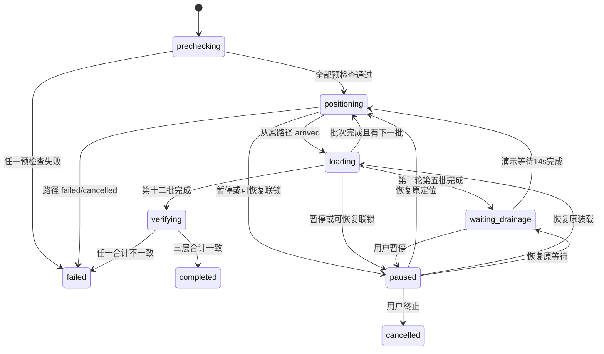

# 一键装船全流程模拟技术实现文档

> 文档状态：P0 已实现 / 本地验证通过 / 待工程评审  
> 版本：v1.1  
> 创建日期：2026-07-28  
> 最近更新：2026-07-28  
> 适用项目：黄骅 8000 t/h 装船机多自由度运动模拟软件  
> 当前机型：SL15  
> 上游需求：`docs/一键装船全流程模拟_PRD.md` v1.1  
> 目标读者：后端、前端、仿真、测试和联调工程师

---

## 1. 目标与边界

本文记录 PRD P0“一键装船”的现役实现合同：系统在单目标六阶段路径能力之上增加整船编排器，按固定三轮十二批完成定位、皮带启停、吨位累计、排水等待和最终核对。

P0 包含：

- 固定“华元503”配载计划、5 个货舱、12 个装载批次。
- 后端权威装船状态机和从属路径子任务。
- 演示时间压缩、整数千克吨位模型和进程内事件。
- 右侧一键入口、任务控制、进度、煤流、货舱高亮和动态填充。
- API、结构化错误、幂等、控制权、测试、发布与回滚。

P0 不包含计划编辑/导入、真实秤重、服务重启恢复、稳性/吃水/舱容计算、真实压载、PLC 控制或颗粒物理。本文合并系统设计、技术规格、接口和 API 设计；本功能无数据库，代码规范沿用现有 Python/JavaScript 约定，因此不单独生成数据库和代码规范文档。

## 2. 现有基线与可行性

| 能力 | 当前实现 | 本功能处理 |
|---|---|---|
| Web/API | FastAPI、Pydantic、原生 JS | 增量增加 Loading 路由和面板 |
| 仿真时钟 | `SimulationWorld.step(dt)` | 增加装船前后钩子和受控时间倍率 |
| 安全定位 | `PathPlanner`、`PathTaskManager` | 复用，不复制六阶段执行逻辑 |
| 设备运动 | 5 个 `MotionAxis` | 装船任务活动时独占控制 |
| 皮带 | `BeltState` | 定位时停止、装载时以 4.8 m/s 运行 |
| 场景 | `SceneState`、Vessel-R/R1～R5 | 校验舱号映射、舱盖和 revision |
| 状态输出 | `SimulationSnapshot` | 增加可选 `loading_task` |
| 三维表现 | Three.js 程序化船舶与装船机 | 增加煤流、高亮和动态填充 |

只读算例已验证 12 个默认目标均可达。当前轴原速的十二次定位预计 `2,588.379s`；纯装载在 `600×` 下为 `39.075s`，排水为 `14s`。演示模式使用机械 `12×` 后预计：

```text
2,588.379 / 12 + 39.075 + 14 = 268.773s ≈ 4.48min
```

普通模式机械倍率固定为 `1×`。倍率只改变仿真时间推进，不修改轴速度配置和限位。

2026-07-28 本地自动化完整运行实测为约 `273.7s`，差异来自离散步进和阶段切换；最终吨位严格为 `52,100,000kg`。

## 3. 总体架构

```text
Browser 右侧装船面板 / Three.js
                  |
                  v
        Loading Plans / Tasks API
                  |
                  v
   LoadingTaskManager + LoadingTaskExecutor
       |          |              |
       |          |              +--> LoadingEventStore
       |          +-----------------> LoadingRateModel
       +----------------------------> PathPlanner / PathTaskManager
                                          |
                                          v
 SimulationWorld.step --> MotionAxis / BeltState --> SimulationSnapshot
          ^                    |
          +------ SceneState --+
```

核心原则：

- `LoadingTaskManager` 是轮次、批次、吨位和等待的唯一真实来源。
- `PathTaskManager` 仍是所有机械定位的唯一执行器。
- 前端不使用 `setTimeout` 推进业务，只消费 API 和状态快照。
- 装船任务、路径任务、运动轴和皮带共享 `SimulationWorld.lock`。
- P0 所有运行数据均在进程内；重启后任务和事件丢失是明确限制。

### 3.1 组件职责

| 组件 | 职责 |
|---|---|
| `LoadingPlanLoader` | 从默认 JSON 加载只读计划和执行配置 |
| `LoadingPlanValidator` | 校验计划合计、顺序、映射、目标网格和路径可达性 |
| `LoadingTaskManager` | 创建、幂等、查询、暂停、恢复、取消、重置和控制锁 |
| `LoadingTaskExecutor` | 批次推进、路径编排、皮带切换、排水和终检 |
| `LoadingRateModel` | 以整数千克累计吨位并保存小数余量 |
| `LoadingEventStore` | 保存结构化事件并提供查询 |
| `PathTaskManager` | 执行从属六阶段定位并报告到位/失败 |
| `SimulationWorld` | 统一推进装船、路径、轴、吨位和快照 |

### 3.2 代码组织

新增 `app/config/default_loading_plan.json`、`app/config/loading.py`、`app/models/loading.py`，以及 `app/core/loading/` 下的校验、吨位、事件、任务管理和执行模块；两组路由放入 `app/api/routers/loading_plans.py` 与 `loading_tasks.py`。

现有 `dependencies.py` 负责单例组装；`main.py` 注册两组路由；`simulation_world.py` 接入钩子；`command_service.py` 增加整船控制锁；`snapshot.py` 增加摘要；`index.html/app.js/styles.css` 增加 UI 和三维表现。

## 4. 默认配载计划

`default_loading_plan.json` 使用 UTF-8，作为 P0 只读配置随应用发布。

| 批次 | 轮次 | 舱 | 吨位 t | 网格 |
|---:|---:|---|---:|---|
| 1～5 | 1 | R4、R2、R5、R3、R1 | 6000、6000、6000、4000、5000 | (7,4)、(4,4)、(5,4)、(4,4)、(5,4) |
| 6～10 | 2 | R4、R2、R5、R1、R3 | 5200、5100、4500、4600、4300 | (7,4)、(4,4)、(5,4)、(5,4)、(4,4) |
| 11～12 | 3 | R1、R5 | 700、700 | (5,4)、(5,4) |

冻结配置：

```json
{
  "plan_id": "hy503-voy2525-20251017",
  "vessel_id": "Vessel-R",
  "total_target_t": 52100,
  "nominal_rate_tph": 8000,
  "belt_speed_mps": 4.8,
  "hold_mapping": {"No.1":"R1","No.2":"R2","No.3":"R3","No.4":"R4","No.5":"R5"},
  "execution": {
    "demo_motion_scale": 12,
    "normal_motion_scale": 1,
    "demo_loading_scale": 600,
    "normal_loading_scale": 1,
    "drainage_logical_s": 50400,
    "drainage_demo_s": 14,
    "event_interval_demo_s": 1
  }
}
```

计划文件必须包含全部批次和元数据；应用启动时解析失败应记录错误并禁用“一键装船”，但不得影响现有手动仿真。

## 5. 数据模型

模型集中在 `app/models/loading.py`，全部继承 Pydantic `BaseModel`。

| 模型 | 关键字段 |
|---|---|
| `LoadingBatch` | `batch_no, round_no, hold_no, hold_id, target_kg, column, row` |
| `LoadingRound` | `round_no, target_kg, batches, after_round_wait` |
| `LoadingExecutionConfig` | 三种倍率、排水时长、皮带速度、事件间隔 |
| `LoadingPlan` | 元数据、映射、三轮、`total_target_kg`、执行配置 |
| `LoadingPlanValidation` | `valid, errors, warnings, calculated totals, path_checks` |
| `LoadingBatchProgress` | 状态、目标/已装 kg、路径任务 ID、开始/结束时间 |
| `LoadingHoldProgress` | 业务舱号、场景舱 ID、目标/已装 kg、完成比例 |
| `LoadingTask` | 标识、状态、当前轮/批/阶段、进度、时间、失败信息 |
| `LoadingTaskSummary` | 快照和 UI 所需的有界任务视图 |
| `LoadingEvent` | 事件序号、任务/批次、仿真时间、吨位和详情 |
| `LoadingTaskCreateRequest` | `request_id, plan_id, mode` |
| `LoadingResetResponse` | 被清除的终态任务和清除后的仿真快照 |

任务状态固定为：

```text
prechecking | positioning | loading | waiting_drainage |
paused | verifying | completed | cancelled | failed
```

`paused_from_status` 只允许保存 `positioning/loading/waiting_drainage`。批次状态固定为 `pending/positioning/loading/completed/failed`。

API 输出提供 `target_t/loaded_t` 数值字段；内部权威字段使用整数 `kg`。P0 目标均为整数吨，加载配置时必须满足 `target_t × 1000` 是整数。

## 6. 计划校验

`LoadingPlanValidator.validate(plan, scene)` 在应用加载、显式校验和任务创建时运行：

1. `plan_id`、船舶、轮次和批次标识非空且唯一。
2. 轮次必须为 1、2、3；全局批次必须为 1～12 且连续。
3. 每批目标、装载速率、倍率和等待时长均为正数。
4. 批次之和等于轮次目标；轮次、分舱合计均等于 `52,100,000kg`。
5. No.1～No.5 映射必须分别解析到 Vessel-R 的 R1～R5。
6. 目标舱存在、舱盖为 `open`、网格在 `10×8` 范围内。
7. 场景 revision 在同一次校验内不得变化。
8. 皮带停止且五轴启用时，对 12 个目标执行 `PathPlanner.preview()` 可达性校验。

校验只计算路径，不写入 `PathPlanStore`。任务实际进入每批前重新规划，避免使用过期路径。任一错误使 `valid=false`；警告不阻止启动。

## 7. 整船状态机



任务创建后同步完成预检查：成功返回 `201` 和 `positioning` 任务；失败任务进入历史并返回 `409 LOADING_PRECHECK_FAILED`，错误上下文包含 `task_id` 和全部校验问题。

每批执行：

1. 停止皮带并创建目标路径计划。
2. 通过内部 owner token 创建从属路径任务。
3. 等待路径 `arrived`；其他终态向上转换为整船失败。
4. 再验场景、舱盖、目标和控制权。
5. 启动 4.8 m/s 皮带，按吨位模型推进。
6. 精确达到批次目标后停止皮带并记录完成。
7. 进入下一批、排水等待或最终核对。

## 8. 仿真时钟与倍率

`SimulationWorld.step(dt)` 保留请求 `dt` 为 `base_dt`，装船任务决定 `motion_scale`：

```text
1. loading_executor.before_step(base_dt)
2. path_executor.before_step()
3. motion_dt = base_dt * motion_scale
4. loader.update(motion_dt)
5. sim_time += motion_dt
6. path_executor.after_step()
7. loading_executor.after_step(base_dt, motion_dt)
8. get_snapshot()
```

- `positioning`：演示模式 `motion_scale=12`，普通模式 `1`。
- `loading/waiting_drainage`：机械倍率为 `1`，设备保持静止。
- 吨位始终使用 `base_dt × loading_scale`，不得使用 `motion_dt`。
- 排水演示进度使用 `base_dt`；逻辑进度按 `50400 / 14` 映射。
- 全局或任务暂停时不执行 1～7，所有计时和吨位冻结。
- `wall_elapsed_s` 只使用 monotonic clock 做观测，不参与状态推进。

路径超时继续使用放大后的 `sim_time`，因此其仿真语义与原速一致，仅压缩墙钟时间。

## 9. 吨位与排水模型

`LoadingRateModel` 使用整数千克和 `Decimal` 小数余量：

```text
exact_kg = rate_tph * 1000 * loading_scale * base_dt / 3600 + carry_kg
step_kg  = floor(exact_kg)
carry_kg = exact_kg - step_kg
loaded_kg = min(target_kg, loaded_kg + step_kg)
```

达到目标时强制：

- 当前批次 `loaded_kg = target_kg`。
- 轮次、货舱和整船合计只由已完成批次目标与当前批次实际值计算。
- 停止皮带后才能推进批次索引。
- 最终核对比较整数 kg，不比较浮点数。

排水等待只在批次 5 与 6 之间创建一次。等待期间皮带停止、所有轴 `running=false`；检测到动作则任务失败为 `DRAINAGE_INTERLOCK_VIOLATION`。

## 10. 从属路径与控制权

`PathTask` 增加可选内部字段 `owner_kind` 和 `owner_id`；公开创建请求不能提交这两个字段。

- 公共路径任务使用 `owner_kind=standalone`。
- 整船编排器调用 `create_owned_task(..., owner_kind="loading", owner_id=loading_task_id)`。
- 活动整船任务存在时，公共路径创建返回 `409 LOADING_TASK_ACTIVE`。
- 从属路径完成后保留在原路径历史中，便于按批次审计。
- 整船任务取消时同步取消活动从属路径并释放两级控制锁。

`MotionCommandService` 先检查 Loading 锁，再检查 Path 锁：

- 手动设置/启动轴、启动皮带、公共路径任务返回 `409 AUTOMATION_LOCKED`。
- 手动停止轴作为安全入口，使整船任务暂停并记录 `manual_stop`。
- 全局暂停委托给整船任务；全局恢复在任务暂停时返回 409，必须使用装船恢复接口。
- 全局仿真复位先取消整船任务，再执行现有轴复位。

## 11. REST API

### 11.1 计划

```http
GET  /api/loading-plans/current
POST /api/loading-plans/{plan_id}/validate
```

`current` 返回 `{plan, validation}`。P0 没有写计划接口；未知计划返回 404。

### 11.2 创建、查询和事件

```http
POST /api/loading-tasks
{"request_id":"uuid","plan_id":"hy503-voy2525-20251017","mode":"demo"}

GET /api/loading-tasks/current
GET /api/loading-tasks/{task_id}
GET /api/loading-tasks?limit=50
GET /api/loading-tasks/{task_id}/events?event_type=&round_no=&batch_no=
```

- 首次创建成功返回 201；相同 `request_id + plan_id` 返回 200 和原任务。
- 相同 request ID 搭配不同 plan ID 返回 `409 IDEMPOTENCY_CONFLICT`。
- 运行、暂停或尚未 reset 的终态任务保留为 `/current`；reset 后返回 JSON `null`。
- 历史按创建时间倒序；`limit` 范围 1～50。

### 11.3 控制

```http
POST /api/loading-tasks/{task_id}/pause
POST /api/loading-tasks/{task_id}/resume
POST /api/loading-tasks/{task_id}/cancel
POST /api/loading-tasks/{task_id}/reset
```

- pause 对已暂停幂等；resume 仅允许 paused；cancel 允许活动/暂停且幂等。
- reset 仅允许 completed/cancelled/failed；活动任务必须先 cancel。
- reset 清除当前指针、吨位视觉运行态和装船锁，保留历史任务、事件、计划、场景和机械姿态。
- reset 返回 `LoadingResetResponse`，包含旧任务和清除后的 `SimulationSnapshot`。

## 12. 错误契约

沿用现有格式：

```json
{"detail":{"code":"LOADING_PLAN_INVALID","message":"配载计划校验失败。","context":{}}}
```

| HTTP | 代码 | 场景 |
|---:|---|---|
| 400 | `LOADING_PLAN_INVALID`、`LOADING_RATE_INVALID` | 配置或数值非法 |
| 404 | `LOADING_PLAN_NOT_FOUND`、`LOADING_TASK_NOT_FOUND` | 标识不存在 |
| 409 | `LOADING_PRECHECK_FAILED`、`LOADING_TASK_CONFLICT` | 无法启动 |
| 409 | `LOADING_TASK_ACTIVE`、`AUTOMATION_LOCKED` | 控制权冲突 |
| 409 | `SCENE_REVISION_MISMATCH`、`HATCH_COVER_CLOSED` | 可恢复联锁 |
| 409 | `INVALID_LOADING_TASK_STATE`、`IDEMPOTENCY_CONFLICT` | 状态或幂等冲突 |
| 500 | `TONNAGE_INVARIANT_BROKEN`、`LOADING_INTERNAL_ERROR` | 安全停止并失败 |

从属路径错误保留原 `failure_code`，整船任务增加 `failure_source="path"` 和当前批次上下文。

## 13. 快照、内存与可观测性

`SimulationSnapshot` 增加：

```python
loading_task: LoadingTaskSummary | None = None
```

摘要包含状态、当前轮/批/阶段、批次/舱/轮/总进度、时间倍率、排水进度、当前路径 ID、暂停/失败信息。前端刷新后先查 `/current`，随后继续从 10Hz 快照更新。

内存边界：

- 最多 50 个装船历史任务。
- 每任务最多 2,000 个事件；淘汰任务时同步清理幂等映射和事件。
- `tonnage_updated` 每 1.0 演示秒或批次结束记录一次。
- 所有状态转换在 `world.lock` 内完成，锁内不得执行文件 I/O。

事件至少包含：

```text
event_id, event_type, task_id, plan_id, scene_revision,
round_no, batch_no, hold_id, status, phase,
sim_time, demo_elapsed_s, logical_business_s,
loaded_batch_kg, loaded_hold_kg, loaded_total_kg, details
```

日志禁止记录请求头、凭据和个人信息。

## 14. 前端与三维实现

右侧 `loading-panel` 位于全局运行按钮下、路径面板上：

- 计划摘要和至少 44px 高“一键装船”按钮。
- 暂停、继续、终止、重置按钮及确定性禁用规则。
- 总体、轮次、批次、当前舱和五舱进度。
- 12 批时间线、路径六阶段、逻辑/演示时间和安全声明。
- 状态信息使用 `aria-live`；终止和重置使用浏览器确认对话框。

运行中禁用路径选择器、手动轴、舱盖和场景编辑；终态 reset 后恢复。

Three.js 使用 `Map<vesselId:holdId, HoldVisual>` 保存煤层网格和高亮对象：

- 当前舱显示独立橙色边框，不修改共享材质。
- `fill_ratio = loaded_hold_kg / target_hold_kg`，只表示计划完成度。
- 煤层 mesh 通过 scale/position 原位更新，不反复创建几何体。
- 装载且皮带运行时显示从 `discharge_point` 到目标点的深色圆柱煤流。
- 定位、暂停、等待、失败和终态不显示煤流。
- 无任务或 reset 后，计划目标船的动态填充显示为 0；其他船沿用场景 `fill_level`。

前端不得计算吨位、排水完成条件或自动推进批次。

## 15. 测试设计

### 15.1 单元与模型

- 12 批顺序、三轮合计、五舱合计和 `52,100,000kg` 总量。
- 缺舱、重复批次、非法网格、负速率、错误等待和错误映射。
- 12 个目标可达及任一目标不可达时整体失败。
- kg 余量、最后一步截断、不同 dt 和最终零误差。
- 12×/600×/1×、14 秒排水映射和暂停冻结。

### 15.2 状态机与控制

- 完整 12 批、批次 5 后唯一排水、最终三层核对。
- 路径 arrived/failed/cancelled、舱盖关闭、scene revision 变化。
- 定位/装载/等待暂停恢复，取消、reset 和全局复位。
- 皮带与轴联锁、手动命令冲突、第二任务冲突。
- request ID 重放/冲突、50/2000 内存边界和事件降采样。

### 15.3 API、前端与性能

- 所有响应模型、HTTP 状态、错误上下文、查询过滤和排序。
- `/current` 在创建、终态、reset 后的语义。
- 按钮状态、五舱进度、12 批时间线、键盘和 aria-live。
- 活动舱、煤流显隐、动态填充和手动控件锁。
- 10Hz 请求、30 FPS 渲染、状态首次反馈 ≤500ms。
- 默认完整演示在 2～5 分钟内且最终吨位精确。

## 16. 需求追踪

| 需求 | 设计模块 | 验证 |
|---|---|---|
| FR-001～005、024 | 计划、Loading API、幂等 | AC-001、AC-009 |
| FR-006～008、019 | 从属路径、控制锁 | AC-003、AC-006、AC-007 |
| FR-009～011、022 | kg 模型、终检、快照 | AC-001、AC-002、AC-010 |
| FR-012～014 | 排水、分层倍率 | AC-001、AC-005 |
| FR-015～018 | 任务控制与 reset | AC-004、AC-005、AC-008 |
| FR-020～021、025 | 前端与 Three.js | AC-001～AC-005 |
| FR-023 | 事件存储和日志 | 全流程审计测试 |
| NFR-001～012 | 全链路 | 性能、精度、兼容、安全门禁 |

## 17. 兼容、上线与回滚

- 新路由、新模型和 `loading_task` 均为增量；旧客户端可忽略新增字段。
- 不修改现有轴、路径、场景和 PLC API 的 URL 或既有字段。
- 不增加数据库、数据迁移、第三方包或外部服务。
- 默认计划加载失败只禁用装船入口，不阻断手动和单目标路径功能。

上线顺序：

1. 模型、计划加载和校验器。
2. 吨位模型、事件存储、任务管理器和仿真钩子。
3. 从属路径 owner、控制权和 API。
4. 快照、右侧面板和三维表现。
5. 自动测试、4.5 分钟全流程和人工 UI 验收。

回滚时取消活动任务、停止皮带和轴，隐藏一键入口并取消 Loading 路由注册；保留新增可选响应字段不会影响旧客户端。任何真实 PLC 配置均不因本功能改变。

## 18. 架构决策记录

### ADR-001：后端分层状态机

**决策：** 整船状态机持有业务真值，路径状态机只负责定位。**备选：** 前端串联 API 或扩展单个 PathTask。**后果：** 可恢复、可审计，职责清晰。

### ADR-002：复用带 owner 的路径子任务

**决策：** 以内部 owner token 复用路径任务。**备选：** 复制六阶段逻辑。**后果：** 安全规则只有一份，但需两级控制锁和错误传播。

### ADR-003：分层时间倍率

**决策：** 定位 12×、装载业务 600×、排水 50400→14 秒。**备选：** 全局单一倍率或真实时间。**后果：** 满足 2～5 分钟，测试必须区分两种 dt。

### ADR-004：整数千克为吨位真值

**决策：** 内部整数 kg，Decimal 只保存余量。**备选：** float 或 Decimal API。**后果：** 合计可精确验收，JSON 仍输出吨数。

### ADR-005：有界进程内存储

**决策：** P0 使用有界内存。**备选：** SQLite 或外部数据库。**后果：** 实现和回滚简单，重启恢复留给 P1。

### ADR-006：快照驱动三维表现

**决策：** 前端只按 `loading_task` 更新表现。**备选：** 浏览器本地定时器。**后果：** 刷新状态一致，网络中断不会重复累计。

## 19. P1/P2 扩展点

`LoadingPlanLoader` 可替换为 JSON/CSV/API 来源；`LoadingRateModel` 预留 `source=simulation|scale_feedback`；批次目标可扩展为网格列表；持久化通过 Store 接口替换内存实现；稳性、吃水、压载和 PLC 只作为独立适配器接入，不进入 P0 核心。

## 20. 完成定义与发布门禁

实现完成必须同时满足：

- PRD FR-001～025、NFR-001～012、AC-001～010 均有代码和测试追踪。
- 12 个目标全部可达，十二批顺序、排水位置和所有 kg 合计精确。
- 演示模式完整运行 2～5 分钟，定位可观察且无阶段越序。
- 暂停、恢复、取消、reset、幂等和冲突控制全部通过。
- 页面刷新后恢复任务显示；服务重启不恢复限制已写入说明。
- 结构化事件可以还原一次完整任务。
- 30 FPS、5Hz 以上状态更新和 ≤500ms 首次反馈达标。
- 页面持续显示“仅用于仿真演示，不用于现场控制或真实配载决策”。

### 20.1 2026-07-28 本地验证状态

已完成：

- 默认计划、12 个目标、三轮十二批和最终整数 kg 核对。
- 定位/装载/排水暂停恢复、舱盖与皮带联锁、取消、reset、幂等和控制冲突。
- Loading API、快照、事件、右侧面板、五舱进度、十二批时间线和仿真安全声明。
- 浏览器启动、控制锁、暂停冻结、继续、终止、重置和控制台检查。
- `pytest -q` 共 `75 passed`，JavaScript 语法和 Python 编译检查通过。

仍待完成：

- PRD AC-001～AC-010 的正式业务与工程签字。
- 指定验收电脑上的新煤流/完整流程性能记录。
- 远端 CI、部署和真实用户入口验证；本文不得据本地结果声称已经上线。

## 21. 变更记录

| 版本 | 日期 | 变更 |
|---|---|---|
| v1.0 | 2026-07-28 | 基于一键装船 PRD v1.0 创建 P0 技术实现设计 |
| v1.1 | 2026-07-28 | 对齐现役代码、75 项测试和浏览器验证结果，明确仍待工程验收与部署 |
