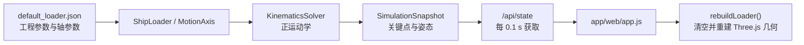

# 黄骅 8000 t/h 装船机三维模型重设计 PRD

> 文档状态：P0 Implemented
> 版本：1.5
> 创建日期：2026-07-24
> 最近更新：2026-07-25
> 适用仓库：`ZCJ`
> 参考图纸：`黄骅8000装船机方案图(1).pdf`
> 目标交付：重设计 Web Three.js 装船机模型；保持现有仿真内核与 API 可用
> 默认方案：SL15（2026-07-24 用户确认）

---

## 1. 执行摘要

当前 Web 模拟器已经具备大车行走、臂架回转、俯仰、伸缩、溜筒回转五个运动自由度，但装船机视觉模型主要由箱体、圆柱和少量桁架杆件临时拼装，比例、轮廓、结构层级与黄骅 8000 t/h 装船机方案图差异明显。最突出的偏差是当前可视化轨距为 2.5 m，而 CAD 性能参数表给出的轨距为 23 m；当前模型也缺少行走台车组、完整门架、上部回转平台、司机室/机房、配重臂、拉索或撑杆、转接漏斗、入料输送结构、维护平台和真实伸缩臂套接关系。

本次重设计不是单纯调整颜色或增加细节，而是建立一套可维护的“工程参数 + 运动骨架 + 视觉资产”模型。工程参数决定运动范围和关键点，运动骨架负责将现有仿真快照映射到各可动总成，视觉资产负责呈现 CAD 可识别的结构。优先采用“程序化运动骨架 + 优化后的分部件 glTF/GLB 资产”的混合方案；在没有原始 DWG/STEP/三维模型时，可以先以参数化低多边形结构完成 P0，但必须保留后续替换高保真资产的接口。

本 PRD 同时记录现有实现、CAD 可确认参数、两者差距、目标模型层级、参数契约、功能需求、验收标准和待确认事项。CAD PDF 中包含 SL13、SL14、SL15 三套方案；用户已确认本期默认并验收 SL15，工程参数不得再混用 SL13/SL14 数值。

---

## 2. 背景与问题

### 2.1 当前问题

当前模型可以表达“有一台装船机在运动”，但无法让工程人员快速识别为 CAD 中的黄骅 8000 t/h 装船机，具体表现为：

- 门架尺度过小，无法形成跨轨式大型港机的体量感。
- 臂架只表现为细圆管和简化三角桁架，未呈现固定臂、伸缩臂、皮带机、头部滚筒、尾部结构和套接关系。
- 缺少行走台车、轮组、支腿、门架横梁、回转支承、上部机房、司机室、配重和维护通道。
- 溜筒由几段圆柱和球体表示，缺少上部转接、伸缩/摆动段、下部回转或导料结构。
- CAD 中可见的入料转接/输送结构和上部配重侧轮廓没有被表达。
- 视觉参数大多硬编码在 `app/web/app.js`，不能按 SL13、SL14、SL15 方案切换。
- 每次状态刷新都会销毁并重建整台装船机几何体，不利于增加真实细节和长期运行。

### 2.2 用户影响

- 工程评审人员无法通过外形判断模型是否对应目标设备。
- 运动演示虽然数值可变，但视觉结构与真实机构缺少对应关系，降低可信度。
- 开发人员无法区分工程尺寸、运动学尺寸和装饰尺寸，后续修改容易破坏关键点对齐。
- 继续在现有硬编码函数中堆叠零件，会快速增加性能和维护成本。

### 2.3 为什么现在重设计

当前仿真内核、状态快照和 Web 可视化链路已经打通，正适合在继续扩展场景、舱盖和工艺逻辑之前固定装船机的模型边界。若先继续增加业务功能，再重做模型层级，后续会同时牵动渲染、运动绑定、碰撞和交互。

---

## 3. 资料来源与可信度

| 来源 | 用途 | 可信度 | 说明 |
|---|---|---:|---|
| `C:/Users/艾嘉/Desktop/黄骅8000装船机方案图(1).pdf` | CAD 结构、方案参数、作业包络 | A/B | 性能参数表可清晰读取；部分细部尺寸因 PDF 将多张图拼在一页，需原始 CAD 复核 |
| `app/config/default_loader.json` | 当前工程几何和轴参数 | A | 当前运行时直接使用 |
| `app/core/kinematics_solver.py` | 当前正运动学计算 | A | 当前关键点唯一计算来源 |
| `app/web/app.js` | 当前 Web 模型几何、材质、更新策略 | A | 本次视觉重设计的主要改造入口 |
| `app/visualization/viewer_3d.py` | PyVista 备用视图 | A | 仅用折线/点表达运动，不是目标高保真模型 |
| 当前 Web 页面运行截图 | 当前效果基线 | A | 2026-07-24 基于工作区未提交状态实测 |

可信度定义：

- A：代码或图纸表格中的明确值，可直接作为需求依据。
- B：图纸中可辨识的结构或尺寸标注，正式建模前仍需原始 CAD 量测。
- C：根据二维视图推断的三维关系，只能作为方案设计依据，不能作为制造或安全计算依据。

重要限制：该 PDF 没有可提取的文本层，且一页中拼接了多套总图和局部图。性能参数表可以可靠读取，但杆件截面、平台尺寸、台车数量和局部枢轴位置应优先由 DWG/STEP 或设计方确认。

---

## 4. CAD 方案理解

### 4.1 图纸内容

PDF 中按行展示三套 8000 t/h 装船机方案：

- SL13：较短外伸和较短伸缩行程。
- SL14：外伸范围扩大，伸缩行程为 18 m。
- SL15：三套中伸缩行程最大，最小外伸距也更小。

每套方案均包含总装主视/侧视/俯视、臂架不同姿态、固定臂架/伸缩臂架局部图、行走机构或门架局部图，以及性能参数表。

### 4.2 三套方案的明确性能参数

| 参数 | SL13 | SL14 | SL15 | 建模含义 |
|---|---:|---:|---:|---|
| 额定生产率 | 8000 t/h | 8000 t/h | 8000 t/h | P1 工艺状态/铭牌信息 |
| 最大生产率 | 9200 t/h | 9200 t/h | 9200 t/h | P1 工艺状态/铭牌信息 |
| 轨距 | 23 m | 23 m | 23 m | P0 门架、轨道、轮组几何 |
| 基距 | 22 m | 22 m | 22 m | P0 行走支承纵向布置 |
| 最大外伸距 | 29.3 m | 37 m | 37.75 m | P0 作业包络；需确认测量基准 |
| 最小外伸距 | 15 m | 19 m | 16.5 m | P0 作业包络；需确认测量基准 |
| 臂架伸缩距离 | 14.3 m | 18 m | 21.25 m | P0 伸缩轴行程和套接视觉 |
| 臂架俯仰角度 | -10°～+24° | -10°～+24° | -10°～+24° | P0 俯仰轴限位 |
| 伸缩速度 | 0～6 m/min | 0～6 m/min | 0～6 m/min | P0 运动速度上限 |
| 臂架俯仰速度 | 图示约 8 m/min | 图示约 8 m/min | 图示约 8 m/min | 图纸以线速度表示，不能直接映射为 deg/s |
| 臂架回转角度 | -35°～+215° | -35°～+215° | -35°～+215° | P0 回转轴限位 |
| 臂架回转速度 | 0～0.17 REV/min | 0～0.17 REV/min | 0～0.17 REV/min | P0 回转速度上限 |
| 皮带机宽度 | 2.4 m | 2.4 m | 2.4 m | P0 臂架截面和皮带几何 |
| 皮带机速度 | 4.8 m/s | 4.8 m/s | 4.8 m/s | P1 皮带动画/工艺状态 |
| 大车速度 | 0～30 m/min | 0～30 m/min | 0～30 m/min | P0 行走速度上限 |
| 溜筒回转速度 | 0～2 REV/min | 0～2 REV/min | 0～2 REV/min | P0 溜筒回转速度上限 |
| 溜筒摆动角度 | 随臂架俯仰 | 随臂架俯仰 | 随臂架俯仰 | P0 溜筒顶端跟随；筒体保持合理姿态 |
| 溜筒摆动速度 | 随臂架俯仰 | 随臂架俯仰 | 随臂架俯仰 | 不建立独立摆动速度轴，除非后续获得机构资料 |
| 溜筒回转角度 | 360° | 360° | 360° | P0 下部回转结构 |
| 最大工作轮压 | ≤450 kN | ≤450 kN | ≤450 kN | 本期不做结构计算，可作为设备信息展示 |

说明：

- “最大/最小外伸距”是作业外伸，不一定等于从俯仰铰点量起的臂架长度。只有确认图纸测量基准后，才能换算为 `boom_base_length_m`。
- 图纸中“臂架俯仰速度”以约 8 m/min 表示，可能对应钢丝绳、卷扬或执行机构线速度；当前软件轴单位为 deg/s，两者不能直接比较。
- CAD 图层的紫、绿、红、黄等颜色用于区分图层和构件，不等于设备实际涂装色。

### 4.3 CAD 可识别的结构总成

P0 模型至少要让以下总成在常用视角中可辨识：

1. 轨道与大车行走台车组。
2. 23 m 轨距、22 m 基距对应的门架支承结构。
3. 门架横梁、上部平台和中心回转支承。
4. 上部回转平台、司机室/机房和设备舱。
5. 固定臂架、伸缩臂架及两者的套接关系。
6. 臂架皮带、托辊或等效节奏结构、头部滚筒/落料端。
7. 后臂/配重结构和俯仰支承构件。
8. 转接漏斗与溜筒上部连接。
9. 垂直溜筒主体、伸缩或分段外观、下部回转导料结构。
10. 主要维护平台、护栏、梯子或登高通道的轮廓。

P1 结构包括图纸中的入料输送机/栈桥、更多机电设备、卷扬、滑轮、钢丝绳、管线、照明和安全标识。

---

## 5. 当前实现详解

### 5.1 系统链路



当前架构的正确边界是：仿真内核计算关键点，渲染器只读取快照。重设计应保持这一边界，不允许视觉模型反向修改内核运动状态。

### 5.2 坐标系与运动学

- 仿真世界坐标：`[x, y, z]`，`z` 为竖直方向，长度单位为 m。
- Three.js 坐标：`(x, y, z)`，`y` 为竖直方向。
- 当前转换：`world [x, y, z] -> Three (x, z, y)`。
- 角度单位：配置和 API 使用 deg。
- 速度单位：线性轴当前按 m/s，旋转轴当前按 deg/s。

当前关键点计算：

```text
base_position
  = rail_origin
  + rail_direction * travel
  + [0, 0, base_height_m]

boom_root_position
  = base_position
  + Rz(slew) * boom_base_offset

boom_direction
  = normalize(Rz(slew) * [0, cos(luff), sin(luff)])

fixed_boom_tip
  = boom_root + boom_direction * boom_base_length_m

boom_tip
  = boom_root + boom_direction * (boom_base_length_m + boom_extension)

chute_bottom
  = boom_tip + [0, 0, -chute_length_m]

discharge_point
  = chute_bottom + discharge_offset
```

当前溜筒始终竖直下垂；`chute_rotate` 只改变水平出料方向，不改变溜筒底部和落料点坐标。这个行为与图纸“溜筒摆动随臂架俯仰”的整体关系相容，但需要把旋转表现绑定到溜筒下部回转总成，而不是让整个竖直筒体随意倾倒。

### 5.3 改造前工程几何参数

| 参数 | 改造前值 | 来源 | 说明 |
|---|---:|---|---|
| `rail_origin` | `[0, 0, 0]` | `default_loader.json` | 轨道参考原点 |
| `rail_direction` | `[1, 0, 0]` | 同上 | 大车沿世界 X 方向 |
| `base_height_m` | 8.0 m | 同上 | 回转中心/基准平台高度 |
| `boom_base_offset` | `[0, 0, 1.5]` | 同上 | 臂架根部相对基座偏移 |
| `boom_base_length_m` | 25.0 m | 同上 | 当前固定臂计算长度 |
| `boom_extension_min_m` | 0.0 m | 同上 | 当前字段未直接约束轴，轴本身另有范围 |
| `boom_extension_max_m` | 15.0 m | 同上 | 当前伸缩上限 |
| `chute_length_m` | 2.6 m | 同上 | 当前溜筒长度，明显偏示意化 |
| `discharge_offset` | `[0, 0, -0.35]` | 同上 | 落料点在溜筒底部下方 0.35 m |
| `visual_scale` | 1.0 | 同上 | 当前 Web 渲染未使用 |

### 5.4 当前运动轴参数与 CAD 对比

| 轴 | 当前范围 | 当前默认速度 | CAD 范围/上限 | 结论 |
|---|---|---:|---|---|
| `travel` | -100～100 m | 1 m/s = 60 m/min | 0～30 m/min | 当前默认速度为 CAD 上限的 2 倍 |
| `slew` | -180°～180° | 5 deg/s ≈ 0.833 REV/min | -35°～+215°；0.17 REV/min | 当前范围和速度均不一致，速度约为 CAD 上限的 4.9 倍 |
| `boom_luff` | -10°～+45° | 2 deg/s | -10°～+24°；俯仰线速度约 8 m/min | 当前上仰上限过大；速度单位不可直接映射 |
| `boom_extension` | 0～15 m | 0.5 m/s = 30 m/min | SL13/14/15：14.3/18/21.25 m；0～6 m/min | 当前行程仅接近 SL13，速度为 CAD 上限的 5 倍 |
| `chute_rotate` | -180°～180° | 10 deg/s ≈ 1.67 REV/min | 360°；0～2 REV/min | 范围等价，默认速度在 CAD 上限以内 |

### 5.5 当前 Web 视觉几何

当前 `rebuildLoader()` 的主要硬编码值如下：

| 构件 | 当前视觉参数 |
|---|---|
| 轨道 | 主轨 `y=±1.25 m`，视觉轨距仅 2.5 m |
| 辅助护轨 | `y=±2.1 m` |
| 地面底座 | `5.8 × 3.8 × 0.7 m` |
| 第二层底座 | `4.8 × 2.7 × 0.45 m` |
| 四条支腿 | 底部偏移 `x=±1.55, y=±1.15 m`，向顶部收拢 |
| 顶部平台 | `3.8 × 2.8 × 0.26 m` |
| 回转圆台 | 半径 1.25 m，高 0.42 m |
| 后部配重示意 | `1.8 × 1.5 × 1.0 m` 箱体 |
| 固定臂桁架 | 宽 0.82 m，高 0.9 m，固定 8 个节间 |
| 伸缩臂桁架 | 宽 0.58 m，高 0.62 m，固定 8 个节间 |
| 皮带示意 | 半径 0.055 m 的圆管，位于臂架上方 |
| 溜筒 | 半径 0.14～0.28 m 的多段圆柱 |
| 材质 | 红橙主机、深红底座、蓝色溜筒、黑色皮带 |

### 5.6 当前渲染更新策略

Web 端以 100 ms 为步长调用 `/api/simulation/step`。每收到一帧快照后：

1. `clearGroup(loaderGroup)` 删除现有装船机节点。
2. 遍历旧节点并释放 geometry。
3. 重新创建所有 Box/Cylinder/Sphere/Truss geometry。
4. 把新模型加入场景。

该方式对当前简模尚可运行，但不适合高保真模型。重设计必须改为“初始化一次、每帧只更新 transform 和少量动态材质”，否则增加轮组、护栏、托辊和平台后会出现频繁分配、卡顿和内存抖动。

---

## 6. 差距分析

| 维度 | 当前状态 | CAD 目标 | 优先级 |
|---|---|---|---:|
| 设备轮廓 | 小型底座 + 细桁架 | 23 m 跨距大型门式港机 | P0 |
| 轨距/基距 | 2.5 m 视觉轨距；无基距配置 | 23 m / 22 m | P0 |
| 行走机构 | 无台车和轮组 | 多台车/轮组可辨识 | P0 |
| 门架 | 四根细杆收拢 | 门腿、横梁、平台和上部回转支承 | P0 |
| 回转上部 | 圆柱 + 小箱体 | 机房、司机室、回转平台、支撑结构 | P0 |
| 臂架 | 两段细桁架 | 固定臂 + 套接伸缩臂 + 皮带结构 | P0 |
| 配重/俯仰 | 小箱体，无完整支承 | 后臂、配重、拉索/撑杆或等效机构 | P0 |
| 溜筒 | 多段圆柱 | 转接、分段筒体、下部回转导料结构 | P0 |
| 入料结构 | 缺失 | 图纸可见入料转接/输送结构 | P1，范围待确认 |
| 参数 | 工程参数与视觉参数混杂 | 方案参数、视觉参数、材质参数分层 | P0 |
| 更新方式 | 10 Hz 销毁重建 | 持久节点 + transform 更新 | P0 |
| 资产替换 | 无稳定节点约定 | 可替换 glTF/GLB 分部件 | P0 |
| 验收视图 | 仅自由相机 | CAD 主视/侧视/俯视固定视图 | P0 |

---

## 7. 产品目标与非目标

### 7.1 目标

1. 在不查看标题的情况下，工程人员能从门架、臂架、配重和溜筒轮廓识别出黄骅 8000 t/h 装船机。
2. 建立和 CAD 参数一致、可切换方案的几何/运动参数体系。
3. 保持现有五自由度仿真和 API 可用，并使每个可动总成与对应轴建立清晰绑定。
4. 将模型更新从“每帧重建”改为“初始化一次、更新节点变换”。
5. 提供固定对比视角、标准姿态和可重复截图，用于模型评审与回归。
6. 为后续接入原始 CAD 导出的 glTF/GLB、高精度溜筒、碰撞检测和工艺动画保留接口。

### 7.2 非目标

- 不根据二维方案图反推制造级尺寸。
- 不开展钢结构强度、轮压、稳定性或有限元计算。
- 不实现真实 PLC 联锁、安全回路或急停逻辑。
- 不在本期实现煤流颗粒、粉尘、风载和真实物料动力学。
- 不在没有资料时虚构设备品牌、涂装 RAL 色号、铭牌文字和安全标识。
- 不要求把船舶模型同步提升到与装船机相同的工业资产精度。

---

## 8. 目标用户

### 8.1 主要用户：港机/机械工程评审人员

需要通过主视、侧视、俯视和运动姿态快速判断结构总成、比例关系和作业范围是否符合方案图。其核心诉求是“结构看得懂、尺寸有依据、运动不穿帮”。

### 8.2 次要用户：仿真开发人员

需要稳定的模型节点、明确的坐标原点、可配置参数和可自动测试的关键点绑定，避免每次换模型都重写运动学。

### 8.3 次要用户：演示/产品人员

需要在浏览器中流畅地展示大车、回转、俯仰、伸缩和溜筒动作，并能切换标准视角、隐藏辅助结构和输出截图。

---

## 9. 范围与优先级

### 9.1 P0：本期必须完成

- 使用已确认的 SL15 作为唯一 P0 默认和验收方案。
- 建立装船机节点层级和可动总成原点。
- 按 23 m 轨距、22 m 基距重做轨道、台车和门架轮廓。
- 建立回转平台、上部机房/司机室、固定臂、伸缩臂、皮带、后臂/配重、溜筒。
- 将 CAD 可确认的轴范围和速度上限写入方案配置。
- 视觉模型与 `SimulationSnapshot` 关键点对齐。
- 改为持久化模型节点，仅更新 transform。
- 提供主视、侧视、俯视和默认透视四个固定相机。
- 提供至少四组标准姿态的视觉回归截图。
- 保持现有 API 与核心单元测试通过。

### 9.2 P1：建议完成

- SL13/SL14/SL15 三套方案预设切换。
- 皮带滚动或纹理动画，速度基线为 4.8 m/s。
- 托辊、滑轮、拉索、卷扬、维护平台、护栏、梯子。
- 入料转接/输送栈桥。
- 模型部件显隐、半透明和选中高亮。
- CAD 轮廓叠加或半透明参考图对比模式。
- LOD 和低性能设备降级。

### 9.3 P2：后续考虑

- 煤流、粉尘和落料轨迹体积效果。
- 碰撞体、船舱边界和防碰撞提示。
- 真实阴影烘焙、环境贴图、夜间灯光。
- 原始 CAD/STEP 自动简化和资产流水线。
- 部件级故障、检修状态和数字孪生数据绑定。

---

## 10. 目标模型设计

### 10.1 推荐实现方案

采用混合方案：

- 运动骨架、关键点和方案参数由代码管理。
- 门架、台车、机房、臂架、溜筒等视觉部件以分部件 glTF/GLB 或可替换的程序化 Mesh 提供。
- 简单重复件使用 `InstancedMesh` 或合并几何，例如轮组、托辊、护栏立柱和桁架腹杆。
- 模型只在加载或方案切换时创建；仿真帧只更新节点 position/quaternion/scale。

不推荐直接导入一个不可拆分的整机 CAD 网格，因为它无法正确绑定伸缩、回转和俯仰，也会带来过高面数。也不推荐继续把所有细节写成 `addCylinderBetween()` 调用，因为视觉调优成本高且难以与工业设计资产协作。

### 10.2 节点层级

```text
shipLoaderRoot                       # 大车行走：travel
├─ railReference                     # 调试参考，不随设备行走
├─ travelAssembly
│  ├─ bogieFrontLeft
│  ├─ bogieFrontRight
│  ├─ bogieRearLeft
│  ├─ bogieRearRight
│  ├─ portalLegs
│  ├─ portalCrossBeam
│  ├─ maintenancePlatforms
│  └─ slewBearingBase
└─ upperSlewAssembly                 # 绕竖直轴：slew
   ├─ machineryHouse
   ├─ operatorCab
   ├─ counterBoom
   ├─ counterWeight
   ├─ luffSupport / ropes
   └─ boomLuffPivot                  # 俯仰：boom_luff
      ├─ fixedBoomAssembly
      │  ├─ fixedBoomTruss
      │  ├─ beltFrameFixed
      │  └─ fixedMaintenanceWalkway
      ├─ telescopicBoomAssembly      # 局部轴向平移：boom_extension
      │  ├─ telescopicBoomTruss
      │  ├─ beltFrameTelescopic
      │  └─ headPulley
      └─ chuteTopAnchor
         └─ chuteAssembly            # 保持竖直；顶部跟随 boom_tip
            ├─ transferHopper
            ├─ chuteSleeves
            └─ chuteYawAssembly      # 绕竖直轴：chute_rotate
               └─ dischargeHead
```

### 10.3 运动绑定规则

| 轴 | 绑定节点 | 变换 | 不应发生的行为 |
|---|---|---|---|
| `travel` | `shipLoaderRoot` | 沿 `rail_direction` 平移 | 轨道和船舶不能随装船机移动 |
| `slew` | `upperSlewAssembly` | 绕世界竖直轴旋转 | 门架、台车不能跟随回转 |
| `boom_luff` | `boomLuffPivot` | 绕臂架根部横向轴俯仰 | 根部铰点不能漂移 |
| `boom_extension` | `telescopicBoomAssembly` | 沿臂架局部轴平移 | 固定臂端点不能随伸缩变化 |
| `chute_rotate` | `chuteYawAssembly` | 绕溜筒竖直轴旋转 | 溜筒顶点、底点和落料点不能因纯回转漂移 |

### 10.4 关键点契约

视觉节点必须与以下快照关键点一致：

| 快照关键点 | 目标视觉节点 |
|---|---|
| `base_position` / `slew_center_position` | 回转支承中心 |
| `boom_root_position` | 臂架俯仰铰点 |
| `fixed_boom_tip_position` | 固定臂计算末端/伸缩基准 |
| `boom_tip_position` / `chute_top_position` | 臂架头部和溜筒上铰点 |
| `chute_bottom_position` | 溜筒主体底部 |
| `discharge_point` | 出料口/落料点标记 |

每次状态更新后，视觉节点世界坐标与对应快照点的误差不得超过 0.01 m。

### 10.5 参数分层

参数必须分成三层，禁止继续混在 `rebuildLoader()` 中：

#### A. 工程/运动参数

- 方案编号、轨距、基距。
- 外伸范围、臂架伸缩行程。
- 回转、俯仰、伸缩和溜筒限位。
- 各轴速度上限。
- 皮带宽度和速度。
- 关键枢轴、关键点和出料偏移。

#### B. 视觉几何参数

- 门架高度、门腿截面、横梁尺寸。
- 台车位置、轮组数量和轮径。
- 机房、司机室、平台、配重外形。
- 固定臂/伸缩臂截面和节间。
- 溜筒直径、分段数量和套接长度。
- 护栏、梯子、托辊的间距。

视觉几何参数如果无法从 PDF 确认，应标记为“待原始 CAD 确认”，不得伪装成工程真值。

#### C. 外观参数

- 主色、辅助色、安全色和金属色。
- 玻璃、皮带、轮胎、煤尘等材质。
- 粗糙度、金属度、透明度。
- 标识、编号、警示条纹和铭牌。

CAD 图层颜色不得直接进入外观参数。正式涂装色由用户或设备资料确认；确认前使用中性工业配色预设。

### 10.6 建议配置结构

```json
{
  "loader_variant": "SL15",
  "engineering": {
    "rated_capacity_tph": 8000,
    "max_capacity_tph": 9200,
    "rail_gauge_m": 23.0,
    "wheel_base_m": 22.0,
    "outreach_min_m": 16.5,
    "outreach_max_m": 37.75,
    "boom_extension_travel_m": 21.25,
    "boom_luff_min_deg": -10.0,
    "boom_luff_max_deg": 24.0,
    "boom_slew_min_deg": -35.0,
    "boom_slew_max_deg": 215.0,
    "belt_width_m": 2.4,
    "belt_speed_mps": 4.8
  },
  "visual": {
    "asset_url": "/assets/shiploader/sl15.glb",
    "material_preset": "industrial-neutral",
    "show_maintenance_details": true
  }
}
```

SL15 已确认为本期默认方案。示例中的 CAD 性能参数可作为 SL15 工程配置；图纸中无法可靠量取的枢轴、门架高度和溜筒局部尺寸仍属于视觉建模假设。

### 10.7 外观方向

- 优先呈现大型港机的结构体量和层级，不追求所有螺栓和管线。
- 主承力结构、运动总成和维护设施使用不同明度或材质层级，便于理解。
- 桁架腹杆应有稳定节奏，固定臂与伸缩臂的截面和颜色应能区分。
- 司机室使用半透明玻璃，但避免高透明度造成排序问题。
- 皮带使用深色、较高粗糙度材质；滚筒和轮组使用深金属或橡胶材质。
- 溜筒应避免当前“蓝色细圆管”观感，改为有套接、法兰或褶皱节奏的工业筒体。
- 护栏和梯子仅保留能形成轮廓和尺度感的主要部分，远距离可通过 LOD 隐藏。

---

## 11. 功能需求

| ID | 需求 | 优先级 | 验收摘要 |
|---|---|---:|---|
| FR-001 | 支持选择一个明确的 CAD 方案作为默认模型 | P0 | 配置和 UI/日志能显示方案编号 |
| FR-002 | 门架按 23 m 轨距、22 m 基距布置 | P0 | 固定视图量测通过，轨道与轮组对齐 |
| FR-003 | 可识别地呈现十项 P0 结构总成 | P0 | 结构清单逐项评审通过 |
| FR-004 | 五个现有运动轴正确绑定到模型节点 | P0 | 标准姿态与关键点误差通过 |
| FR-005 | 工程、视觉和外观参数分层配置 | P0 | P0 尺寸不再硬编码于每帧重建函数 |
| FR-006 | 模型初始化后仅更新 transform | P0 | 连续运行时无整机 geometry 重建 |
| FR-007 | 提供主视、侧视、俯视、默认透视相机 | P0 | 一键切换且目标构件完整入镜 |
| FR-008 | 生成标准姿态回归截图 | P0 | 四组姿态、四个视角可重复输出 |
| FR-009 | 支持模型部件显隐和辅助线开关 | P1 | 可独立隐藏门架、臂架、溜筒、维护件 |
| FR-010 | 支持 SL13/SL14/SL15 方案预设 | P1 | 切换后范围、资产和标识同步更新 |
| FR-011 | 皮带运行状态有可辨识动画 | P1 | `belt_state` 驱动，暂停时停止 |
| FR-012 | 支持低配渲染模式 | P1 | 可关闭阴影、细小附件和高 LOD |
| FR-013 | 保持现有状态、命令和场景 API 兼容 | P0 | 现有 API 测试全部通过 |

---

## 12. 用户故事

### US-001：工程人员核对整机结构

作为港机工程评审人员，  
我希望在主视、侧视和俯视图中看到与方案图一致的主要总成，  
从而快速判断模型是否对应黄骅 8000 t/h 装船机。

验收标准：

- 给定默认方案，切换到三个 CAD 对比视角时，门架、回转上部、固定臂、伸缩臂、配重和溜筒都完整入镜。
- P0 十项结构总成全部可辨识，不以文字标签代替缺失几何。
- 轨距和基距来自方案配置，不来自散落的硬编码常量。

### US-002：工程人员核对运动范围

作为运动仿真评审人员，  
我希望模型在回转、俯仰和伸缩极限位置仍保持正确连接，  
从而确认作业包络和机构关系可信。

验收标准：

- 在最小俯仰、最大俯仰、最小伸缩、最大伸缩和回转两端限位姿态下，无构件断裂、漂移或错误跟随。
- 固定臂末端不因伸缩轴变化而移动。
- 溜筒顶点始终与 `chute_top_position` 对齐，纯溜筒回转不改变落料点。
- 超出方案限位的命令被现有轴约束拒绝。

### US-003：开发人员替换视觉资产

作为仿真开发人员，  
我希望可以替换门架、臂架或溜筒的 glTF/GLB 部件而不修改运动学，  
从而持续提升模型精度。

验收标准：

- 每个可动总成有稳定节点名和枢轴约定。
- 资产使用 m 和统一上方向，导入后不需要在业务代码中写不明来源的补偿旋转。
- 视觉资产缺失时，可降级到参数化简模并给出明确提示。

### US-004：演示人员流畅操控模型

作为演示人员，  
我希望在浏览器中连续操控五个轴并切换相机，  
从而稳定展示装船机动作。

验收标准：

- 1600×900 视口、默认质量下连续运行 5 min，平均帧率不低于 30 FPS。
- 状态仍按 10 Hz 更新，但相机和画面渲染不被状态请求频率限制。
- 连续运行期间不重复创建整机 Mesh，不出现持续性内存增长。

### US-005：评审人员比较方案

作为方案评审人员，  
我希望按 SL13、SL14、SL15 切换参数和模型，  
从而比较不同外伸与伸缩范围。

验收标准：

- P1 启用后三套方案的性能参数与 CAD 表格一致。
- 切换方案后，伸缩限位、外伸信息、方案标识和对应资产同步更新。
- 不允许只改 UI 数字而不改变运动范围或视觉几何。

---

## 13. 非功能需求

| ID | 类别 | 要求 | 目标 |
|---|---|---|---|
| NFR-001 | 正确性 | 视觉关键节点与快照关键点对齐 | 世界坐标误差 ≤0.01 m |
| NFR-002 | 性能 | 默认视口持续交互 | 1600×900、5 min、平均 ≥30 FPS |
| NFR-003 | 帧稳定性 | 避免频繁大卡顿 | p95 帧时间 ≤33 ms，目标硬件待记录 |
| NFR-004 | 内存 | 持续运行无明显泄漏 | 5 min 后稳定堆内存增长 <10% |
| NFR-005 | 资源 | P0 默认 LOD 控制复杂度 | 整机建议 ≤300k 三角面、≤200 draw calls |
| NFR-006 | 加载 | 本地资产首次可交互 | ≤3 s；目标硬件和缓存条件需记录 |
| NFR-007 | 兼容 | 保持现有 API 契约 | 现有测试全部通过 |
| NFR-008 | 可维护性 | 关键总成独立、命名稳定 | 节点层级与配置文档一致 |
| NFR-009 | 可访问性 | 相机和显隐按钮可键盘操作 | 可聚焦、具备可读标签 |
| NFR-010 | 降级 | 资产加载失败仍可使用 | 显示简模和错误提示，不中断仿真 |

性能目标需要在实际部署电脑上记录 CPU、GPU、浏览器版本后最终签字；上表先作为开发验收下限。

---

## 14. 技术约束与接口

### 14.1 保留的现有边界

- Python/FastAPI 继续作为仿真状态和命令来源。
- `KinematicsSolver` 继续负责关键点，不把运动学复制到 Three.js。
- Web 只读取 `SimulationSnapshot` 和配置，不反向计算工程真值。
- 现有 `/api/state`、`/api/axis/*`、`/api/simulation/*`、`/api/scene` 保持兼容。

### 14.2 建议新增的数据能力

P0 可以直接随前端静态加载方案配置；若需要运行时切换，建议新增：

- `GET /api/loader/config`：返回当前方案、工程参数和资源版本。
- `PUT /api/loader/variant`：P1，用于切换 SL13/SL14/SL15。

若新增接口，必须明确切换方案时如何重置轴值，避免当前姿态落在新方案限位之外。

### 14.3 glTF/GLB 资产约定

- 单位必须为 m。
- 导出前冻结非必要 scale；根节点 scale 应为 1。
- 枢轴分别放在回转中心、臂架俯仰铰点、伸缩基准和溜筒回转中心。
- 节点名使用稳定英文标识，不依赖建模软件自动编号。
- 材质数量受控，重复材质复用。
- 贴图建议使用 1K/2K，避免无必要的 4K 贴图。
- 几何原点和上方向必须通过导入测试；现有世界坐标 Z-up 到 Three.js Y-up 的映射只保留一处。

### 14.4 渲染循环

目标更新方式：

```text
应用启动或方案切换
  -> 加载/创建模型一次
  -> 缓存关键节点引用

每个仿真快照
  -> 更新 travelRoot.position
  -> 更新 upperSlewAssembly.quaternion
  -> 更新 boomLuffPivot.quaternion
  -> 更新 telescopicBoomAssembly.position
  -> 更新 chuteAssembly.position
  -> 更新 chuteYawAssembly.quaternion
  -> 更新读数和轨迹

每个浏览器动画帧
  -> controls.update()
  -> renderer.render()
```

不允许在快照更新中遍历并销毁整机 geometry。

---

## 15. 设计与交互需求

### 15.1 固定视角

- 默认透视：同时看到门架、臂架、溜筒和船舱。
- 主视：对应 CAD 中跨门架方向的正视。
- 侧视：对应行走方向的侧视。
- 俯视：检查回转扇区、外伸和入料结构关系。
- 臂架特写：P1，用于检查固定臂、伸缩臂和溜筒接口。

固定视角必须使用确定性的相机位置、目标点和焦距，确保回归截图可比较。

### 15.2 模型辅助显示

- 可显示关键点、枢轴和局部坐标轴。
- 可显示当前方案和各轴限位。
- 可独立隐藏维护附件，避免密集杆件遮挡主结构。
- P1 支持模型半透明和 CAD 轮廓叠加。

### 15.3 配色

首个版本提供至少两套可切换预设：

- `industrial-neutral`：中性工业灰 + 安全黄/橙点缀，用于结构评审。
- `presentation`：适度提高主结构和可动总成对比，用于演示。

正式设备涂装在资料确认后新增，不从 CAD 图层色推断。

---

## 16. 标准姿态与验收场景

每个默认方案至少保存以下姿态：

| 场景 | 轴状态 | 验收重点 |
|---|---|---|
| S1 初始姿态 | `travel=0`、`slew=0`、`luff=10°`、`extension=0`、`chute=0` | 默认视觉和关键点对齐 |
| S2 最低俯仰/最大伸缩 | `luff=-10°`、`extension=max` | 作业外伸、套接、溜筒跟随 |
| S3 最高俯仰/最小伸缩 | `luff=+24°`、`extension=min` | 上仰包络、配重/支承关系 |
| S4 回转边界 A | `slew=-35°` | 回转限位和门架不跟随 |
| S5 回转边界 B | `slew=+215°` | 回转扇区和入料结构关系 |
| S6 溜筒回转 | `chute=0/90/180/270°` | 出料头旋转，关键点不漂移 |

每个场景至少在主视、侧视、俯视和默认透视下输出截图。若默认方案不是 CAD 中的该范围，必须从其方案配置读取实际限位，不能把表格数字再次硬编码在测试中。

---

## 17. 成功指标

采用以 HEART 中 Task Success 为主的自定义指标。

### 17.1 北极星指标

**结构与运动联合验收通过率**

```text
通过率 = 已通过的 P0 验收项 / 全部 P0 验收项
目标 = 100%
```

### 17.2 支持指标

| 指标 | 当前基线 | 目标 |
|---|---:|---:|
| P0 结构总成覆盖率 | 约 3/10 | 10/10 |
| CAD 明确工程参数配置化率 | 部分 | 100% |
| 视觉关键点对齐误差 | 未自动量测 | ≤0.01 m |
| 每帧整机 geometry 重建次数 | 1 次/快照 | 0 |
| 现有自动化测试通过率 | 需执行确认 | 100% |
| 标准姿态截图覆盖 | 0 | 6 场景 × 4 视角 |
| 5 min 平均帧率 | 需记录 | ≥30 FPS |
| 5 min 稳定内存增长 | 需记录 | <10% |

### 17.3 反向指标

- 不得为了外观改造导致现有轴命令、暂停、重置、船舶场景或舱盖功能回归。
- 不得通过放宽关键点误差掩盖资产枢轴不正确。
- 不得把所有细节合并为一个不可动的整机网格。

---

## 18. 里程碑与工作量

以下为单人开发的相对估算，不代表已承诺日期：

| 阶段 | 交付物 | 预计工作日 | 退出条件 |
|---|---|---:|---|
| M0 资料确认 | SL15 方案、原始 CAD 可用性、涂装方向 | 0.5～1 | SL15 已锁定；其余关键开放问题有结论 |
| M1 参数与骨架 | 方案配置、节点层级、关键点绑定、固定相机 | 2～3 | 简模在全部标准姿态正确 |
| M2 结构建模 | 门架、台车、上部、臂架、配重、溜筒 P0 资产 | 4～6 | P0 结构清单通过视觉评审 |
| M3 集成与优化 | glTF/程序化资产接入、持久 transform、LOD | 2～3 | 性能和内存目标通过 |
| M4 验收与文档 | 截图基线、自动测试、参数说明、问题清单 | 1～2 | P0 验收通过率 100% |

合计约 9.5～15 个工作日。若能提供结构化 DWG/STEP 和设备涂装资料，可减少二维反推和返工；若要求制造级细节，工作量需重新评估。

---

## 19. 风险与缓解

| 风险 | 概率 | 影响 | 缓解措施 |
|---|---:|---:|---|
| 后续改动误混入 SL13/SL14 数值 | 中 | 高 | 配置固定 `loader_variant=SL15`，以自动化测试锁定 SL15 参数 |
| PDF 缺少可提取文本和三维信息 | 高 | 高 | 请求 DWG/STEP；所有推断尺寸标记来源等级 |
| 直接导入 CAD 导致面数过高 | 中 | 高 | 分部件导出、简化、实例化、LOD、贴图烘焙 |
| 资产枢轴不正确导致运动漂移 | 中 | 高 | 在建模软件和运行时双重校验关键点 |
| 外观改造破坏现有运动学 | 中 | 高 | 视觉层只消费 Snapshot；保留核心回归测试 |
| 每帧重建造成卡顿和内存抖动 | 当前已存在 | 高 | 持久节点和 transform 更新列为 P0 |
| CAD 图层颜色被误当成真实涂装 | 中 | 中 | 使用中性预设；真实 RAL 色号单独确认 |
| 入料栈桥是否属于移动整机不清晰 | 中 | 中 | 在层级中暂列 P1；确认其固定/随动关系后绑定 |
| 外伸距测量基准不清楚 | 高 | 高 | 不直接写入 `boom_base_length_m`；先确认基准点 |

---

## 20. 依赖与假设

### 20.1 依赖

- 用户已确认默认方案为 SL15。
- 最好提供原始 DWG、DXF、STEP 或已有三维模型。
- 若使用 glTF/GLB，需要补充 Three.js `GLTFLoader` 及资产构建流程。
- 需要确定一台性能验收电脑，并记录浏览器、GPU 和分辨率。
- 正式涂装需要设备照片、企业色规范或 RAL 色号。

### 20.2 假设

- 当前五个自由度仍是本期唯一需要驱动的主轴。
- 门架和台车只随大车行走，不参与上部回转。
- 溜筒主体保持竖直，顶部随臂架头部移动，下部出料头独立回转。
- 船舶和舱盖的当前未提交改动属于用户工作，不在本次 PRD 交付中修改。
- 当前项目仍以本地浏览器演示为主要运行环境。

---

## 21. 开放问题

1. **已解决：默认验收方案为 SL15。**
2. 是否能够提供原始 DWG/DXF/STEP，而不仅是拼版 PDF？
3. “最大/最小外伸距”的测量起点在哪里，如何换算到当前 `boom_root_position`？
4. 图纸中的入料输送机/栈桥是否需要进入本期三维模型？它是地面固定、随大车移动，还是部分随上部回转？
5. 溜筒是否有独立伸缩、摆动或只保留回转？当前软件只有 `chute_rotate`。
6. 需要接近制造级的结构细节，还是以工程演示级轮廓为目标？
7. 设备真实涂装色、编号、Logo 和警示标识是什么？
8. 当前 `base_height_m=12.0`、`boom_base_offset.z=1.8`、`boom_base_length_m=16.5` 和 `chute_length_m=12.6` 是否有工程依据？其中 12.6 m 是按 SL15 立面比例和用户细部图重建的视觉包络，不是制造尺寸。
9. **已解决：本期只实施并验收 SL15。**
10. 性能验收目标电脑和浏览器版本是什么？

开放问题不阻止程序化 SL15 骨架实现，但问题 2、3 会阻止制造级尺寸定稿和正式 CAD/GLB 资产验收。

---

## 22. 最终验收清单

- [x] 默认 CAD 方案 SL15 已确认并写入配置。
- [x] 23 m 轨距、22 m 基距在固定视图中量测正确。
- [x] P0 十项结构总成全部可辨识。
- [x] 五个运动轴与目标节点绑定正确。
- [x] 六组标准姿态无断裂、漂移、错误跟随和明显穿插。
- [x] 视觉关键点与快照关键点误差不超过 0.01 m。
- [x] 工程参数、视觉参数、外观参数完成分层。
- [x] 每个仿真快照不再销毁重建整机 geometry。
- [x] 四个固定相机可重复输出截图。
- [x] 1600×900 连续运行 5 min 平均不低于 30 FPS。
- [x] 连续运行 5 min 稳定内存增长低于 10%。
- [x] 现有测试全部通过。
- [x] 未提供正式 GLB 时自动使用程序化简模，仿真保持可用。
- [x] 图纸推断值与明确工程值在配置和文档中有来源标记。

---

## 23. 相关文件

- `app/config/default_loader.json`：当前工程几何和轴配置。
- `app/core/kinematics_solver.py`：当前关键点与正运动学。
- `app/models/geometry.py`：当前几何参数模型。
- `app/models/snapshot.py`：渲染可读取的关键点和姿态。
- `app/web/app.js`：当前 Three.js 模型、材质和更新逻辑。
- `app/visualization/viewer_3d.py`：PyVista 备用简化视图。
- `tests/test_kinematics_solver.py`：关键点运动回归测试。
- `tests/test_api.py`：API 和场景回归测试。

---

## 24. 变更记录

| 版本 | 日期 | 变更 |
|---|---|---|
| 1.0 | 2026-07-24 | 基于 CAD PDF、当前代码和运行效果建立首版模型重设计 PRD |
| 1.1 | 2026-07-24 | 默认方案锁定为 SL15，后续实现与验收不再混用 SL13/SL14 参数 |
| 1.2 | 2026-07-24 | 完成 SL15 P0 程序化持久模型，并写入数值、视觉和五分钟性能验收结果 |
| 1.3 | 2026-07-25 | 按溜筒细部图补充顶部机械框架、导向/爬梯系统、下部平台及导料头，并完成整机完整性复核 |
| 1.4 | 2026-07-25 | 根据复核截图纠正出料口数量：删除正视图左侧多余分叉，仅保留右侧单一出料口 |
| 1.5 | 2026-07-25 | 根据俯视复核截图纠正陆侧入料传送带位置：从门架中心线移至左侧，并改为沿大车行走方向布置 |
