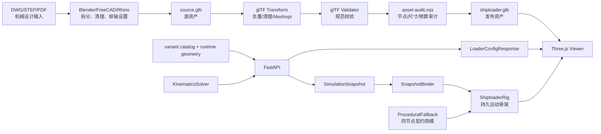
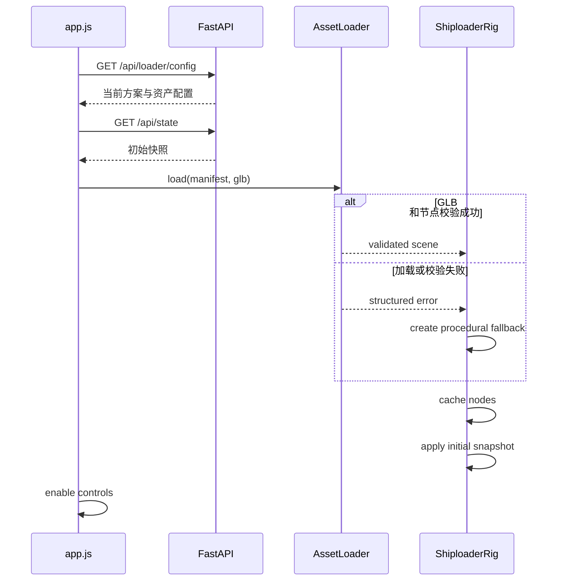
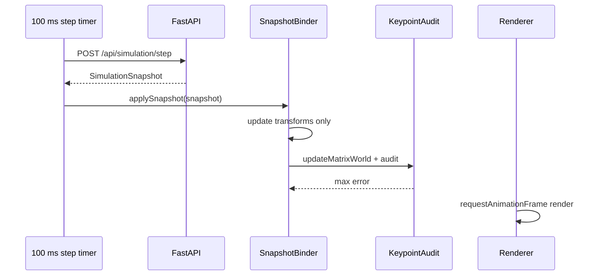

# 黄骅 8000 t/h 装船机模型重设计技术实现文档

> 文档版本：v1.5
> 编写日期：2026-07-25
> 状态：SL15 P0 R4 已实施并完成本机验收
> 关联 PRD：`docs/黄骅8000装船机模型重设计_PRD.md`
> 图纸来源：`C:/Users/艾嘉/Desktop/黄骅8000装船机方案图(1).pdf`

---

## 1. 文档目的

本文档把 PRD、CAD 方案图、当前代码实现和 GitHub 开源方案调研转化为可执行的技术设计，指导开发人员完成黄骅 8000 t/h 装船机三维模型重设计。

本文档重点回答以下问题：

1. 哪些现有能力保留，哪些模块需要改造。
2. CAD 中的结构与参数如何进入工程配置、运动骨架和视觉资产。
3. 五个现有运动轴如何稳定绑定到 Three.js 场景树。
4. 如何加载、校验、优化和降级 glTF/GLB 资产。
5. 如何证明视觉节点与后端运动学关键点一致。
6. 如何满足性能、回归、部署和回滚要求。
7. GitHub 中哪些现成方案可以采用，哪些只借鉴思路，哪些明确不引入。

本文档不替代机械设计图、结构计算书或制造图。PDF 中不能可靠读取的局部尺寸仍需原始 DWG/STEP 或设计方确认。

---

## 2. 执行摘要

### 2.1 最终技术路线

采用“后端工程运动学 + 前端持久运动骨架 + 可替换 GLB 视觉资产 + 程序化降级简模”的混合架构：

- Python/FastAPI 继续维护仿真状态、轴限位和关键点，是工程运动学唯一真值来源。
- Three.js 不复制整套运动学，只把 `SimulationSnapshot` 映射到稳定的运动节点。
- 装船机模型在应用启动或方案切换时创建一次；每个快照只更新 `position`、`quaternion`、`scale` 和少量材质状态。
- P0 视觉资产采用按运动总成拆分的 GLB；资产尚未完成或加载失败时，使用具有相同节点契约的参数化简模。
- 工程参数、运动学几何、视觉几何、外观材质分层存储，禁止继续在 `rebuildLoader()` 中硬编码。
- 默认保持当前 Three.js r160，所有新增 addon 必须来自同一 r160 版本，避免核心库与 loader 版本错配。
- 模型发布前经过 glTF Transform 优化、glTF Validator 校验和项目自定义节点/尺寸审计。

### 2.2 本期最关键的改造

当前 `app/web/app.js` 每 100 ms 执行一次 `clearGroup(loaderGroup)`，销毁并重新创建整机几何。P0 首要改造是：

```text
当前
快照 -> 清空整机 -> 新建全部 Box/Cylinder/Truss -> 渲染

目标
启动 -> 创建整机一次 -> 缓存运动节点
快照 -> 更新 5 个运动节点 transform -> 关键点审计 -> 渲染
```

完成后，每次快照的整机 geometry 创建次数必须为 0。

### 2.3 技术决策边界

- 不把 PDF/DWG 直接放进浏览器作为运行时模型。
- 不把不可拆分的整机 CAD 网格直接绑定五个自由度。
- 不引入完整 BIM/CAD 查看器替换现有 Three.js。
- 不引入 URDF 作为产品运行时格式。
- 不根据最大/最小外伸距猜测 `boom_base_length_m`。
- 不把 CAD 图层颜色当作设备涂装颜色。
- 不在前端重新计算后端已经给出的工程关键点。

### 2.4 SL15 实际实现记录

2026-07-24 已按用户确认的 SL15 完成第一版程序化持久模型；2026-07-25 根据溜筒细部图完成 R2 完整性修订：

- `app/config/default_loader.json` 统一保存 SL15 工程、运动学、视觉和轴配置。
- `app/models/loader_config.py` 对伸缩行程、轴范围和最大速度做交叉验证。
- `GET /api/loader/config` 向前端提供只读 SL15 配置。
- `app/web/shiploader/procedural-rig.js` 创建多轮均衡台车、双构件门腿、中央塔架、回转平台、机房/司机室、固定臂、伸缩臂、配重、俯仰支承、陆侧入料桁架和完整溜筒总成。
- 模型初始化一次；快照只更新大车、回转、俯仰、伸缩、溜筒和拉索 transform。
- `coordinate-frame.js` 集中管理 Z-up 到 Y-up 映射和角度符号。
- 页面提供透视、主视、侧视和俯视四个固定视角。
- 轨迹使用固定容量 `BufferGeometry`，不再每个快照销毁重建。
- 运行时七个关键点最大误差实测不超过 `3.56e-15 m`。
- R2 程序化整机约 9920 三角面、66 个 mesh；1600×900 默认透视实测 200 draw calls。
- 6 个标准姿态 × 4 个固定视角及 1 张溜筒近景，共生成 25 张视觉回归基线。
- 363.945 s 动态测试记录 27,274 帧，平均 75.00 FPS、p95 帧间隔 13.5 ms。
- 强制垃圾回收后的保留堆在继续动态运行 63 s 后变化 -9.62%，模型构建次数始终为 1。
- 本机 Chrome 冷启动到 `window.__shiploaderReady` 实测 242 ms，浏览器控制台和页面错误为 0。

由于没有结构化 DWG/STEP 或现成三维资产，本版 `model_mode=procedural`。后续正式 GLB 必须继续遵守相同节点和关键点契约，不得改变后端运动学。

完整截图矩阵和性能记录位于 `tests/visual-baselines/sl15/`。无头 Chrome 的 RAF 未锁定到 60 Hz，性能数据用于证明本机达到 PRD 门槛；指定交付电脑仍需复测签字。

### 2.5 R2 模型完整性复核

| 总成 | R2 状态 | 已还原内容 | 仍需原始 CAD 才能定稿的内容 |
|---|---|---|---|
| 行走台车 | P0 完成 | 四角台车、每台六轮、主/摇架、均衡梁 | 真实轮组数量、轴箱、驱动与制动器 |
| 门架 | P0 完成 | 23 m 轨距、22 m 基距、双构件门腿、交叉撑、中央塔架、平台、梯子与栏杆 | 箱梁截面、节点板和焊缝 |
| 回转与上部平台 | P0 完成 | 回转支承、平台、机房、司机室、屋面、玻璃和周圈栏杆 | 设备布置、门窗和检修口精确尺寸 |
| 臂架系统 | P0 完成 | 固定/伸缩桁架、皮带、托辊、头部滚筒、侧检修走道、后臂和配重 | 桁架截面、伸缩导轨和驱动机构 |
| 俯仰系统 | P0 完成 | 俯仰桅杆、前后拉索及动态前索 | 滑轮组、卷扬机和钢丝绳绕法 |
| 臂头转接 | P0 完成 | 开放式滚筒支架、转接壳体和溜筒悬挂 V 架 | 软连接、密封和内部料流通道 |
| 溜筒总成 | P0 完成 | 12.6 m 视觉包络、顶部平台/机械框架、回转壳体、三段筒体、四角导向架、爬梯、提升导杆、下平台/机械框架、回转分配头、单侧倾斜锥形导料斗、单一出口框和悬索 | 各局部尺寸、伸缩驱动、内部耐磨衬板和电缆管路 |
| 陆侧入料 | P0 轮廓完成 | 俯视图左侧沿大车行走方向布置的固定入料桁架、皮带和托辊 | 与码头固定输送机的真实接口尺寸 |
| 涂装与标识 | 临时预设 | 工业黄、浅灰、深灰和安全色分层 | 正式 RAL 色号、设备编号、Logo 和警示贴 |

本复核已补齐 PDF 和用户细部图中能够可靠识别的外部结构。没有 DWG/STEP 时，节点板、螺栓、管路、内部驱动和不可见截面不能宣称为制造级完整还原；这些项目不影响当前运动演示，但属于后续高保真 GLB 的输入缺口。

---

## 3. 输入资料与可信度

| 输入 | 用途 | 可信度 | 限制 |
|---|---|---:|---|
| 黄骅 8000 装船机方案图 PDF | 总装轮廓、结构总成、方案参数、作业包络 | A/B | 无文本层，多套图拼在一页；局部尺寸需原始 CAD 复核 |
| 模型重设计 PRD | 范围、需求、验收标准、待确认事项 | A | 默认方案已确认为 SL15 |
| `app/config/default_loader.json` | 当前运行时几何、轴范围和速度 | A | 数值属于当前 MVP，不代表 CAD 真值 |
| `app/core/kinematics_solver.py` | 当前关键点计算公式 | A | 当前几何参数需要按确认方案修订 |
| `app/web/app.js` | 当前 Three.js 渲染和更新策略 | A | 视觉尺寸硬编码且每快照重建 |
| GitHub 官方/开源仓库 | 资产加载、关节层级、优化和验证思路 | A/B | 未发现可直接落地的装船机整机项目 |

### 3.1 CAD 已确认的共同结构

三套方案均可识别出：

1. 轨道与大车行走台车组。
2. 大跨距门架、门腿、横梁和顶部平台。
3. 中心回转支承与上部回转平台。
4. 司机室、机房或设备舱。
5. 固定桁架臂、伸缩臂及套接关系。
6. 臂架皮带、托辊节奏和头部落料端。
7. 后臂、配重和俯仰支承构件。
8. 转接漏斗、垂直分段溜筒和下部回转出料头。
9. 维护平台、护栏、梯子和走道。
10. 陆侧入料/转接输送结构。

### 3.2 CAD 已确认的工程参数

| 参数 | SL13 | SL14 | SL15 |
|---|---:|---:|---:|
| 额定生产率 | 8000 t/h | 8000 t/h | 8000 t/h |
| 最大生产率 | 9200 t/h | 9200 t/h | 9200 t/h |
| 轨距 | 23 m | 23 m | 23 m |
| 基距 | 22 m | 22 m | 22 m |
| 最大外伸距 | 29.3 m | 37 m | 37.75 m |
| 最小外伸距 | 15 m | 19 m | 16.5 m |
| 臂架伸缩距离 | 14.3 m | 18 m | 21.25 m |
| 臂架俯仰角度 | -10°～+24° | -10°～+24° | -10°～+24° |
| 伸缩速度 | 0～6 m/min | 0～6 m/min | 0～6 m/min |
| 臂架回转角度 | -35°～+215° | -35°～+215° | -35°～+215° |
| 臂架回转速度 | 0～0.17 REV/min | 0～0.17 REV/min | 0～0.17 REV/min |
| 皮带宽度 | 2.4 m | 2.4 m | 2.4 m |
| 皮带速度 | 4.8 m/s | 4.8 m/s | 4.8 m/s |
| 大车速度 | 0～30 m/min | 0～30 m/min | 0～30 m/min |
| 溜筒回转角度 | 360° | 360° | 360° |
| 溜筒回转速度 | 0～2 REV/min | 0～2 REV/min | 0～2 REV/min |
| 最大工作轮压 | ≤450 kN | ≤450 kN | ≤450 kN |

换算后的软件速度上限：

```text
大车速度：30 m/min = 0.5 m/s
伸缩速度：6 m/min = 0.1 m/s
臂架回转：0.17 REV/min = 1.02 deg/s
溜筒回转：2 REV/min = 12 deg/s
```

图纸中的臂架俯仰速度约为 8 m/min，属于线速度表达，不能直接换算成当前软件使用的 deg/s。正式俯仰角速度需机构资料或设计方确认。

### 3.3 禁止直接推导的参数

最大/最小外伸距的测量基准未在当前 PDF 中可靠确认，因此：

- `outreach_min_m`、`outreach_max_m` 保存为 CAD 性能参数。
- `boom_base_length_m` 保存为运动学几何参数。
- 两者不得通过简单减法或等值替换关联。
- 只有得到测量基准、俯仰铰点位置或原始 CAD 后，才能确定正式的 `boom_base_length_m`。

---

## 4. 当前实现基线

### 4.1 系统栈

- 后端：Python、FastAPI、Pydantic、NumPy。
- 前端：原生 HTML/CSS/JavaScript、Three.js r160、OrbitControls。
- 静态资源：FastAPI `StaticFiles` 从 `app/web` 提供。
- 仿真刷新：浏览器每 100 ms 调用一次 step，约 10 Hz。
- 渲染：`requestAnimationFrame` 持续渲染。
- 测试：Pytest，当前覆盖 API、运动轴、运动学和场景。

### 4.2 当前运动学

后端世界坐标使用 `[X, Y, Z]`，Z 轴向上：

```text
base = rail_origin + rail_direction * travel + [0, 0, base_height]
boom_root = base + Rz(slew) * boom_base_offset
boom_direction = Rz(slew) * [0, cos(luff), sin(luff)]
fixed_tip = boom_root + boom_direction * boom_base_length
boom_tip = boom_root + boom_direction * (boom_base_length + extension)
chute_bottom = boom_tip + [0, 0, -chute_length]
discharge = chute_bottom + discharge_offset
```

后端已经输出：

- `slew_center_position`
- `base_position`
- `boom_root_position`
- `fixed_boom_tip_position`
- `boom_tip_position`
- `chute_top_position`
- `chute_bottom_position`
- `discharge_point`
- `boom_direction`
- `chute_direction`

这些关键点继续作为前端视觉审计的真值。

### 4.3 当前参数与 CAD 的主要偏差

| 项目 | 当前值 | CAD/目标 | 处理 |
|---|---:|---:|---|
| Three.js | r160 | P0 保持 r160 | addon 与核心版本一致 |
| 可视轨距 | 2.5 m | 23 m | 重做轨道、门架和台车 |
| 基距 | 未配置 | 22 m | 新增工程参数 |
| 俯仰上限 | +45° | +24° | 方案激活时修订 |
| 回转范围 | -180°～+180° | -35°～+215° | 方案激活时修订 |
| 伸缩行程 | 15 m | 14.3/18/21.25 m | 按方案选择 |
| 伸缩速度 | 0.5 m/s | 最大 0.1 m/s | 修订 |
| 回转速度 | 5 deg/s | 最大 1.02 deg/s | 修订 |
| 大车速度 | 1 m/s | 最大 0.5 m/s | 修订 |
| 模型更新 | 每快照重建 | 仅 transform 更新 | 架构改造 |

### 4.4 当前性能根因

`rebuildLoader(snapshot)` 在每次快照中：

1. 遍历并移除 `loaderGroup` 全部子节点。
2. 销毁临时 geometry。
3. 重建底座、门腿、回转支承、配重、桁架、溜筒和出料头。
4. 重建轨迹线 geometry。

即使快照频率只有 10 Hz，这种策略仍会制造大量 JavaScript 对象和 GPU 资源，导致：

- 垃圾回收抖动。
- WebGL buffer 反复创建/销毁。
- 难以缓存模型节点。
- 无法接入分总成 GLB。
- 无法对单个部件做显隐、LOD 或材质管理。

---

## 5. GitHub 方案调研

### 5.1 调研结论

使用 GitHub 连接器和网页检索对 `shiploader`、`ship loader simulation`、`crane digital twin`、`Three.js articulated model`、`Three.js CAD viewer`、`glTF joints` 等方向进行了检索。

未发现满足以下条件的现成项目：

- 黄骅或相近结构装船机。
- 同时具备大车、回转、俯仰、伸缩、溜筒回转五自由度。
- 可直接嵌入当前 FastAPI + 原生 Three.js 工程。
- 模型和代码许可适合直接采用。

因此不能通过复制一个开源装船机项目完成本需求，但可以复用成熟的通用基础能力。

### 5.2 可复用仓库与采用决策

| 项目 | 可复用能力 | 许可 | 本项目决策 |
|---|---|---|---|
| [mrdoob/three.js](https://github.com/mrdoob/three.js) | `GLTFLoader`、`Object3D` 层级、`InstancedMesh`、LOD、官方 glTF 示例 | MIT | 直接采用；P0 固定 r160 |
| [donmccurdy/glTF-Transform](https://github.com/donmccurdy/glTF-Transform) | GLB 去重、清理、压缩、贴图处理和可复现 CLI | MIT | 直接采用为离线资产管线 |
| [KhronosGroup/glTF-Validator](https://github.com/KhronosGroup/glTF-Validator) | 按 glTF 2.0 规范校验并输出 JSON 报告 | Apache-2.0 | 直接采用为资产发布门禁 |
| [zeux/meshoptimizer](https://github.com/zeux/meshoptimizer) | 网格优化、`EXT_meshopt_compression`、`gltfpack` | MIT | 通过 glTF Transform 和 Three.js MeshoptDecoder 采用 |
| [gkjohnson/urdf-loaders](https://github.com/gkjohnson/urdf-loaders) | 稳定关节名称、父子节点、关节值驱动思路 | Apache-2.0 | 只借鉴关节契约，不引入 URDF |
| [mlightcad/cad-viewer](https://github.com/mlightcad/cad-viewer) | 同材质批处理、重复件实例化、材质缓存、大图形性能思路 | MIT，部分解析器另有约束 | 只借鉴渲染优化，不引入 2D CAD 系统 |
| [gkjohnson/three-mesh-bvh](https://github.com/gkjohnson/three-mesh-bvh) | 加速射线拾取和空间查询 | MIT | P2 有碰撞/精确拾取需求时再评估 |
| [xeokit/xeokit-sdk](https://github.com/xeokit/xeokit-sdk) | 大型 BIM/工程模型查看 | AGPL-3.0/商业许可 | 不引入；架构和许可成本均过高 |

### 5.3 直接采用的实现思路

1. 使用 Three.js 官方 `GLTFLoader` 加载 GLB。
2. 使用 `setMeshoptDecoder()` 解码 `EXT_meshopt_compression`。
3. 加载后按稳定名称缓存节点，不在每帧遍历整个模型。
4. 使用 glTF Transform 进行 `prune`、`dedup`、网格优化和纹理压缩。
5. 使用 glTF Validator 在 CI 或资产发布脚本中生成校验报告。
6. 轮组、托辊、护栏立柱、桁架重复腹杆优先使用实例化或离线合并。
7. 使用材质缓存，避免相同涂装生成大量独立材质。

### 5.4 不直接采用 URDF 的原因

URDF 适合机器人关节模型，但本项目已经有：

- Pydantic 工程参数。
- FastAPI 状态与命令 API。
- `KinematicsSolver` 和 `SimulationSnapshot`。
- CAD 视觉资产需求。

引入 URDF 会产生第二套几何/关节真值和额外解析依赖。借鉴其“稳定关节名 + 父子层级 + 关节值驱动”即可获得主要收益。

### 5.5 不引入完整 CAD/BIM 查看器的原因

当前目标是可动装船机仿真，不是通用 DWG/IFC 查看：

- 通用查看器无法自动识别装船机运动总成和正确枢轴。
- 当前前端已有 Three.js 场景、船舶和交互。
- 引擎替换会扩大测试和部署范围。
- xeokit 的 AGPL/商业许可需要独立法务评估。

结论：保留现有引擎，只引入最小的官方 loader 和离线工具。

---

## 6. 目标系统架构



### 6.1 后端职责

- 读取并验证激活方案。
- 管理运动轴状态、限位和速度。
- 计算工程关键点和姿态。
- 对外提供快照和当前模型配置。
- P1 支持方案切换和轴值安全重置。

### 6.2 前端职责

- 加载配置和 GLB。
- 校验 GLB 必需节点。
- 创建或接入持久运动骨架。
- 将快照映射到节点 transform。
- 显示固定相机、显隐、质量模式和错误状态。
- 采集关键点误差与渲染性能。
- 资产失败时切换到程序化简模。

### 6.3 离线资产管线职责

- 将 CAD/建模资产拆分为运动总成。
- 统一单位、坐标系、枢轴和节点名称。
- 控制三角面、材质和贴图。
- 生成压缩 GLB。
- 输出机器可读的验证、统计和版本信息。

---

## 7. 配置与数据契约

### 7.1 参数分层

建议拆成三类来源，避免一个 JSON 同时承担 CAD 事实、运行时几何和视觉调参。

本期只实现 SL15，因此先在 `default_loader.json` 内以 `engineering`、`geometry`、`visual`、`axes` 四个对象完成逻辑分层，并由 `LoaderProfile` 统一校验。只有启用 SL13/SL14 多方案切换时，才把 `engineering` 目录进一步拆到 `loader_variants.json`，避免为尚未实施的方案增加重复配置。

#### A. 方案工程目录

建议新增：

```text
app/config/loader_variants.json
```

保存从 CAD 性能表确认的事实：

- 方案编号。
- 生产率。
- 轨距和基距。
- 外伸范围。
- 伸缩行程。
- 回转/俯仰范围。
- 各轴上限速度。
- 皮带宽度和速度。
- 数据来源、单位和确认状态。

#### B. 运行时运动学配置

继续由：

```text
app/config/default_loader.json
```

提供 `KinematicsSolver` 所需的、已经确认可运行的几何：

- `rail_origin`
- `rail_direction`
- `base_height_m`
- `boom_base_offset`
- `boom_base_length_m`
- `boom_extension_min_m`
- `boom_extension_max_m`
- `chute_length_m`
- `discharge_offset`
- 五个轴的范围、当前值和速度

只有完整并通过 Pydantic 验证的运行时配置才能激活。

#### C. 视觉资产清单

每个方案资产目录提供：

```text
app/web/assets/shiploader/<variant>/manifest.json
app/web/assets/shiploader/<variant>/shiploader.glb
```

清单保存：

- 资产版本和 hash。
- GLB URL。
- Three.js 兼容版本。
- 单位、上方向和前方向。
- 必需节点名。
- 包围盒。
- 三角面、draw call、材质和贴图预算。
- 视觉参数确认状态。
- 程序化降级参数。

### 7.2 建议的配置响应

P0 新增只读接口：

```http
GET /api/loader/config
```

响应示例：

```json
{
  "schema_version": "2.0",
  "loader_id": "SL01",
  "variant_id": "SL13",
  "asset_revision": "sl13-r1",
  "coordinate_system": "WORLD_Z_UP_METERS",
  "engineering": {
    "rated_capacity_tph": 8000,
    "max_capacity_tph": 9200,
    "rail_gauge_m": 23.0,
    "wheel_base_m": 22.0,
    "outreach_min_m": 15.0,
    "outreach_max_m": 29.3,
    "boom_extension_travel_m": 14.3,
    "boom_luff_min_deg": -10.0,
    "boom_luff_max_deg": 24.0,
    "boom_slew_min_deg": -35.0,
    "boom_slew_max_deg": 215.0,
    "belt_width_m": 2.4,
    "belt_speed_mps": 4.8
  },
  "kinematics": {
    "rail_origin": [0.0, 0.0, 0.0],
    "rail_direction": [1.0, 0.0, 0.0],
    "base_height_m": 8.0,
    "boom_base_offset": [0.0, 0.0, 1.5],
    "boom_base_length_m": 25.0,
    "boom_extension_min_m": 0.0,
    "boom_extension_max_m": 14.3,
    "chute_length_m": 2.6,
    "discharge_offset": [0.0, 0.0, -0.35]
  },
  "visual": {
    "asset_url": "/assets/shiploader/sl13/shiploader.glb",
    "manifest_url": "/assets/shiploader/sl13/manifest.json",
    "material_preset": "industrial-neutral",
    "fallback_enabled": true
  }
}
```

SL15 已激活。`outreach_*`、轨距、基距、伸缩行程和轴范围来自 CAD；`boom_base_length_m`、`base_height_m`、`boom_base_offset`、`chute_length_m` 在未取得原始 DWG/STEP 前仍属于仿真和视觉建模假设，不得用于制造。

### 7.3 Pydantic 模型建议

新增：

```text
LoaderVariantEngineering
LoaderVisualConfig
LoaderRuntimeConfig
LoaderConfigResponse
```

验证规则：

- 所有长度使用 m，速度使用 m/s、deg/s，生产率使用 t/h。
- `rail_gauge_m > 0`、`wheel_base_m > 0`。
- `outreach_max_m > outreach_min_m`。
- `boom_extension_max_m - boom_extension_min_m` 与方案行程一致，误差 ≤0.001 m。
- 运动轴范围必须与激活方案一致。
- `rail_direction` 必须归一化且非零。
- `asset_url` 必须是同源站内路径，禁止运行时任意远程 URL。
- `variant_id` 仅允许已登记枚举。
- 未确认的运动学必填值不能激活。

### 7.4 方案切换接口

P1 可新增：

```http
PUT /api/loader/variant
Content-Type: application/json

{"variant_id": "SL15", "reset_policy": "reset"}
```

`reset_policy`：

- `reset`：暂停仿真，切换配置，五轴回到目标方案初始值；推荐默认。
- `clamp`：将当前轴值裁剪到新范围；仅用于工程调试。
- 不允许“保留非法值继续运行”。

成功响应应返回新配置和初始快照。切换过程需具备互斥锁，避免 step 与配置替换并发。

---

## 8. 坐标系、资产轴向和变换规则

### 8.1 唯一坐标映射

后端使用 Z-up，Three.js 使用 Y-up。全项目只允许一个坐标适配模块：

```javascript
function worldToThree([x, y, z]) {
  return new THREE.Vector3(x, z, y);
}
```

反向映射：

```javascript
function threeToWorld({ x, y, z }) {
  return [x, z, y];
}
```

禁止在各部件 loader、相机和测试中再次手写不同映射。

### 8.2 GLB 资产轴向约定

导出后的资产统一：

- 单位：m。
- 上方向：Three.js `+Y`。
- 零回转时臂架前向：Three.js `+Z`，对应后端世界 `+Y`。
- 臂架横向：Three.js `+X`，对应后端世界 `+X`。
- 根节点 scale：`[1, 1, 1]`。
- 非必要对象 scale 在导出前应用。

### 8.3 角度符号

在上述映射下：

```javascript
upperSlewAssembly.rotation.y = -THREE.MathUtils.degToRad(slewDeg);
boomLuffPivot.rotation.x = -THREE.MathUtils.degToRad(luffDeg);
chuteYawAssembly.rotation.y =
  -THREE.MathUtils.degToRad(slewDeg + chuteRotateDeg);
```

回转和俯仰分别放在父、子节点上，不在同一 Euler 中混合。若必须使用 Euler，固定使用 `"YXZ"` 顺序并增加符号测试。

### 8.4 大车行走

大车根节点从后端关键点和配置得到：

```text
ground_position =
  base_position - [0, 0, base_height_m]
travelRoot.position = worldToThree(ground_position)
```

轨道、船舶和场景辅助线必须位于 `travelRoot` 外部。

### 8.5 溜筒保持竖直

PRD 概念层级把溜筒放在臂架头部之下，但运行时不能让溜筒继承俯仰旋转。实际场景树需要做如下技术调整：

```text
shipLoaderRoot                    # 整机大车行走根节点
├─ travelAssembly
├─ upperSlewAssembly
│  ├─ boomLuffPivot
│  │  ├─ fixedBoomAssembly
│  │  ├─ telescopicBoomAssembly
│  │  └─ boomHeadAttachment
│  └─ counterBoom / machinery
└─ chuteWorldAnchor
   └─ chuteAssembly
      └─ chuteYawAssembly
```

`chuteWorldAnchor` 是 `shipLoaderRoot` 的子节点，但不是 `boomLuffPivot` 的子节点：

- `shipLoaderRoot` 本身承载 `travel` 平移，`travelAssembly` 是其静态视觉子节点。
- 位置来自 `chute_top_position`，通过 `shipLoaderRoot.worldToLocal()` 转为局部坐标，不能直接把世界坐标写入子节点。
- 自身保持世界竖直。
- 下部 `chuteYawAssembly` 使用 `slew + chute_rotate` 总角度。
- 纯溜筒回转时，`chute_top_position`、`chute_bottom_position` 和 `discharge_point` 不漂移。

### 8.6 数值不变量

每个快照更新后必须满足：

1. 回转支承中心误差 ≤0.01 m。
2. 臂架根部标记误差 ≤0.01 m。
3. 固定臂末端标记误差 ≤0.01 m。
4. 臂架头部标记误差 ≤0.01 m。
5. 溜筒顶部、底部和出料点标记误差分别 ≤0.01 m。
6. 纯回转不改变门架和台车的世界矩阵。
7. 纯俯仰不改变臂架根部世界位置。
8. 纯伸缩不改变固定臂末端世界位置。
9. 纯溜筒回转不改变溜筒顶部、底部和出料标记位置。

---

## 9. 模型节点与资产契约

### 9.1 必需运动节点

GLB 或程序化简模必须提供以下稳定节点：

| 节点名 | 含义 | 变换所有者 |
|---|---|---|
| `SL_ShipLoaderRoot` | 整机大车行走根节点 | `travel` |
| `SL_TravelAssembly` | 台车、门架和行走设备 | 静态子节点，继承整机行走 |
| `SL_UpperSlewAssembly` | 上部回转总成 | `slew` |
| `SL_BoomLuffPivot` | 臂架俯仰枢轴 | `boom_luff` |
| `SL_FixedBoomAssembly` | 固定臂与固定皮带架 | 静态子节点 |
| `SL_TelescopicBoomAssembly` | 伸缩臂与头部 | `boom_extension` |
| `SL_BoomHeadAttachment` | 臂架头部附件 | 随臂架 |
| `SL_ChuteAssembly` | 垂直溜筒主体 | `chute_top_position` |
| `SL_ChuteYawAssembly` | 下部旋转出料结构 | `chute_rotate` |

### 9.2 必需关键点标记

资产中使用无渲染几何的空节点：

| 标记节点 | 对应快照字段 |
|---|---|
| `MK_SLEW_CENTER` | `slew_center_position` |
| `MK_BOOM_ROOT` | `boom_root_position` |
| `MK_FIXED_BOOM_TIP` | `fixed_boom_tip_position` |
| `MK_BOOM_TIP` | `boom_tip_position` |
| `MK_CHUTE_TOP` | `chute_top_position` |
| `MK_CHUTE_BOTTOM` | `chute_bottom_position` |
| `MK_DISCHARGE` | `discharge_point` |

`MK_DISCHARGE` 表示工程落料参考点或回转轴上的参考点，不要求位于旋转出料头最外端。否则纯溜筒回转会造成工程关键点漂移。

### 9.3 P0 可识别总成节点

建议提供以下视觉分组，支持显隐和评审：

```text
VIS_Bogies
VIS_Portal
VIS_SlewPlatform
VIS_MachineryHouse
VIS_OperatorCab
VIS_FixedBoom
VIS_TelescopicBoom
VIS_BeltAndRollers
VIS_CounterBoom
VIS_CounterWeight
VIS_TransferHopper
VIS_Chute
VIS_Maintenance
VIS_LandSideTransfer
```

### 9.4 节点校验

加载完成后：

1. `getObjectByName()` 获取全部必需节点。
2. 检查同名节点数量必须为 1。
3. 检查父子关系。
4. 检查根 scale 和对象矩阵可分解。
5. 检查标记节点不包含可见 geometry。
6. 检查模型包围盒与 manifest 一致。
7. 任一必需项失败，整份资产视为不可用并进入降级模式。

禁止缺少节点时静默跳过运动绑定。

---

## 10. GLB 制作与发布管线

### 10.1 源数据优先级

1. 原始三维 CAD/STEP。
2. 可拆分的 DWG 总装和部件图。
3. 高精度二维图配合设计方尺寸。
4. 当前 PDF，仅用于轮廓和已确认性能参数。

### 10.2 建模拆分

建模软件中至少拆成：

- 轨道参考，不进入移动 GLB 或独立场景资产。
- 前后左右台车组。
- 门腿、横梁、平台和回转支承底座。
- 上部平台、机房、司机室、后臂和配重。
- 固定臂。
- 伸缩臂。
- 臂架头部、转接漏斗。
- 垂直溜筒主体。
- 下部回转出料头。
- 维护附件和陆侧输送。

### 10.3 枢轴设置

必须在建模软件中设置并冻结：

- 回转中心。
- 臂架俯仰铰点。
- 伸缩零位基准。
- 溜筒顶部连接点。
- 下部出料头回转中心。

枢轴错误不得通过前端写“补偿常量”长期掩盖。临时补偿必须有 issue 编号、来源和移除计划。

### 10.4 几何简化原则

- 保留决定整机识别度的外轮廓和主承力结构。
- 圆柱分段按屏幕尺寸控制，不按 CAD 圆弧精度直接导出。
- 小于目标像素尺寸的螺栓、焊缝和线缆不进入 P0。
- 护栏、托辊、轮组和重复腹杆使用实例化或共享几何。
- 不可见内腔和重复面删除。
- 法线、切线、UV 在发布前统一校验。
- 避免大量双面材质；只有确实为薄片的部件允许双面。

### 10.5 材质与贴图

P0 建议材质集合：

```text
MAT_StructureMain
MAT_StructureSecondary
MAT_SafetyYellow
MAT_MetalDark
MAT_BeltRubber
MAT_Glass
MAT_Chute
MAT_CoalDust
```

要求：

- 同类部件复用同一材质。
- CAD 图层色不直接转换为材质色。
- 默认使用中性工业配色，正式涂装待确认。
- 贴图优先 1K，必要时 2K。
- P0 使用 WebP；KTX2/Basis 可作为 P1。

### 10.6 优化步骤

建议开发依赖锁定版本后执行：

```powershell
npx gltf-transform optimize source.glb optimized.glb --texture-compress webp
npx gltf-transform meshopt optimized.glb shiploader.glb --level medium
```

发布脚本还需执行：

```text
source.glb
  -> glTF Transform
  -> glTF Validator
  -> 项目 asset-audit.mjs
  -> 生成 manifest.json
  -> 复制到 app/web/assets/shiploader/<variant>/
```

如具体 CLI 参数随依赖版本变化，以锁文件对应版本的帮助信息为准；CI 必须使用锁定版本，不能使用未固定的全局最新版。

### 10.7 发布门禁

P0 默认资产必须同时满足：

- glTF Validator：0 error。
- 项目节点审计：全部必需节点存在且唯一。
- 单位审计：关键尺寸为 m。
- 标记节点静态姿态误差 ≤0.01 m。
- 三角面 ≤300k。
- 默认视角 draw calls ≤200。
- 首次加载到可交互 ≤3 s，测试环境需记录。
- GLB 与 manifest hash 一致。
- 24 张标准姿态截图可生成。

---

## 11. 前端模块设计

### 11.1 目标目录

```text
app/web/
├─ app.js
├─ shiploader/
│  ├─ constants.js
│  ├─ coordinate-frame.js
│  ├─ asset-loader.js
│  ├─ node-contract.js
│  ├─ shiploader-rig.js
│  ├─ snapshot-binder.js
│  ├─ procedural-fallback.js
│  ├─ keypoint-audit.js
│  ├─ camera-presets.js
│  ├─ quality-profile.js
│  └─ diagnostics.js
├─ assets/shiploader/
│  ├─ sl13/
│  ├─ sl14/
│  └─ sl15/
└─ vendor/
   ├─ three.module.js
   └─ jsm/
      ├─ controls/OrbitControls.js
      ├─ loaders/GLTFLoader.js
      └─ libs/meshopt_decoder.module.js
```

P0 只提交已确认方案的正式 GLB；其他方案目录可以仅有 manifest/占位说明，不得伪装成完成资产。

### 11.2 `coordinate-frame.js`

职责：

- 提供唯一 `worldToThree()` / `threeToWorld()`。
- 提供角度符号转换。
- 提供后端向量到 Three.js quaternion 的测试辅助方法。
- 不包含任何具体装船机尺寸。

### 11.3 `asset-loader.js`

职责：

1. 获取 manifest。
2. 初始化 r160 对应的 `GLTFLoader`。
3. 注入 r160 对应的 `MeshoptDecoder`。
4. 加载 GLB。
5. 设置加载超时和取消标记。
6. 校验 hash/版本字段。
7. 调用节点契约验证。
8. 返回已验证场景或抛出结构化错误。

加载成功后调用 r160 已有的 `renderer.compile(scene, camera)` 预编译材质。`compileAsync()` 属于更新版本接口，P0 不依赖。

### 11.4 `shiploader-rig.js`

职责：

- 创建稳定根节点。
- 接收已验证 GLB 或程序化简模。
- 缓存全部运动节点和关键点标记。
- 管理模型显隐和释放。
- 方案切换时原子替换整机。
- 提供 `applySnapshot(snapshot, config)`。

关键约束：

- 日常快照不得创建/销毁整机 geometry。
- 不允许日常快照调用 `scene.traverse()`。
- 节点引用在初始化时缓存。
- 只有方案切换或页面销毁时执行完整 dispose。

### 11.5 `snapshot-binder.js`

更新顺序固定：

```text
1. 校验 snapshot.loader_id 与 config.loader_id
2. 更新 travel root
3. 更新 upper slew
4. 更新 boom luff
5. 更新 telescopic extension
6. 更新 chute world anchor
7. 更新 chute yaw
8. 更新 belt visual state
9. updateMatrixWorld(true)
10. 执行关键点审计
```

伸缩节点零位必须来自 manifest：

```javascript
telescopicBoom.position.z =
  manifest.extension_axis_sign * extensionMeters +
  manifest.extension_zero_offset_m;
```

禁止根据当前模型包围盒动态猜测伸缩方向。

### 11.6 `procedural-fallback.js`

降级简模必须：

- 使用与正式资产完全相同的运动节点名和标记名。
- 正确表达 23 m 轨距、22 m 基距。
- 具备 P0 主要总成轮廓。
- 在加载失败时不影响轴控制、仿真和关键点。
- 在 UI 明确显示“简化模型 / 正式资产未加载”。

降级简模本身也只创建一次。可以继续使用 Box/Cylinder/Truss 构建，但不能在快照中重建。

### 11.7 `keypoint-audit.js`

对每个标记执行：

```text
marker.getWorldPosition(actualThree)
expectedThree = worldToThree(snapshot.key_points[field])
error = actualThree.distanceTo(expectedThree)
```

行为：

- 开发模式每个快照检查。
- 生产模式每秒抽样一次或仅异常时检查。
- `error > 0.01 m` 记录结构化错误。
- 连续 3 次超差，UI 状态显示“模型绑定异常”。
- 超差不修改后端快照，也不自动隐藏错误。

### 11.8 `camera-presets.js`

提供：

- `perspective`
- `front`
- `side`
- `top`

固定视角以当前整机包围盒和配置尺寸计算，不写死当前小模型的相机位置。

正交相机用于主视、侧视、俯视，透视相机用于默认交互。相机切换必须保留画布、控制器和渲染器，不重新初始化 WebGL context。

### 11.9 `quality-profile.js`

质量档：

| 配置 | 高 | 默认 | 低 |
|---|---|---|---|
| pixel ratio | ≤2 | ≤1.5 | 1 |
| 阴影 | 开 | 可选 | 关 |
| 维护附件 | 全部 | 主要 | 隐藏 |
| LOD | LOD0 | LOD1 | LOD2 |
| 环境效果 | 完整 | 简化 | 最小 |
| 关键点审计 | 1 Hz | 1 Hz | 0.2 Hz |

P0 若只有单一 GLB，可先实现附件显隐和阴影档位；LOD 作为 P1。

### 11.10 `diagnostics.js`

采集：

- 配置加载耗时。
- GLB 下载字节数和加载耗时。
- 模型初始化耗时。
- 当前方案和资产版本。
- `renderer.info.render.calls`。
- `renderer.info.render.triangles`。
- `renderer.info.memory.geometries/textures`。
- 平均 FPS 和 p95 帧时间。
- 最大关键点误差。
- 降级次数和错误原因。

默认只保存在浏览器内存和控制台，不上传个人或业务数据。

---

## 12. 后端改造设计

### 12.1 新增文件

```text
app/models/loader_config.py
app/config/loader_variants.json
app/config/variant_loader.py
app/api/routers/loader.py
app/api/loader_service.py
```

### 12.2 修改文件

| 文件 | 修改 |
|---|---|
| `app/models/geometry.py` | 补充配置交叉验证；不混入外观参数 |
| `app/config/loader.py` | 读取激活方案并验证 catalog 与 runtime 一致 |
| `app/main.py` | 注册 loader router |
| `app/core/simulation_world.py` | P1 支持原子替换 loader 配置 |
| `app/config/default_loader.json` | 已按 SL15 更新 CAD 轴范围、速度和视觉参数 |

### 12.3 保持兼容的接口

以下现有接口不得破坏：

```text
GET  /api/state
GET  /api/scene
PUT  /api/scene
POST /api/axis/{axis_id}/target
POST /api/simulation/step
POST /api/simulation/pause
POST /api/simulation/resume
POST /api/simulation/reset
```

`SimulationSnapshot` 的既有字段保持兼容。新增字段必须有默认值或通过独立配置接口提供。

### 12.4 配置一致性检查

应用启动时：

1. 加载方案 catalog。
2. 加载 `default_loader.json`。
3. 校验 `variant_id` 存在。
4. 校验伸缩范围与方案行程。
5. 校验俯仰、回转范围。
6. 校验速度不超过 CAD 上限。
7. 校验资产 manifest 存在。
8. 记录配置版本。

工程配置错误应阻止该方案激活，而不是用前端视觉补偿继续运行。

### 12.5 俯仰速度处理

由于 CAD 给出的是约 8 m/min 线速度：

- 暂时保留当前可操作的角速度配置字段。
- 在配置中标记 `source_status: "unconfirmed_conversion"`。
- UI 不显示“与 CAD 一致”的结论。
- 得到机构几何或设计值后再更新。

---

## 13. 运行时流程

### 13.1 应用初始化



控制按钮在 rig 准备好前保持禁用，避免初始化期间收到无法绑定的快照。

### 13.2 快照更新



若上一次 step 尚未结束，不并发发起下一次 step；沿用当前 `stepping` 防重入逻辑。

### 13.3 方案切换

P1 流程：

```text
暂停仿真
  -> PUT variant(reset)
  -> 加载新 manifest/GLB
  -> 在离屏 Group 中校验和初始化
  -> 应用新初始快照
  -> 原子替换旧 rig
  -> dispose 旧 rig
  -> 恢复或保持暂停
```

新资产加载失败时保留旧 rig 和旧方案，不产生半切换状态。

---

## 14. 错误处理与降级

| 故障 | 检测 | 用户表现 | 技术处理 |
|---|---|---|---|
| manifest 404/格式错误 | fetch/schema | 状态栏提示 | 使用程序化简模 |
| GLB 404/超时 | loader error/timeout | 状态栏提示 | 使用程序化简模 |
| Meshopt 解码失败 | loader error | 提示资产不兼容 | 使用程序化简模 |
| 必需节点缺失/重复 | node contract | 提示资产结构错误 | 整份 GLB 拒绝 |
| 配置与快照 loader 不一致 | binder | 暂停视觉更新 | 重新加载配置和状态 |
| 关键点连续超差 | audit | 显示绑定异常 | 冻结最后正常姿态或保持并告警 |
| step 网络错误 | request error | 显示连接异常 | 保留最后快照，不清空模型 |
| WebGL context lost | browser event | 显示恢复提示 | 暂停渲染，context restored 后重建 GPU 资源 |
| 低性能 | frame monitor | 建议切换低配 | 自动或手动降低质量 |
| 方案切换失败 | API/asset error | 仍显示旧方案 | 回滚到旧配置和 rig |

错误对象建议：

```json
{
  "code": "ASSET_NODE_MISSING",
  "variant_id": "SL13",
  "asset_revision": "sl13-r1",
  "details": ["MK_BOOM_TIP"],
  "recoverable": true
}
```

不得把原始本地文件路径、堆栈或敏感环境信息直接显示给最终用户。

---

## 15. 性能设计

### 15.1 预算

| 指标 | P0 上限/目标 |
|---|---:|
| 整机三角面 | ≤300k |
| 默认视角 draw calls | ≤200 |
| 首次可交互 | ≤3 s |
| 1600×900 平均 FPS | ≥30 |
| p95 帧时间 | ≤33 ms |
| 5 min 稳定堆内存增长 | <10% |
| 快照 geometry 重建 | 0 |
| 关键点误差 | ≤0.01 m |

测试必须记录 CPU、GPU、浏览器版本、分辨率、DPR、缓存状态和资产大小。

### 15.2 优化优先级

1. 取消每快照 geometry 重建。
2. 合并/实例化重复件。
3. 复用材质。
4. 清理 CAD 冗余几何。
5. Meshopt 压缩和 WebP 贴图。
6. 维护附件显隐。
7. LOD。
8. 只有出现精确拾取瓶颈时才引入 BVH。

### 15.3 轨迹线优化

当前轨迹线每快照重建 `BufferGeometry`。建议改为固定容量的 `BufferAttribute` 环形缓冲：

- 容量 280 点。
- 更新 position attribute 的有效区间。
- 设置 `needsUpdate = true`。
- 不在每个快照 dispose/recreate。

这不是整机重设计的核心，但应与持久场景树一起修复。

---

## 16. 安全与部署

### 16.1 资产安全

- GLB URL 只能来自配置中的同源白名单路径。
- 不提供任意用户 URL 的模型加载。
- 对 manifest 和 GLB 设置文件大小上限。
- 方案编号使用枚举，不拼接未经验证的路径。
- 发布资产生成 hash，配置记录对应 hash。

### 16.2 静态文件

FastAPI 静态服务需确认：

- `.glb` 使用 `model/gltf-binary` 或兼容的二进制 MIME。
- 带 hash 的正式资产可设置长缓存和 `immutable`。
- `manifest.json`、激活配置和 HTML 使用短缓存或 no-cache。
- Three.js 核心、GLTFLoader、MeshoptDecoder 版本必须一致。

### 16.3 内容安全策略

生产部署建议：

- `script-src 'self'`
- `connect-src 'self'`
- `img-src 'self' data: blob:`
- `worker-src 'self' blob:`（若后续使用 worker）

P0 不依赖 CDN，避免离线或内网部署受外部网络影响。

---

## 17. 测试策略

### 17.1 Python 单元测试

新增：

```text
tests/test_loader_variant_config.py
tests/test_loader_config_api.py
tests/test_variant_switch.py       # P1
```

覆盖：

- 三套方案 CAD 工程参数。
- 单位换算。
- 伸缩行程与轴范围一致性。
- CAD 速度上限。
- 无效方案、空 rail direction、非法范围拒绝。
- `/api/loader/config` 响应 schema。
- 现有 API 兼容。

### 17.2 运动学回归

保留并扩展：

```text
tests/test_kinematics_solver.py
```

覆盖 S1～S6：

- 行走影响全部设备关键点。
- 回转不影响轨道/门架参考。
- 俯仰根点不漂移。
- 伸缩只改变 boom tip，不改变 fixed tip。
- 溜筒回转不改变 chute top/bottom/discharge。
- 方案限位边界可求解。

### 17.3 JavaScript 单元测试

建议添加最小 Node 测试环境，覆盖纯函数：

- Z-up ↔ Y-up 映射。
- 回转和俯仰符号。
- 必需节点验证。
- 关键点误差计算。
- 质量档选择。
- manifest schema。

不要求为了测试把整个前端迁移到 React/Vite。

### 17.4 资产审计测试

`tools/asset-audit.mjs` 检查：

- glTF Validator error 数量。
- 必需节点存在、唯一和层级。
- 根 scale。
- 关键 marker。
- 包围盒。
- 三角面、材质、贴图和估算 draw calls。
- manifest hash。

### 17.5 浏览器集成测试

建议使用 Playwright：

1. 启动 FastAPI 测试服务。
2. 等待 `window.__shiploaderReady === true`。
3. 依次设置 S1～S6 轴状态。
4. 对每个姿态切换四个固定视角。
5. 读取 `window.__shiploaderDiagnostics`。
6. 断言关键点误差、资产模式和 render calls。
7. 输出截图。

### 17.6 视觉回归

基线为：

```text
6 个场景 × 4 个视角 = 24 张
```

截图要求：

- 固定画布 1600×900。
- 固定 DPR。
- 固定相机和背景。
- CI 关闭阴影或使用稳定阴影参数。
- 等待模型、材质和首帧完成。
- 屏蔽动态时钟文本。

像素差异只作为外观回归；工程正确性以关键点数值测试为准。

### 17.7 性能测试

单独运行 5 min：

- 每秒记录 FPS、p95 帧时间、draw calls、triangles、geometry 和 texture 数量。
- 第 30 s 后作为稳定基线。
- 结束时比较 JS heap 和 Three.js memory。
- 断言快照期间 geometry 数量不随时间线性增加。

---

## 18. 迁移、发布与回滚

### 18.1 特性开关

新增前端配置：

```text
renderer_mode = legacy | rigged
```

迁移期间默认可先为 `legacy`，验证通过后切换为 `rigged`。保留旧模式一个发布周期。

### 18.2 分阶段实施

#### 阶段 A：参数与测试基线

- 新增方案工程目录和只读配置 API。
- 不修改现有运动学输出结构。
- 建立 S1～S6 数值测试。
- 明确默认方案和未确认参数。

退出条件：配置验证通过，现有测试全部通过。

#### 阶段 B：持久程序化骨架

- 拆分前端模块。
- 用程序化简模创建一次稳定节点树。
- 替换 `rebuildLoader()` 为 transform 更新。
- 增加关键点审计。

退出条件：0 次/快照 geometry 重建，关键点误差 ≤0.01 m。

#### 阶段 C：正式 GLB

- 完成 CAD 清理和分总成建模。
- 接入 GLTFLoader、MeshoptDecoder。
- 完成资产管线和节点门禁。
- 正式 GLB 与简模使用同一 binder。

退出条件：P0 十项结构可辨识，资产审计通过。

#### 阶段 D：相机、显隐和性能

- 四个固定视角。
- 部件显隐、辅助线、质量档。
- 24 张截图和 5 min 性能测试。

退出条件：PRD P0 验收 100%。

#### 阶段 E：切换默认与清理

- `renderer_mode` 默认切到 `rigged`。
- 观察一个发布周期。
- 删除旧 `rebuildLoader()` 和旧硬编码尺寸。

退出条件：无 P0/P1 回归且回滚窗口结束。

### 18.3 回滚策略

无数据库迁移，回滚主要通过：

1. 将 `renderer_mode` 改回 `legacy`。
2. 恢复上一版 manifest 和带 hash 的 GLB。
3. 保持后端旧快照 API 不变。
4. 方案切换失败时继续使用旧 rig。

正式切换前不得删除旧渲染器。旧渲染器删除需单独提交，便于版本回退。

---

## 19. 按文件实施清单

| 顺序 | 文件 | 工作 |
|---:|---|---|
| 1 | `app/config/loader_variants.json` | 录入 CAD 已确认方案参数和来源状态 |
| 2 | `app/models/loader_config.py` | 定义分层配置模型 |
| 3 | `app/config/variant_loader.py` | 加载和交叉验证 |
| 4 | `app/api/loader_service.py` | 组合配置响应 |
| 5 | `app/api/routers/loader.py` | 提供只读配置 API |
| 6 | `app/main.py` | 注册 router |
| 7 | `tests/test_loader_variant_config.py` | 参数和单位测试 |
| 8 | `tests/test_loader_config_api.py` | API 测试 |
| 9 | `app/web/shiploader/coordinate-frame.js` | 坐标唯一映射 |
| 10 | `app/web/shiploader/node-contract.js` | 节点表和校验 |
| 11 | `app/web/shiploader/procedural-fallback.js` | 持久简模 |
| 12 | `app/web/shiploader/shiploader-rig.js` | 稳定节点树 |
| 13 | `app/web/shiploader/snapshot-binder.js` | 快照绑定 |
| 14 | `app/web/shiploader/keypoint-audit.js` | 误差量测 |
| 15 | `app/web/app.js` | 改为 rig 编排，移除每帧重建调用 |
| 16 | `app/web/vendor/jsm/loaders/GLTFLoader.js` | 引入 Three.js r160 官方 addon |
| 17 | `app/web/vendor/jsm/libs/meshopt_decoder.module.js` | 引入 r160 兼容解码器 |
| 18 | `app/web/shiploader/asset-loader.js` | GLB 加载和降级 |
| 19 | `tools/asset-audit.mjs` | 节点/预算审计 |
| 20 | `app/web/assets/shiploader/<variant>/` | manifest 和正式 GLB |
| 21 | `app/web/shiploader/camera-presets.js` | 四视角 |
| 22 | `app/web/shiploader/quality-profile.js` | 质量档 |
| 23 | `app/web/shiploader/diagnostics.js` | 性能和错误指标 |
| 24 | `tests/browser/` | Playwright 姿态、截图和性能测试 |

每个阶段单独提交，避免配置、运动学、资产和 UI 全部堆在一个无法回滚的提交中。

---

## 20. 需求追踪矩阵

| PRD | 设计实现 | 验证 |
|---|---|---|
| FR-001 默认方案明确 | variant catalog、config API、UI 标识 | 配置/API 测试 |
| FR-002 23 m 轨距、22 m 基距 | 工程配置、程序化简模/GLB 门架 | 固定视图量测、资产审计 |
| FR-003 十项结构总成 | `VIS_*` 分组、GLB 制作清单 | 结构评审清单 |
| FR-004 五轴绑定 | `ShiploaderRig`、`SnapshotBinder` | S1～S6、关键点审计 |
| FR-005 参数分层 | catalog/runtime/manifest | schema 测试、代码审查 |
| FR-006 仅 transform 更新 | 持久 rig | geometry 数量和性能测试 |
| FR-007 四个固定相机 | `camera-presets.js` | 浏览器集成测试 |
| FR-008 标准姿态截图 | Playwright 24 图 | CI 视觉回归 |
| FR-009 部件显隐 | `VIS_*`、Layers/visible | UI 集成测试 |
| FR-010 三方案预设 | P1 variant API 和资产目录 | 切换测试 |
| FR-011 皮带动画 | binder 读取 `belt_state` | 运行/暂停测试 |
| FR-012 低配模式 | `quality-profile.js` | 性能档测试 |
| FR-013 API 兼容 | 保持 snapshot 与现有路由 | 现有 Pytest 全量 |
| NFR-001 误差 ≤0.01 m | marker + audit | 数值断言 |
| NFR-002 平均 ≥30 FPS | 几何持久化、优化资产 | 5 min 性能测试 |
| NFR-003 p95 ≤33 ms | 同上 | 帧时间统计 |
| NFR-004 内存增长 <10% | dispose 边界、无快照重建 | heap/renderer.info |
| NFR-005 ≤300k/≤200 calls | 资产预算、实例化 | asset audit + 浏览器 |
| NFR-006 首次 ≤3 s | Meshopt/WebP/预编译 | 冷加载测试 |
| NFR-007 API 兼容 | 独立配置接口 | `tests/test_api.py` |
| NFR-008 稳定命名 | node contract | asset audit |
| NFR-009 键盘可操作 | 可聚焦按钮、aria-label | 可访问性测试 |
| NFR-010 资产失败降级 | procedural fallback | 故障注入测试 |

---

## 21. 架构决策记录

### ADR-001：采用混合骨架与视觉资产

**决定**：代码管理运动骨架，GLB 管理可替换视觉部件。

**原因**：

- 运动正确性和视觉制作可以独立迭代。
- 同一 binder 可驱动简模和正式资产。
- 资产失败不阻断仿真。

**放弃方案**：

- 单体 CAD 网格：无法可靠绑定五轴。
- 全程序化高细节：维护和美术调优成本过高。

### ADR-002：后端保持工程运动学唯一真值

**决定**：前端只做坐标映射和节点绑定。

**原因**：

- 避免 Python 与 JavaScript 两套运动学漂移。
- 现有 API 和测试已经围绕后端关键点建立。

### ADR-003：P0 保持 Three.js r160

**决定**：不在模型重设计中同时升级渲染引擎。

**原因**：

- 当前核心和 OrbitControls 均为 r160。
- 降低升级带来的视觉和 API 回归。
- r160 已具备 GLTFLoader、InstancedMesh、LOD、Meshopt 支持所需能力。

**约束**：新增 addon 必须来自同一 r160 tag。Three.js 升级应单独立项。

### ADR-004：GLB + Meshopt + glTF Validator

**决定**：正式资产使用 GLB，默认 Meshopt 几何压缩和 WebP 贴图。

**原因**：

- 浏览器加载路径成熟。
- 可用开源工具做可复现优化和规范校验。
- 不需要运行时解析 DWG/STEP。

### ADR-005：不采用 URDF

**决定**：只借鉴关节命名和层级思路。

**原因**：避免引入第二套工程几何和状态真值。

### ADR-006：不采用 xeokit/完整 CAD Viewer

**决定**：保留当前 Three.js。

**原因**：

- 产品不是通用 BIM/CAD 查看器。
- 引擎替换收益不足。
- 存在许可证和商业使用评估成本。

### ADR-007：数值测试优先于像素测试

**决定**：关键点误差是运动正确性的主门禁，截图是外观门禁。

**原因**：像素测试可能受 GPU、字体和阴影影响，不能证明工程关键点正确。

---

## 22. 开放问题与开工门禁

### 22.1 M0 必须确认

1. **已解决：P0 默认方案为 SL15。**
2. 是否能提供 DWG、STEP 或现有三维模型。
3. 最大/最小外伸距的测量基准。
4. 回转中心、俯仰铰点和伸缩零位的正式尺寸。
5. 溜筒长度、分段和下部出料头几何。
6. 设备正式涂装色和标识。
7. 性能验收电脑、浏览器和 GPU。

### 22.2 可以先行的工作

即使 M0 尚未全部确认，也可以先完成：

- 配置分层和 schema。
- 持久程序化骨架。
- GLB 节点契约。
- 坐标映射和关键点审计。
- 固定相机。
- 资产管线脚本。
- 降级机制。

### 22.3 会阻止正式验收的问题

- `boom_base_length_m` 和关键枢轴仍为猜测。
- 正式资产未按节点契约拆分。
- 目标电脑未确定；本机性能门槛已通过，但正式交付指标仍需在指定电脑签字。

---

## 23. 最终技术验收清单

- [x] 默认方案 SL15 在配置、UI 和状态接口中一致。
- [x] CAD 已确认参数全部进入 SL15 统一 profile。
- [x] 23 m 轨距和 22 m 基距量测正确。
- [x] P0 十项结构总成可识别。
- [ ] GLB 必需节点存在、唯一且层级正确。
- [x] 程序化 rig 必需节点存在、唯一且层级正确。
- [x] 五个运动轴均通过 S1～S6。
- [x] 七个关键点最大误差 ≤0.01 m。
- [x] 快照更新期间整机 geometry 创建/销毁次数为 0。
- [x] 轨迹线使用持久 BufferGeometry。
- [ ] glTF Validator 为 0 error。
- [x] 整机 ≤300k 三角面、默认视角 ≤200 draw calls。
- [x] 1600×900、5 min 平均 ≥30 FPS，p95 ≤33 ms。
- [x] 5 min 稳定堆内存增长 <10%。
- [x] 冷加载首次可交互 ≤3 s。
- [x] 6 个姿态 × 4 个视角截图完成。
- [x] 无正式 GLB 时进入程序化简模且仿真可用。
- [x] 现有 API 和新增 SL15 回归测试全部通过。
- [ ] 方案切换失败可保留旧方案。
- [ ] `renderer_mode=legacy` 回滚路径验证通过。

未勾选项属于正式 GLB、未来多方案切换或 legacy 回滚范围；当前 P0 仅交付 SL15 程序化模型，不能把未提供的 GLB 资产标记为已验证。

---

## 24. 参考资料

### 24.1 项目资料

- `docs/黄骅8000装船机模型重设计_PRD.md`
- `C:/Users/艾嘉/Desktop/黄骅8000装船机方案图(1).pdf`
- `app/config/default_loader.json`
- `app/models/geometry.py`
- `app/core/kinematics_solver.py`
- `app/models/snapshot.py`
- `app/web/app.js`

### 24.2 GitHub 调研资料

- [Three.js 官方仓库](https://github.com/mrdoob/three.js)
- [Three.js GLTFLoader 官方示例](https://github.com/mrdoob/three.js/blob/dev/examples/webgl_loader_gltf.html)
- [glTF Transform](https://github.com/donmccurdy/glTF-Transform)
- [Khronos glTF Validator](https://github.com/KhronosGroup/glTF-Validator)
- [meshoptimizer](https://github.com/zeux/meshoptimizer)
- [URDF Loaders for Three.js](https://github.com/gkjohnson/urdf-loaders)
- [CAD-Viewer](https://github.com/mlightcad/cad-viewer)
- [three-mesh-bvh](https://github.com/gkjohnson/three-mesh-bvh)
- [xeokit SDK](https://github.com/xeokit/xeokit-sdk)

---

## 25. 变更记录

| 版本 | 日期 | 说明 |
|---|---|---|
| v1.0 | 2026-07-24 | 基于模型重设计 PRD、CAD PDF、当前代码和 GitHub 调研形成首版技术实现方案 |
| v1.1 | 2026-07-24 | 默认方案锁定为 SL15，并记录程序化持久骨架的实际实现路径 |
| v1.2 | 2026-07-24 | 记录 SL15 P0 数值、24 视角、冷启动和五分钟动态性能验收结果 |
| v1.3 | 2026-07-25 | 根据溜筒细部图重建 R2 溜筒及整机缺失结构，并记录 25 张视觉基线和 R2 性能验收 |
| v1.4 | 2026-07-25 | 按复核截图删除正视图左侧多余分叉，R3 溜筒仅保留右侧单一出料口，并同步更新节点契约与视觉基线 |
| v1.5 | 2026-07-25 | 按俯视复核截图将陆侧入料传送带旋转 90°并移至门架左侧，R4 同步更新固定接口契约与视觉基线 |
