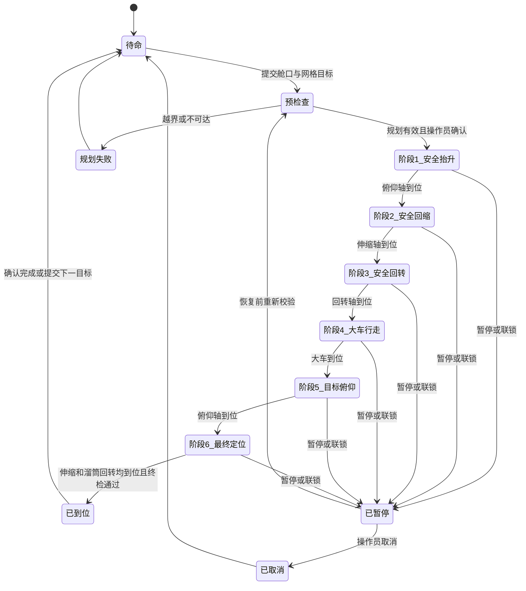

# 装船机舱口网格目标点自动定位与路径规划 PRD

> 文档状态：P0 已实现 / 待工程验收  
> 版本：1.1  
> 创建日期：2026-07-25  
> 最近更新：2026-07-25  
> 适用项目：黄骅 8000 t/h 装船机多自由度运动模拟软件  
> 当前机型：SL15  
> 目标读者：产品、工艺、算法、后端、前端、仿真、测试和现场联调人员

---

## 1. 执行摘要

本功能允许操作人员指定“船舶、舱口编号、舱口网格坐标”，例如“2 号舱口（9，4）”，系统把该网格单元转换为装船机世界坐标和各运动轴目标值，并按预定安全顺序自动将溜筒移动到目标点。

每个舱口划分为 `10 × 8` 个等尺寸网格，共 80 个网格单元。外部坐标采用从 1 开始的 `(列, 行)` 表达，因此合法列号为 `1～10`，合法行号为 `1～8`；`(9,4)` 表示第 9 列、第 4 行的单元中心，而不是网格交点。

P0 聚焦一次一个目标点的路径规划和自动到位，严格执行以下六个运动阶段：

1. 臂架俯仰，将溜筒抬升到安全高度。
2. 臂架伸缩，将臂架回缩到安全长度。
3. 臂架在安全姿态下回转到目标船侧工作角。
4. 大车行走到目标舱口对应位置。
5. 臂架俯仰到目标姿态。
6. 臂架伸缩与溜筒回转协同运动，完成最终定位。

系统不要求装满一个舱口后才能切换。一次自动定位完成后，操作人员可以直接选择另一个舱口或另一个网格继续执行。自动决定各舱装料量、装料时长和跨舱任务队列属于后续阶段。

---

## 2. 背景与问题

### 2.1 当前状态

当前系统已经具备：

- SL15 大车行走、臂架回转、臂架俯仰、臂架伸缩和溜筒回转五个运动轴。
- 各轴上下限、速度上限、目标值、到位状态和独立控制接口。
- 根据轴值计算装船机基座、臂架端部、溜筒底部和落料点的正运动学。
- 船舶、多个舱口及舱口长度、宽度、中心偏移和装载比例配置。
- 浏览器三维模型、固定视角、轨迹显示和仿真状态快照。

当前系统尚不具备：

- 舱口 `10 × 8` 网格数据模型。
- “舱口编号 + 网格坐标”到世界坐标的统一转换。
- 从世界目标点反求装船机轴目标值的目标求解能力。
- 按安全阶段自动执行多个运动轴的路径状态机。
- 对自动路径进行预览、开始、暂停、恢复、取消和结果追踪。

### 2.2 用户问题

实际装船作业不会机械地“装满一个舱再装下一个舱”，而会根据配载和船舶平衡要求，在多个舱口之间分阶段切换。操作人员需要快速指定下一次落料位置，而不是逐轴手动试调大车、俯仰、伸缩和溜筒角度。

逐轴手动控制存在以下问题：

- 操作步骤重复，跨舱移动效率低。
- 不同操作人员的移动顺序不一致。
- 未先抬升或回缩就行走，可能产生碰撞风险。
- 网格坐标、船舶坐标和装船机坐标容易混淆。
- 无法形成可复现、可测试、可记录的目标点移动流程。

### 2.3 产品机会

将舱口网格目标转化为标准化自动路径，可以建立后续自动配载、跨舱任务队列、分层布料、均匀装舱和 PLC/HMI 联调的基础能力。

---

## 3. 产品目标与非目标

### 3.1 产品目标

1. 操作人员只需选择舱口和网格，即可生成可执行路径。
2. 系统在运动前完成坐标转换、可达性和轴限位检查。
3. 自动路径严格遵守六阶段安全顺序。
4. 每个阶段只有在相关轴确认到位后才能进入下一阶段。
5. 任意合法舱口和网格均能使用统一接口访问，不绑定“装满一个舱再切换”的流程。
6. 最终落料点与目标网格中心之间的误差满足仿真验收要求。
7. 规划、执行、暂停、恢复、取消、完成和失败过程可观察、可记录、可测试。

### 3.2 用户目标

- 快速选择下一装料点。
- 清楚看到目标网格、目标坐标和预计路径。
- 知道系统当前执行到哪一个阶段。
- 在异常或工艺变化时安全暂停或取消。
- 到位后获得明确的“可以开始装料”信号。

### 3.3 非目标

以下内容不纳入 P0：

- 自动计算每个舱口应该装多少吨。
- 自动决定舱口切换顺序。
- 自动控制皮带开始装料、停止装料或累计吨位。
- 自动更新每个网格的真实料堆高度。
- 船舶实时横滚、纵倾、升沉补偿。
- 三维连续碰撞搜索和最短时间最优轨迹。
- 多台装船机协同调度。
- 基于禁入区、碰撞包络或最短时间的最优臂架回转规划。
- 直接接入真实 PLC 并驱动现场设备。

---

## 4. 用户角色

### 4.1 主要用户：装船机操作员

**职责：**

- 选择船舶、舱口和网格目标。
- 查看路径预览并确认执行。
- 监控自动移动阶段。
- 必要时暂停、恢复或取消任务。

**核心诉求：**

- 输入简单。
- 状态明确。
- 越界和不可达原因可理解。
- 自动动作顺序稳定、可预测。

### 4.2 次要用户：装船工艺人员

**职责：**

- 决定跨舱装料顺序和每次装料量。
- 配置安全高度、网格方向和目标装料高度。
- 审核路径规划是否符合工艺。

### 4.3 次要用户：仿真与联调工程师

**职责：**

- 校验坐标转换和逆解结果。
- 检查每阶段轴命令、到位条件和异常行为。
- 通过 API 对接后续 PLC/HMI 或装舱策略模块。

---

## 5. 核心概念与坐标约定

### 5.1 舱口网格

每个舱口在自身局部平面中划分为：

- 纵向 10 列。
- 横向 8 行。
- 共 80 个等尺寸矩形单元。
- 外部编号从 1 开始。
- 网格目标指单元中心点。

合法坐标：

```text
column ∈ [1, 10]
row    ∈ [1, 8]
```

非法示例：

- `(0,4)`：列号小于 1。
- `(11,4)`：列号大于 10。
- `(9,0)`：行号小于 1。
- `(9,9)`：行号大于 8。

### 5.2 P0 方向约定

P0 冻结以下方向，不再作为开放问题：

- 船舶局部 `+X` 为艏到艉，列号 `1 → 10` 沿艏到艉增长。
- 船舶局部 `+Y` 为左舷到右舷，行号 `1 → 8` 沿左舷到右舷增长。
- 船舶局部 `+Z` 向上，构成右手坐标系。
- UI 俯视网格始终保持艏部朝上，并显示列、行增长方向。
- 船舶通过 `yaw_deg` 把局部坐标旋转到世界坐标；旋转不得改变网格编号含义。

### 5.3 单元中心计算

设：

- 舱口长度为 `L`。
- 舱口宽度为 `W`。
- 列号为 `c`，范围 `1～10`。
- 行号为 `r`，范围 `1～8`。

单元尺寸为：

```text
cell_length = L / 10
cell_width  = W / 8
```

相对舱口中心的局部坐标为：

```text
local_x = -L / 2 + (c - 0.5) × cell_length
local_y = -W / 2 + (r - 0.5) × cell_width
```

因此 `(9,4)` 代表第 9 列、第 4 行单元的中心。

### 5.4 舱口坐标到世界坐标

目标点转换必须依次考虑：

1. 网格单元相对舱口中心的局部坐标。
2. 舱口中心相对船舶中心的偏移。
3. 船舶在世界坐标中的位置和朝向。
4. 舱口平面高度。
5. 溜筒出口相对舱口平面的装料净空高度。

概念表达如下：

```text
grid_local
  → hold_local
  → vessel_local
  → world_target
```

P0 在船舶配置中增加 `yaw_deg`。当前默认场景显式使用 `yaw_deg=0°`，即船舶局部 X 轴与世界 X 轴一致；非零角度通过绕世界 Z 轴的旋转矩阵转换，不能修改网格编号。

### 5.5 目标点定义

P0 的“到达目标网格”定义为：

- 溜筒落料点的水平投影到达网格单元中心。
- 溜筒出口高度到达“显式舱口平面高度 + `1.0m` 装料净空”。
- 溜筒出口方向默认沿船舶艏到艉方向。

目标对象至少包含：

```json
{
  "vessel_id": "Vessel-R",
  "hold_id": "R2",
  "grid": {
    "column": 9,
    "row": 4
  },
  "loading_clearance_m": 1.0,
  "chute_heading_deg": 0.0
}
```

`loading_clearance_m` 的 P0 默认值为 `1.0m`；`chute_heading_deg` 省略时按船舶艏到艉方向解析。预览结果必须明确显示最终采用值。

---

## 6. 业务流程

### 6.1 主流程

1. 操作人员选择船舶。
2. 操作人员选择舱口。
3. 系统显示该舱口的 `10 × 8` 网格。
4. 操作人员点击网格或输入列号、行号。
5. 系统显示目标单元中心、世界坐标和目标装料高度。
6. 操作人员点击“规划路径”。
7. 系统计算可达性、各阶段轴目标和预计耗时。
8. 系统显示路径预览和风险提示。
9. 操作人员点击“开始移动”。
10. 系统按六阶段顺序自动执行。
11. 所有阶段完成且最终误差满足要求后，状态变为“已到位”。
12. 系统输出“允许进入装料流程”信号，但 P0 不自动启动皮带。
13. 操作人员可以选择相同舱口的另一个网格，也可以直接切换到其他舱口。

### 6.2 示例

输入：

```text
目标舱口：2 号舱口
目标网格：第 9 列、第 4 行
```

预期：

1. UI 高亮 2 号舱口的 `(9,4)` 单元。
2. 显示该单元中心的舱口局部坐标和世界坐标。
3. 规划器生成六阶段路径。
4. 操作人员确认后自动执行。
5. 最终溜筒落料点进入 `(9,4)` 的允许误差范围。
6. 到位后可以立即选择其他舱口，例如“4 号舱口（3，6）”，无需先把 2 号舱口装满。

---

## 7. 六阶段路径要求

### 7.1 状态流程



### 7.2 预检查

运动前必须完成：

- 船舶、舱口、列号和行号存在性检查。
- 网格范围检查。
- 舱盖处于允许作业状态检查。
- 目标世界坐标计算。
- 目标轴值求解。
- 各轴目标是否在允许范围内检查。
- 安全抬升和安全回缩目标是否有效检查。
- 当前是否存在其他自动任务检查。
- 皮带是否停止检查。
- 船舶位姿、船侧和固定工作回转角检查。
- 最终目标误差的正运动学回算检查。

预检查失败时，不得有任何运动轴启动。

### 7.3 阶段 1：臂架俯仰安全抬升

**目标：** 在大车行走和长距离换位前，提高溜筒最低点，降低与舱口、舱盖和船体结构发生干涉的风险。

要求：

- 仅向 `boom_luff` 轴发送安全俯仰目标。
- P0 建议默认安全俯仰角为当前 SL15 上限 `24°`，但必须做成可配置参数。
- 若当前姿态已经满足安全高度，不重复做无意义运动，直接确认阶段到位。
- 本阶段不得启动大车行走。
- 本阶段不得启动皮带。
- 以俯仰轴 `at_target=true` 且溜筒最低点达到安全高度作为完成条件。

### 7.4 阶段 2：臂架伸缩安全回缩

**目标：** 在大车移动前把臂架缩回，减小运动包络和碰撞风险。

要求：

- 仅向 `boom_extension` 轴发送安全回缩目标。
- P0 建议默认安全回缩长度为 `0 m`，但必须可配置。
- 俯仰轴保持阶段 1 的安全姿态。
- 大车保持不动。
- 以伸缩轴 `at_target=true` 作为完成条件。

### 7.5 阶段 3：臂架安全回转

**目标：** 在臂架抬升并完全回缩后，把臂架回转到目标船侧的固定工作角。

要求：

- 仅向 `slew` 轴发送船侧工作角目标。
- 右侧船舶固定为 `0°`，左侧船舶固定为 `180°`。
- `side=center` 的船舶不允许执行 P0 自动路径。
- 俯仰保持 `24°`，伸缩保持 `0m`，大车保持不动。
- 以回转轴 `at_target=true` 作为完成条件。

### 7.6 阶段 4：大车行走

**目标：** 沿轨道方向把装船机移动到目标舱口网格对应的纵向位置。

要求：

- 仅向 `travel` 轴发送规划目标。
- 臂架保持安全俯仰和安全回缩。
- 行走目标必须在 `[-100 m, 100 m]` 范围内。
- 到位判定必须同时检查轴到位和落料点目标解仍然可达。
- 如果船舶或场景配置在行走期间发生变化，路径必须暂停并重新规划。

### 7.7 阶段 5：臂架俯仰到目标姿态

**目标：** 在大车到位后，把臂架调整到目标装料高度对应的俯仰角。

要求：

- 向 `boom_luff` 轴发送规划得到的目标角度。
- 臂架继续保持安全回缩，直到俯仰到位。
- 目标角度必须在 `[-10°, 24°]` 范围内。
- 以俯仰轴到位和目标高度回算有效作为完成条件。

### 7.8 阶段 6：伸缩与溜筒回转最终定位

**目标：** 完成横向/径向位置和溜筒出口方向的最终对准。

要求：

- `boom_extension` 和 `chute_rotate` 可以同时启动。
- 伸缩目标必须在 `[0 m, 21.25 m]` 范围内。
- 溜筒回转目标必须在 `[-180°, 180°]` 范围内。
- 两个轴都到位后，才能进行最终坐标误差检查。
- 最终落料点误差超限时，状态不得显示“已到位”。
- P0 不允许通过反复抖动轴值进行无限纠偏；一次复核失败后进入“定位失败”，要求重新规划。

### 7.9 臂架回转的 P0 边界

P0 的自动臂架回转是可预测的固定船侧动作，不执行连续碰撞搜索或每目标角度优化。任何目标如果在右侧 `0°` 或左侧 `180°` 的固定角下不可达，预览必须失败；不得临时寻找其他回转角绕过限制。禁入区、碰撞包络和最优回转角属于后续增强。

### 7.10 溜筒回转的作用边界

当前模型中：

- 臂架伸缩改变落料点位置。
- 溜筒回转改变单一出料口的朝向。
- 溜筒回转本身不改变溜筒中心轴的水平位置。

因此，P0 不得把溜筒回转错误地当成平移轴。目标点位置由大车、固定船侧回转角、俯仰和伸缩共同决定；溜筒回转用于出口方向对准。

---

## 8. 功能需求

### 8.1 P0 功能需求

| 编号 | 需求 | 验收摘要 |
|---|---|---|
| FR-001 | 系统必须支持为每个舱口建立 `10 × 8` 网格 | 每个舱口返回 80 个合法单元 |
| FR-002 | 外部网格编号必须使用 1-based `(列, 行)` | `(1,1)` 和 `(10,8)` 合法，0 或越上限非法 |
| FR-003 | 系统必须支持通过点击网格或数字输入选择目标 | 两种方式产生完全相同的目标对象 |
| FR-004 | 系统必须把网格目标转换为舱口局部坐标 | 公式与舱口长度、宽度一致 |
| FR-005 | 系统必须把舱口局部坐标转换为世界坐标 | 考虑船舶位置、舱口偏移和目标高度 |
| FR-006 | 系统必须在运动前计算目标轴值并正向回算 | 回算误差满足定位容差才允许执行 |
| FR-007 | 系统必须在运动前检查五个轴的目标上下限 | 任一轴越界则整体拒绝 |
| FR-008 | 系统必须生成固定六阶段路径 | 阶段顺序不可跳过或交换 |
| FR-009 | 阶段 1 必须先完成安全抬升 | 未到安全高度不得进入回缩或行走 |
| FR-010 | 阶段 2 必须完成安全回缩 | 未回缩到位不得开始回转或行走 |
| FR-011 | 阶段 3 必须在安全姿态下回转到固定船侧角 | 右侧 `0°`、左侧 `180°`，未到位不得行走 |
| FR-012 | 阶段 4 必须在安全姿态下行走 | 行走期间回转、俯仰和伸缩保持不变 |
| FR-013 | 阶段 5 必须在大车到位后执行目标俯仰 | 大车未到位不得下降臂架 |
| FR-014 | 阶段 6 必须支持伸缩和溜筒回转并行 | 两个轴全部到位才进入最终校验 |
| FR-015 | 系统必须提供规划预览 | 显示目标坐标、各阶段目标、预计耗时和不可达原因 |
| FR-016 | 系统必须提供开始、暂停、恢复、取消 | 所有操作有确定的状态转换 |
| FR-017 | 恢复任务前必须重新检查场景和轴状态 | 场景变化时禁止无条件续跑 |
| FR-018 | 自动任务执行期间必须处理手动轴命令冲突 | P0 默认拒绝手动命令并提示先暂停或取消 |
| FR-019 | 路径移动期间皮带必须停止 | 皮带运行时不得开始自动路径 |
| FR-020 | 到位后必须输出明确结果 | 包含目标、实际位置、误差、耗时和完成状态 |
| FR-021 | 任意舱口均可作为下一目标 | 不以其他舱口是否装满作为前置条件 |
| FR-022 | 系统必须记录最近任务历史 | 至少记录请求、规划、阶段、结果和失败原因 |
| FR-023 | 相同请求必须支持幂等处理 | 重复提交不得创建两个并行任务 |
| FR-024 | 配置变化必须使旧预览失效 | 船舶、舱口或安全参数变化后要求重新规划 |
| FR-025 | UI 必须显示当前阶段和阶段完成进度 | 操作人员可判断正在抬升、回缩、回转、行走或定位 |
| FR-026 | UI 必须高亮当前目标网格和实际落料点 | 能直观看出目标与实际偏差 |

### 8.2 P1 功能需求

以下仅定义扩展方向，不形成 P0 的接口、状态机或验收承诺：

| 编号 | 需求 | 说明 |
|---|---|---|
| FR-101 | 预留多舱口、多网格目标队列扩展点 | 不改变 P0 的单计划、单任务契约 |
| FR-102 | 预留装料量、装料时长和外部配载策略扩展点 | 路径定位与装料控制保持解耦 |
| FR-103 | 预留禁入区、碰撞包络、回转角和动态补偿优化扩展点 | 不在 P0 构造实现细节 |

---

## 9. 用户故事

### US-001：选择舱口网格目标

**用户故事：**

```text
作为装船机操作员，
我希望选择一个舱口并点击其中的网格，
从而快速指定下一次装料位置。
```

**验收标准：**

- 给定一个存在的舱口，界面显示 `10 × 8` 网格。
- 点击任一单元后，该单元高亮并显示列号、行号。
- 输入 `(9,4)` 与点击第 9 列第 4 行得到相同目标。
- 输入越界时，界面明确显示合法范围且不能规划。

**优先级：** P0  
**工作量：** M

### US-002：预览可执行路径

**用户故事：**

```text
作为装船机操作员，
我希望在设备移动前看到目标坐标和运动阶段，
从而确认系统将去往正确位置。
```

**验收标准：**

- 预览显示舱口局部坐标、世界坐标和目标高度。
- 预览显示六个阶段及每阶段轴目标。
- 预览显示预计总耗时。
- 不可达时不显示可执行按钮，并给出具体原因。

**优先级：** P0  
**工作量：** L

### US-003：按安全顺序自动到位

**用户故事：**

```text
作为装船机操作员，
我希望系统按固定安全顺序自动移动，
从而避免每次逐轴手动操作和错误排序。
```

**验收标准：**

- 系统严格执行抬升、回缩、安全回转、行走、目标俯仰、最终定位。
- 任一阶段未到位时，下一阶段不启动。
- 阶段 6 的伸缩和溜筒回转可以同时运动。
- 最终误差合格后才显示“已到位”。

**优先级：** P0  
**工作量：** XL，实施前必须拆分为状态机、目标求解和执行器故事

### US-004：暂停、恢复和取消

**用户故事：**

```text
作为装船机操作员，
我希望在自动移动过程中暂停、恢复或取消，
从而应对现场工艺变化和异常情况。
```

**验收标准：**

- 暂停后所有参与轴停止，当前阶段和目标保留。
- 暂停后统一仿真时钟停止推进，暂停时长不计入阶段超时。
- 恢复前重新验证场景、轴状态和可达性。
- 取消后任务终止，不自动启动其他阶段。
- 暂停或取消原因写入任务历史。

**优先级：** P0  
**工作量：** M

### US-005：跨舱连续选择目标

**用户故事：**

```text
作为装船工艺人员，
我希望一次定位完成后可以选择任意其他舱口，
从而按配载要求在多个舱口之间分批装料。
```

**验收标准：**

- 当前任务完成后，无需修改舱口装满状态即可选择下一舱。
- 下一目标可以来自当前舱口或其他舱口。
- 每次定位有独立记录。
- P0 不自动决定下一舱，也不自动修改装料量。

**优先级：** P0  
**工作量：** S

### US-006：查看到位结果

**用户故事：**

```text
作为仿真与联调工程师，
我希望查看目标点、实际点和误差，
从而验证路径规划和运动学计算是否正确。
```

**验收标准：**

- 结果包含目标世界坐标和实际落料点坐标。
- 结果包含水平误差、垂直误差和溜筒角度误差。
- 结果包含各阶段开始、结束和耗时。
- 失败时记录失败阶段和原因。

**优先级：** P0  
**工作量：** M

### US-101：跨舱任务队列

**用户故事：**

```text
作为装船工艺人员，
我希望预先配置多个舱口和网格的装料任务，
从而让系统按配载计划在各舱之间分批切换。
```

**验收标准：**

- P0 的单目标计划和任务类型不阻止未来由外层队列引用。
- 路径定位结果可被未来装料策略消费，但 P0 不定义队列执行和装料完成协议。
- 具体队列、装料量和路径优化验收标准在 P1 PRD 中另行制定。

**优先级：** P1  
**工作量：** 待 P1 立项后评估

---

## 10. UI/UX 需求

### 10.1 目标选择区

必须包含：

- 船舶选择器。
- 舱口选择器。
- `10 × 8` 网格。
- 列号输入框，范围 `1～10`。
- 行号输入框，范围 `1～8`。
- 网格方向标识。
- 舱口尺寸和单元尺寸。
- 当前目标单元高亮。
- 目标世界坐标预览。

### 10.2 路径预览区

必须显示：

- 目标标识，例如 `Vessel-R / R2 / (9,4)`。
- 六阶段列表。
- 每阶段参与轴。
- 每阶段目标值。
- 每阶段预计耗时。
- 安全俯仰角和安全回缩长度。
- 规划是否可执行。
- 不可执行原因。

### 10.3 执行监控区

必须显示：

- 当前任务状态。
- 当前阶段。
- 六阶段进度。
- 当前轴值与本阶段目标。
- 目标落料点与实际落料点误差。
- 开始、暂停、恢复和取消按钮。
- 联锁和失败提示。

### 10.4 三维视图

三维视图至少显示：

- 舱口网格轮廓。
- 被选中的目标单元。
- 目标点标记。
- 实际落料点标记。
- 已执行轨迹。
- 当前自动路径阶段。

目标和实际点不能只依靠颜色区分，还必须使用不同图形或文字标签。

### 10.5 错误提示

错误提示必须使用用户可理解的中文，不得只返回内部异常文本。

示例：

- “行号必须在 1～8 之间。”
- “目标需要大车行走到 108.4 m，超出 100 m 上限。”
- “目标在该船侧固定回转角下不可达。”
- “皮带正在运行，请停止皮带后再开始路径。”
- “船舶位置已变化，请重新规划。”

---

## 11. 数据需求

### 11.1 舱口网格配置

每个舱口需要增加或派生以下数据：

```json
{
  "vessel_id": "Vessel-R",
  "vessel_yaw_deg": 0.0,
  "id": "R2",
  "center_offset_m": -11.0,
  "length_m": 8.2,
  "width_m": 6.0,
  "grid": {
    "columns": 10,
    "rows": 8,
    "index_base": 1,
    "column_direction": "bow_to_stern",
    "row_direction": "port_to_starboard"
  },
  "hatch_plane_offset_z_m": 2.02,
  "cover_state": "open"
}
```

`columns=10`、`rows=8` 和 `index_base=1` 为 P0 固定规则；方向字段必须保留，避免未来船舶方向变化时产生歧义。

实施时必须为当前默认场景所有舱口显式写入 `hatch_plane_offset_z_m=2.02`，与船舶 `position.z=1.6` 相加得到世界舱口平面 `3.62m`；所有舱口显式写入 `cover_state="open"`。这些值只用于仿真，不是已经确认的工程高度或现场联锁状态。字段缺失时允许加载旧场景，但必须拒绝路径预览。

### 11.2 目标请求

```json
{
  "vessel_id": "Vessel-R",
  "hold_id": "R2",
  "column": 9,
  "row": 4,
  "loading_clearance_m": 1.0,
  "chute_heading_deg": null
}
```

### 11.3 路径计划

路径计划至少包含：

```json
{
  "plan_id": "plan-20260725-0001",
  "scene_revision": 1,
  "target": {
    "vessel_id": "Vessel-R",
    "hold_id": "R2",
    "column": 9,
    "row": 4,
    "world_point": [3.87, 23.625, 4.62]
  },
  "feasible": true,
  "estimated_duration_s": 96.56,
  "stages": [
    {
      "stage": "safe_luff",
      "axis_targets": {
        "boom_luff": 24.0
      }
    },
    {
      "stage": "safe_retract",
      "axis_targets": {
        "boom_extension": 0.0
      }
    },
    {
      "stage": "safe_slew",
      "axis_targets": {
        "slew": 0.0
      }
    },
    {
      "stage": "travel",
      "axis_targets": {
        "travel": 3.87
      }
    },
    {
      "stage": "target_luff",
      "axis_targets": {
        "boom_luff": 9.656884
      }
    },
    {
      "stage": "final_approach",
      "axis_targets": {
        "boom_extension": 7.464579,
        "chute_rotate": -90.0
      }
    }
  ]
}
```

以上数值是当前默认仿真场景 `Vessel-R / R2 / (9,4)` 的标准回算样例，不作为 SL15 制造尺寸或现场控制目标。

### 11.4 任务状态

状态枚举至少包含：

```text
idle
planning
ready
running
paused
arrived
cancelled
failed
```

运行阶段至少包含：

```text
precheck
safe_luff
safe_retract
safe_slew
travel
target_luff
final_approach
final_verify
```

### 11.5 审计记录

每次任务必须记录：

- 请求人或调用方。
- 请求时间。
- 船舶、舱口、列号、行号。
- 场景版本。
- 目标世界坐标。
- 规划轴目标。
- 每阶段开始和结束时间。
- 暂停、恢复、取消和失败原因。
- 最终实际坐标和误差。

P0 可以保存在内存并支持 JSON 导出；持久化存储策略在技术设计阶段确认。

---

## 12. API 需求

以下为产品级接口建议，最终路径和字段由技术设计确认。

### 12.1 获取舱口网格

```http
GET /api/vessels/{vessel_id}/holds/{hold_id}/grid
```

返回：

- 舱口尺寸。
- 网格行列数。
- 方向约定。
- 80 个单元中心的局部坐标。
- 可选的单元装载状态。

### 12.2 路径预览

```http
POST /api/path-plans/preview
```

要求：

- 不启动任何运动。
- 返回目标世界坐标。
- 返回可达性。
- 返回六阶段轴目标。
- 返回预计耗时。
- 返回所有警告和不可执行原因。

### 12.3 创建并开始任务

```http
POST /api/path-tasks
```

要求：

- 必须引用仍然有效的预览计划。
- 必须使用 `request_id` 保证幂等。
- 创建成功后进入第一运动阶段。
- 同一装船机同一时刻只允许一个自动任务。

### 12.4 查询当前任务

```http
GET /api/path-tasks/current
```

返回：

- 任务状态。
- 当前阶段。
- 轴当前值和目标值。
- 目标点、实际点和误差。
- 已用时间和预计剩余时间。

### 12.5 控制任务

```http
POST /api/path-tasks/{task_id}/pause
POST /api/path-tasks/{task_id}/resume
POST /api/path-tasks/{task_id}/cancel
```

所有接口必须返回操作后的完整任务状态。

### 12.6 查询历史

```http
GET /api/path-tasks
GET /api/path-tasks/{task_id}
```

P0 至少返回本次进程启动后的任务历史。

---

## 13. 技术考虑

### 13.1 逻辑分层

```text
Target Selection UI / Future Loading Strategy
                  |
            Target API
                  |
        Hold Grid Transformer
                  |
       Reachability / Target Solver
                  |
         Six-Stage Path Planner
                  |
       Path Executor + Interlocks
                  |
       Existing Motion Command API
                  |
 MotionAxis + KinematicsSolver + SimulationWorld
```

### 13.2 与现有系统的关系

- `SceneConfig` 已包含船舶位置和舱口尺寸，可作为网格转换输入。
- `MotionAxis` 已实现目标、速度、上下限和到位状态，可作为阶段执行基础。
- `KinematicsSolver` 已实现正运动学，可用于路径预览后的回算验证。
- 当前系统缺少逆向目标求解、路径状态机和自动任务互斥，需要新增独立模块。
- 三维前端只负责目标选择、状态显示和轨迹渲染，不得自行决定轴目标。

### 13.3 目标求解原则

- 输入是世界目标点、目标方向和船侧固定工作回转角。
- 输出是大车、回转、俯仰和伸缩目标，以及溜筒出口方向目标。
- 所有候选解必须满足轴限位。
- P0 使用右侧 `0°`、左侧 `180°` 的确定性解析解，不在多个回转角之间做优化。
- 规划结果必须经过现有正运动学回算，不能只依赖解析逆解。

### 13.4 当前轴约束

| 轴 | 目标范围 | 最大速度 |
|---|---:|---:|
| 大车行走 | `-100～100 m` | `0.5 m/s` |
| 臂架回转 | `-35～215°` | `1.02°/s` |
| 臂架俯仰 | `-10～24°` | `2°/s` |
| 臂架伸缩 | `0～21.25 m` | `0.1 m/s` |
| 溜筒回转 | `-180～180°` | `12°/s` |

路径预览中的预计耗时必须基于配置速度上限和实际指定速度计算。

### 13.5 并发与控制权

- 手动轴控制与自动路径控制必须有明确控制权。
- 自动任务运行时，P0 默认拒绝手动目标命令。
- 暂停不等于释放控制权。
- 取消后释放自动控制权。
- 未来 PLC 接入必须复用相同控制权机制。

### 13.6 场景版本

路径预览必须绑定以下输入的版本或哈希：

- 船舶位置和姿态。
- 舱口尺寸和偏移。
- 网格方向。
- 舱口平面高度。
- 装船机几何参数。
- 轴上下限。
- 安全抬升和回缩参数。

任一输入变化后，旧计划不得直接执行。

---

## 14. 安全与联锁需求

| 编号 | 联锁条件 | 系统行为 |
|---|---|---|
| IL-001 | 皮带正在运行 | 禁止开始自动路径 |
| IL-002 | 舱口或网格不存在 | 拒绝规划 |
| IL-003 | 舱盖未处于允许状态 | 拒绝执行 |
| IL-004 | 目标轴值越界 | 拒绝执行 |
| IL-005 | 目标不可达 | 拒绝执行 |
| IL-006 | 自动任务已存在 | 拒绝第二任务 |
| IL-007 | 场景版本变化 | 暂停并要求重新规划 |
| IL-008 | 轴被禁用 | 暂停或拒绝执行 |
| IL-009 | 轴运行超时 | 停止任务并进入失败 |
| IL-010 | 最终误差超限 | 不得输出“已到位” |
| IL-011 | 船舶运动超出 P0 静态条件 | 暂停并提示不支持实时补偿 |
| IL-012 | 操作员触发紧急停止 | 立即停止所有参与轴 |

安全参数必须配置化，不能散落为前端常量。

---

## 15. 非功能需求

| 编号 | 类别 | 要求 | 目标 |
|---|---|---|---|
| NFR-001 | 规划性能 | 单目标路径预览响应时间 | 本机 p95 小于 200 ms |
| NFR-002 | 状态刷新 | 自动任务状态更新频率 | 不低于 10 Hz |
| NFR-003 | 定位精度 | 最终水平位置误差 | 不大于 0.10 m |
| NFR-004 | 定位精度 | 最终垂直位置误差 | 不大于 0.10 m |
| NFR-005 | 定位精度 | 溜筒方向误差 | 不大于 1.0° |
| NFR-006 | 状态一致性 | 轴状态、关键点和任务阶段使用同一仿真时刻 | 100% |
| NFR-007 | 可靠性 | 合法、可达目标自动到位成功率 | 不低于 99% |
| NFR-008 | 安全性 | 阶段越序、轴限位和联锁违规 | 0 次 |
| NFR-009 | 可测试性 | 坐标转换、求解、规划和执行器可单元测试 | 核心分支覆盖 |
| NFR-010 | 可观测性 | 任务和阶段有结构化日志 | 100% 自动任务 |
| NFR-011 | 可访问性 | 网格支持鼠标和键盘选择 | 全部 80 个单元 |
| NFR-012 | 兼容性 | 保持现有手动轴控制和状态 API 可用 | 无破坏性变更 |

上述定位容差为 P0 仿真验收暂定值，现场值需由工艺和设备团队确认。

---

## 16. 成功指标

本功能采用以任务成功为核心的 HEART Task Success 指标，不使用用户增长类指标。

### 16.1 北极星指标

**合法可达目标自动到位成功率**

```text
成功到位任务数 ÷ 合法且规划可达的已启动任务数 × 100%
```

P0 目标：不低于 `99%`。

### 16.2 支持指标

| 指标 | P0 目标 |
|---|---:|
| 目标预览响应时间 | p95 < 200 ms |
| 六阶段顺序正确率 | 100% |
| 阶段到位后再切换比例 | 100% |
| 最终水平误差 | ≤ 0.10 m |
| 最终垂直误差 | ≤ 0.10 m |
| 溜筒方向误差 | ≤ 1.0° |
| 越界目标运动启动次数 | 0 |
| 自动任务并发冲突次数 | 0 |
| 任务失败原因可诊断率 | 100% |

### 16.3 反向指标

- 不得为了提高到位速度而突破轴速度上限。
- 不得为了减少步骤而跳过安全抬升或回缩。
- 不得在路径移动期间自动启动皮带。
- 不得把不可达目标自动吸附到附近网格并宣称成功。

### 16.4 事件记录

至少记录：

- `grid_target_selected`
- `path_preview_requested`
- `path_preview_succeeded`
- `path_preview_failed`
- `path_task_started`
- `path_stage_started`
- `path_stage_completed`
- `path_task_paused`
- `path_task_resumed`
- `path_task_cancelled`
- `path_task_arrived`
- `path_task_failed`

---

## 17. 验收场景

### AC-001：2 号舱口（9，4）正常到位

**Given：**

- 2 号舱口存在。
- 舱口网格为 `10 × 8`。
- `(9,4)` 可达。
- 皮带停止。
- 所有相关轴启用。

**When：**

- 操作人员选择 2 号舱口 `(9,4)`。
- 完成预览并确认开始。

**Then：**

- 系统依次执行六个阶段。
- 不出现阶段越序。
- 最终落料点进入位置容差。
- 溜筒方向进入角度容差。
- 任务状态为“已到位”。

### AC-002：跨舱切换

**Given：**

- 2 号舱口 `(9,4)` 已到位并完成一次装料。

**When：**

- 操作人员选择 4 号舱口 `(3,6)`。

**Then：**

- 系统允许生成新的独立计划。
- 不要求 2 号舱口装满。
- 新任务重新执行完整六阶段路径。

### AC-003：网格越界

| 输入 | 结果 |
|---|---|
| `(0,4)` | 拒绝，提示列范围 `1～10` |
| `(11,4)` | 拒绝，提示列范围 `1～10` |
| `(9,0)` | 拒绝，提示行范围 `1～8` |
| `(9,9)` | 拒绝，提示行范围 `1～8` |

不得创建路径任务，不得启动任何轴。

### AC-004：目标轴值越界

如果目标需要：

- 大车超过 `100 m`。
- 俯仰超过 `24°`。
- 伸缩超过 `21.25 m`。
- 溜筒回转超过允许范围。

则预览必须返回不可执行，并指出具体轴、所需值和允许范围。

### AC-005：皮带运行

皮带运行时点击“开始移动”：

- 系统拒绝启动。
- 提示先停止皮带。
- 所有运动轴保持原状态。

### AC-006：阶段中暂停与恢复

在大车行走阶段暂停：

- 大车停止。
- 后续目标俯仰不启动。
- 当前任务、目标和阶段保留。
- 恢复前重新校验场景。
- 校验通过后从当前阶段继续。

### AC-007：场景变化

路径预览后修改船舶位置：

- 旧计划标记为过期。
- “开始移动”不可执行旧计划。
- 操作人员必须重新预览。

### AC-008：最终误差超限

最终轴显示到位但落料点误差大于容差：

- 任务不得进入“已到位”。
- 状态变为“定位失败”。
- 记录目标、实际位置和误差。

### AC-009：左侧船舶安全回转

选择左侧船舶中的合法可达网格：

- 预览计划的阶段 3 包含 `slew=180°`。
- 臂架未达到 `24°` 或伸缩未达到 `0m` 前不得启动回转。
- 回转未到位前不得启动大车行走。
- 右侧船舶的相同规则使用 `slew=0°`。

### AC-010：重复请求

使用相同 `request_id` 重复提交：

- 返回同一任务或已存在状态。
- 不创建并行任务。

---

## 18. 范围与版本规划

### 18.1 P0：单目标自动定位

- 固定 `10 × 8` 网格。
- 船舶、舱口和网格选择。
- 坐标转换。
- 固定船侧回转角下的目标求解。
- 六阶段路径规划。
- 单任务执行状态机。
- 预览、开始、暂停、恢复、取消。
- 到位误差验证。
- 三维目标和轨迹显示。
- 任务历史。

### 18.2 P1：跨舱装料任务队列

- 多目标队列扩展点。
- 装料量、装料时长和外部配载策略扩展点。
- 回转禁入区、碰撞包络、角度优化和动态补偿扩展点。

P1 的接口、状态机、失败处理和验收标准不在本 PRD 中展开。

### 18.3 P2：真实作业增强

- 船舶六自由度运动补偿。
- 料堆高度反馈。
- 三维碰撞检测。
- 梯形或 S 曲线速度规划。
- 多装船机协调。
- PLC/HMI 接入。

---

## 19. 里程碑建议

项目未指定上线日期，以下使用相对阶段和退出条件；具体工期需技术评审后确定。

| 阶段 | 主要交付物 | 退出条件 |
|---|---|---|
| M1 坐标约定冻结 | 网格方向、舱口平面、目标高度定义 | 工艺、产品和算法共同确认 |
| M2 网格与转换 | 数据模型、80 网格、局部/世界坐标转换 | 边界和方向单元测试通过 |
| M3 目标求解 | 可达性、轴目标和正向回算 | 标准目标与边界目标通过 |
| M4 路径状态机 | 六阶段规划、执行、暂停和取消 | 阶段顺序与联锁测试通过 |
| M5 API 与 UI | 网格选择、预览、监控、历史 | 端到端示例可操作 |
| M6 仿真验收 | 跨舱、越界、暂停、失败场景 | 本 PRD P0 验收场景全部通过 |
| M7 技术设计评审 | 技术实现文档和 P1 拆分 | 工程负责人批准 |

---

## 20. 风险与缓解

| 风险 | 影响 | 概率 | 缓解措施 |
|---|---|---|---|
| 网格方向理解不一致 | 目标落到镜像位置 | 高 | 在 UI 显示方向箭头；冻结 1-based 和局部轴定义 |
| 舱口平面高度缺失 | 垂直目标错误 | 高 | 增加明确字段；无数据时禁止正式执行 |
| 固定船侧回转角无法覆盖目标 | 部分网格不可达 | 中 | P0 明确预检查并拒绝；P1 评审禁入区和回转角优化 |
| 溜筒回转被误当成平移轴 | 逆解错误 | 中 | 在数据和测试中区分位置目标与方向目标 |
| 船舶位置变化使旧计划失效 | 到位偏差或碰撞 | 中 | 路径绑定场景版本；恢复和执行前重验 |
| 仅检查轴到位、不检查世界坐标 | 显示成功但实际点错误 | 中 | 最终必须使用正运动学回算 |
| 自动和手动命令竞争 | 状态机失控 | 中 | 增加单一控制权和任务互斥 |
| 安全抬升高度不足 | 与舱盖或船体干涉 | 高 | 参数化并由碰撞包络验证；未确认前仅用于仿真 |
| 速度模型只有匀速 | 真实设备动作不平滑 | 中 | P0 保持仿真；P2 引入加减速曲线 |
| 任务队列过早进入 P0 | 范围膨胀 | 中 | P0 只做单目标，队列作为 P1 |

---

## 21. 依赖与假设

### 21.1 内部依赖

- `SceneConfig` 船舶和舱口模型。
- `ShipLoaderGeometry` 装船机几何参数。
- `MotionAxis` 轴目标、速度、限位和到位状态。
- `KinematicsSolver` 正运动学关键点。
- `SimulationWorld` 统一仿真时钟。
- Web 三维视图和状态面板。
- 现有手动命令和状态 API。

### 21.2 数据依赖

实施 P0 前必须具备：

- 每个舱口唯一 ID。
- 舱口中心位置。
- 舱口长度和宽度。
- 舱口平面高度。
- 船舶世界位置。
- 网格方向定义。
- 工作船侧对应的臂架回转角。
- 安全俯仰角或安全高度。
- 安全回缩长度。
- 目标装料净空。

### 21.3 P0 假设

- 当前默认场景船舶 `yaw_deg=0°`；转换算法支持非零艏向角。
- 路径执行期间船舶位置保持不变。
- 舱盖通过每舱显式 `cover_state="open"` 确认允许作业。
- 一次只执行一个自动路径任务。
- 臂架在安全抬升和回缩后自动回转到右侧 `0°` 或左侧 `180°`。
- 溜筒长度在 P0 中保持当前固定值。
- 网格目标取单元中心。
- P0 只定位，不自动决定或执行装料量。

---

## 22. 已冻结决策与后续评审项

P0 已冻结：

1. 列 `1→10` 为艏到艉，行 `1→8` 为左舷到右舷，UI 艏部朝上。
2. API 同时传 `vessel_id` 和 `hold_id`，不使用无船舶上下文的纯数字舱号。
3. 目标高度为显式舱口平面上方 `1.0m`。
4. 安全俯仰为 `24°`，安全回缩为 `0m`。
5. 右侧船舶工作回转角为 `0°`，左侧为 `180°`，并作为第 3 阶段自动执行。
6. 溜筒出口默认沿艏到艉方向。
7. 暂停恢复前重新校验并从当前阶段继续；场景版本变化必须重新规划。
8. 舱盖状态来自每舱显式 `cover_state`，当前默认仿真场景为 `open`。
9. P0 只输出到位信号，不自动启动皮带。

仍需在仿真转现场前评审：

- 世界舱口平面 `3.62m`、安全俯仰、回缩长度、固定回转角和定位容差的现场工程值。
- 舱盖状态与 PLC/外部联锁的真实来源和失效安全策略。
- P1 的“装一些”采用吨位、时间、料位还是皮带累计量，以及队列和回转优化规则。

---

## 23. 评审与签署

| 角色 | 评审重点 | 状态 |
|---|---|---|
| 产品负责人 | P0/P1 范围和用户流程 | 待评审 |
| 装船工艺负责人 | 网格方向、切舱流程、目标高度 | 待评审 |
| 设备/安全负责人 | 安全抬升、回缩、联锁和容差 | 待评审 |
| 算法负责人 | 坐标转换、可达性和目标求解 | 待评审 |
| 后端负责人 | 状态机、控制权、API 和日志 | 待评审 |
| 前端负责人 | 网格交互、预览和任务监控 | 待评审 |
| 测试负责人 | 边界、阶段、异常和精度验收 | 待评审 |

P0 开发开始前，产品、工艺、设备安全和算法负责人必须确认第 22 节冻结决策仅用于仿真，并明确现场参数不得直接沿用。

---

## 24. 相关资料

- `docs/装船机多自由度运动模拟软件_PRD.md`
- `docs/装船机多自由度运动模拟软件技术设计文档.md`
- `docs/黄骅8000装船机模型重设计_PRD.md`
- `docs/黄骅8000装船机模型重设计_技术实现文档.md`
- `app/config/default_loader.json`
- `app/config/default_scene.json`
- `app/models/scene.py`
- `app/core/kinematics_solver.py`
- `app/core/motion_axis.py`

---

## 25. 术语

| 术语 | 定义 |
|---|---|
| 舱口网格 | 将一个舱口平面划分得到的 `10 × 8` 等尺寸单元 |
| 网格坐标 | 从 1 开始的 `(列, 行)`，例如 `(9,4)` |
| 网格中心 | 单元矩形的几何中心，P0 的默认目标点 |
| 世界坐标 | 装船机、船舶和场景共用的 `WORLD_Z_UP_METERS` 坐标 |
| 落料点 | `discharge_point`，用于与目标网格位置比较的关键点 |
| 固定船侧回转角 | P0 在安全姿态下自动设置的回转角，右侧 `0°`、左侧 `180°` |
| 安全抬升 | 换位前通过臂架俯仰提高溜筒最低点 |
| 安全回缩 | 大车行走前把臂架缩至安全长度 |
| 最终定位 | 目标俯仰完成后，通过伸缩和溜筒回转完成位置与方向对准 |
| 可达性 | 目标是否能在几何关系、轴限位和联锁条件下实现 |
| 场景版本 | 表示船舶、舱口、几何和安全参数组合的版本标识 |

---

## 26. 变更记录

| 版本 | 日期 | 说明 |
|---|---|---|
| 1.1 | 2026-07-25 | 冻结网格方向、高度、舱盖和船侧回转规则；将自动路径由五阶段修订为六阶段，并与技术实现文档对齐 |
| 1.0 | 2026-07-25 | 根据 `10 × 8` 舱口网格、跨舱分批装料需求和五阶段移动顺序建立首版 PRD |
