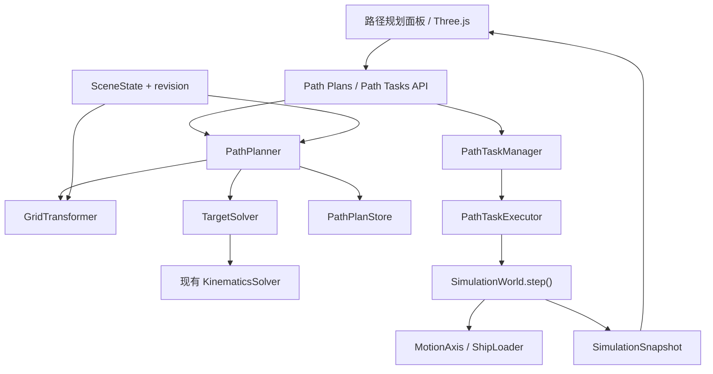
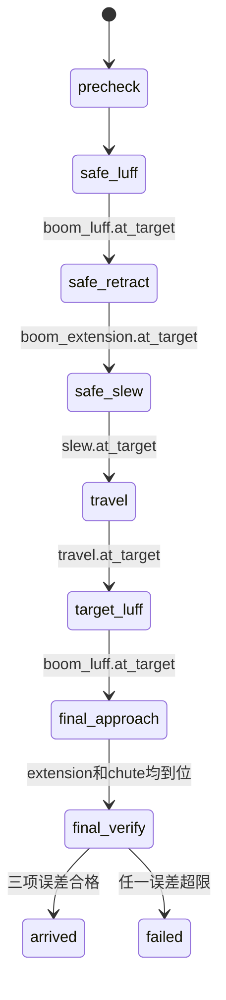

# 装船机舱口网格目标点路径规划技术实现文档

> 文档状态：P0 已实现、待工程验收  
> 版本：1.1  
> 创建日期：2026-07-25  
> 最近更新：2026-07-25  
> 适用项目：黄骅 8000 t/h 装船机多自由度运动模拟软件  
> 当前机型：SL15  
> 上游需求：`docs/装船机舱口网格目标点路径规划_PRD.md` v1.1  
> 目标读者：后端、算法、前端、仿真、测试和现场联调工程师

---

## 1. 目标与边界

本文把 PRD 中的单目标舱口网格自动定位要求落实为可直接开发的技术方案。用户选择 `vessel_id + hold_id + (column,row)` 后，后端负责坐标转换、解析逆解、可达性验证、六阶段路径生成和任务执行，前端只负责选择、预览、控制和展示。

P0 包含：

- 固定 `10 × 8`、1-based 舱口网格。
- 单目标预览和单任务自动到位。
- 船侧固定工作回转角：右侧 `0°`、左侧 `180°`。
- 暂停、恢复、取消、超时、场景失效和最终误差校验。
- 进程内计划缓存、任务历史、幂等控制和结构化日志。

P0 不包含多目标队列、装料量决策、路径最优化、动态船舶补偿、连续碰撞搜索、PLC 驱动或持久化数据库。本文中的高度和安全参数仅用于仿真，不能直接作为现场设备控制参数。

## 2. 现有系统基线

| 能力 | 当前实现 | 本功能复用方式 |
|---|---|---|
| API | FastAPI + Pydantic | 新增规划和任务路由，保留现有接口 |
| 运动轴 | `MotionAxis` | 复用目标、速度、限位、停止和 `at_target` |
| 正运动学 | `KinematicsSolver.solve()` | 作为逆解后的唯一回算真值 |
| 仿真时钟 | `SimulationWorld.step()` | 在同一仿真步内推进轴和任务状态机 |
| 场景 | `SceneConfig`、`SceneState` | 增加船舶朝向、网格、高度、舱盖和版本 |
| 状态快照 | `SimulationSnapshot` | 增加可选任务摘要 |
| 前端 | 原生 JavaScript + Three.js | 增加网格选择和任务面板 |

实现不得在前端复制运动学公式。轴目标、阶段完成条件和最终误差都由后端计算。

## 3. 架构设计



### 3.1 组件职责

| 组件 | 职责 | 禁止事项 |
|---|---|---|
| `GridTransformer` | 校验网格并计算舱口局部、船舶局部和世界坐标 | 不求解运动轴 |
| `TargetSolver` | 根据固定船侧回转角解析求解轴目标并正向回算 | 不启动运动 |
| `PathPlanner` | 执行联锁预检查、生成六阶段计划和预计耗时 | 不保存运行态 |
| `PathPlanStore` | 保存最多 100 条、TTL 600 秒的预览计划 | 不持久化到磁盘 |
| `PathTaskManager` | 创建任务、幂等、控制权、查询和最多 200 条历史 | 不直接更新轴位置 |
| `PathTaskExecutor` | 阶段下发、到位判断、暂停/恢复/取消/超时/终检 | 不重新选择目标 |

推荐新增 `app/core/path_planning/` 放置转换器、求解器、规划器和执行器；数据契约集中在 `app/models/path_planning.py`；接口分别放入 `app/api/routers/path_plans.py` 和 `path_tasks.py`。

## 4. 场景和数据模型

### 4.1 场景配置增量

```python
CoverState = Literal["open", "closed"]

class HoldGridConfig(BaseModel):
    columns: Literal[10] = 10
    rows: Literal[8] = 8
    index_base: Literal[1] = 1
    column_direction: Literal["bow_to_stern"] = "bow_to_stern"
    row_direction: Literal["port_to_starboard"] = "port_to_starboard"

class HoldConfig(BaseModel):
    # 保留现有字段
    grid: HoldGridConfig = Field(default_factory=HoldGridConfig)
    hatch_plane_offset_z_m: float | None = None
    cover_state: CoverState | None = None

class VesselConfig(BaseModel):
    # 保留现有字段
    yaw_deg: float = 0.0

class SceneConfig(BaseModel):
    revision: int = 0
    vessels: list[VesselConfig]
```

约束：

- `yaw_deg` 表示船舶局部 `+X`（艏→艉）绕世界 `+Z` 的逆时针角度。
- 列 `1→10` 沿艏→艉，行 `1→8` 沿左舷→右舷；前端俯视网格始终艏部朝上。
- `hatch_plane_offset_z_m` 是相对船舶 `position.z` 的舱口平面高度。字段缺失时场景仍可加载，但路径预览返回配置错误。
- `cover_state` 必须显式为 `open` 才允许规划；缺失或 `closed` 均拒绝。
- 实现时必须为 `default_scene.json` 的全部舱口显式写入 `hatch_plane_offset_z_m=2.02` 和 `cover_state="open"`，并为两船写入 `yaw_deg=0.0`。此时世界舱口平面为 `1.6+2.02=3.62m`，这是仿真默认值，不是制造或现场工程值。

### 4.2 场景版本

`SceneState` 初始化版本为 `1`，每次成功 `PUT /api/scene` 后递增一次。服务端覆盖请求中的 `revision`，并在 GET/PUT 响应中返回当前值。没有 `revision` 的旧请求仍可解析。

预览计划记录创建时的整数版本。以下任一情况使计划失效：

- 当前场景版本与计划不一致。
- 计划创建超过 600 秒。
- 计划已从最多 100 条的 LRU 缓存中淘汰；读取计划会更新其最近访问顺序。

装船机几何、轴限位和 P0 安全常量在当前进程内视为不可变；修改 `default_loader.json` 需要重启服务，而重启会清空全部计划。轴当前位置不属于场景版本：创建任务时必须重新校验实际轴状态，并按实际当前位置重算阶段预计时间，但不得改变预览给出的最终轴解和阶段顺序。

### 4.3 计划与任务类型

`PathPlan` 至少包含：`plan_id`、`scene_revision`、`created_at`、`expires_at`、目标网格、目标世界坐标、解析轴解、六个阶段、各阶段预计时间、总预计时间、容差和警告。

`PathTask` 至少包含：`task_id`、`request_id`、`plan_id`、状态、当前阶段、`stage_index`、固定 `stage_count=6`、创建/开始/结束时间、暂停或失败原因、目标/实际坐标、误差和阶段时间线。

任务状态固定为：

```text
ready | running | paused | arrived | cancelled | failed
```

运行阶段固定为：

```text
precheck | safe_luff | safe_retract | safe_slew |
travel | target_luff | final_approach | final_verify
```

## 5. 坐标转换

### 5.1 坐标系

- 世界坐标：`WORLD_Z_UP_METERS`。
- 船舶局部坐标：`+X` 艏→艉，`+Y` 左舷→右舷，`+Z` 向上。
- 舱口中心的船舶局部坐标为 `[center_offset_m, 0, hatch_plane_offset_z_m]`。

设舱口长度 `L`、宽度 `W`、列 `c∈[1,10]`、行 `r∈[1,8]`：

```text
cell_length = L / 10
cell_width  = W / 8
cell_x = -L/2 + (c - 0.5) * cell_length
cell_y = -W/2 + (r - 0.5) * cell_width

vessel_local_x = center_offset_m + cell_x
vessel_local_y = cell_y
world_xy = vessel.position.xy + Rz(vessel.yaw_deg) * [vessel_local_x, vessel_local_y]
world_z  = vessel.position.z + hatch_plane_offset_z_m + loading_clearance_m
```

P0 的 `loading_clearance_m` 默认且固定为 `1.0m`；接口允许显式传入同值以便审计，其他值返回 `400 LOADING_CLEARANCE_UNSUPPORTED`。不同值必须先通过产品/工艺配置评审，不能由前端随意放宽。

默认溜筒方向沿船舶艏→艉，即世界方向：

```text
desired_heading_vector = Rz(vessel.yaw_deg) * [1, 0, 0]
desired_heading_deg = normalize_deg(vessel.yaw_deg)
```

## 6. 解析逆运动学

### 6.1 输入和输出

输入为目标落料点、目标方向、船侧、装船机几何和轴限位。船侧回转目标固定为：

```text
Vessel-R / side=right -> slew_target = 0°
Vessel-L / side=left  -> slew_target = 180°
side=center           -> 不支持路径规划
```

输出为 `travel`、`slew`、`boom_luff`、`boom_extension`、`chute_rotate`。求解使用解析公式，不依赖 SciPy。

### 6.2 求解公式

现有正运动学满足：

```text
discharge = boom_tip + [0, 0, -chute_length] + discharge_offset
```

因此：

```text
tip_target = discharge_target
             - ([0, 0, -chute_length] + discharge_offset)

q = normalize(rail_direction)
u = Rz(slew_target) * [0, 1, 0]
z = [0, 0, 1]

root0 = rail_origin
        + [0, 0, base_height]
        + Rz(slew_target) * boom_base_offset

delta = tip_target - root0
travel = dot(delta, q)
radial = dot(delta, u)
vertical = dot(delta, z)
residual = delta - travel*q - radial*u - vertical*z

boom_total_length = hypot(radial, vertical)
boom_luff = degrees(atan2(vertical, radial))
boom_extension = boom_total_length - boom_base_length

chute_rotate = normalize_deg(
    desired_heading_deg - 90° - slew_target
)
```

当前模型中 `q` 与固定船侧的 `u` 正交。求解器仍必须检查：

- `norm(residual) <= 1e-6m`，否则返回几何不兼容。
- `radial >= 0`，否则目标位于臂架反向。
- 五轴目标均在各自 `MotionAxis` 上下限内。
- `boom_total_length >= boom_base_length`。
- 输入值有限且船舶、舱口尺寸为正。

### 6.3 正向回算

把解析解传给现有 `KinematicsSolver.solve()`，再比较：

```text
horizontal_error = hypot(actual.x-target.x, actual.y-target.y)
vertical_error = abs(actual.z-target.z)
heading_error = shortest_angle(actual_heading, target_heading)
```

只有满足以下条件才可生成计划：

- 水平误差 `≤ 0.10m`
- 垂直误差 `≤ 0.10m`
- 方向误差 `≤ 1.0°`

求解失败不得吸附到相邻网格，也不得截断轴值后宣称可达。

## 7. 标准算例：Vessel-R / R2 / (9,4)

已知：

```text
vessel.position = [12.0, 24.0, 1.6]
vessel.yaw_deg = 0°
hold.center_offset_m = -11.0
hold.length_m = 8.2
hold.width_m = 6.0
hatch_plane_offset_z_m = 2.02
loading_clearance_m = 1.0
slew_target = 0°
```

计算结果：

```text
cell_x = -4.1 + 8.5*0.82 = 2.87
cell_y = -3.0 + 3.5*0.75 = -0.375
world_target = [12-11+2.87, 24-0.375, 1.6+2.02+1.0]
             = [3.87, 23.625, 4.62]

tip_target.z = 4.62 + 12.6 + 0.6 = 17.82
root0.z = 12.0 + 1.8 = 13.8
vertical = 4.02
radial = 23.625
boom_total_length = 23.964579
boom_luff = 9.656884°
boom_extension = 7.464579m
travel = 3.87m
chute_rotate = -90°
```

以上值必须作为单元测试和 API 端到端测试的固定样例，浮点断言使用容差，不比较字符串。

## 8. 六阶段规划与执行



| 序号 | 阶段 | 参与轴 | 固定目标/完成条件 |
|---:|---|---|---|
| 1 | `safe_luff` | `boom_luff` | `24°`；俯仰轴到位 |
| 2 | `safe_retract` | `boom_extension` | `0m`；伸缩轴到位 |
| 3 | `safe_slew` | `slew` | 右侧 `0°`、左侧 `180°`；回转轴到位 |
| 4 | `travel` | `travel` | 解析解；大车轴到位 |
| 5 | `target_luff` | `boom_luff` | 解析解；俯仰轴到位 |
| 6 | `final_approach` | `boom_extension`、`chute_rotate` | 两轴并行且全部到位 |

规则：

- 预检查通过且操作员启动后才进入阶段 1。
- 每阶段仅启动表中参与轴，其他轴保持上一阶段目标。
- 若轴已经在容差内，记录 `skipped=true` 并立即进入下一阶段，但阶段记录不得缺失或重排。
- 阶段预计时间为 `abs(target-current)/velocity`；第 6 阶段取两个并行轴的最大值；总时间为六阶段之和。
- 单阶段超时为 `2 * estimated_duration_s + 5s`，按仿真时间计算。
- 最终验证失败立即进入 `failed`，不自动反复纠偏。

### 8.1 联锁与控制权

启动前必须满足：

- 皮带 `running=false`。
- `cover_state="open"`。
- 五个参与轴均启用。
- 没有运行或暂停中的自动任务。
- 计划未过期且场景版本一致。
- 所有目标和安全值在轴限位内。

执行器在每次 `before_step()` 重验场景版本、皮带、舱盖和轴启用状态。场景版本变化时暂停并要求重新规划；其他运行期联锁失败时停止参与轴并按错误类型进入暂停或失败。

任务处于 `running` 或 `paused` 时持有自动控制锁：

- 手动设置、启动轴命令返回 `409 AUTOMATION_LOCKED`。
- 启动皮带返回 `409 PATH_TASK_ACTIVE`。
- 手动停止轴可作为安全停止入口，并将任务暂停，原因记为 `manual_stop`。
- `POST /api/simulation/reset` 取消当前任务，原因记为 `simulation_reset`，随后复位。

### 8.2 暂停、恢复和取消

- 暂停：停止参与轴并调用 `SimulationWorld.pause()`，保留轴目标、当前阶段、已用仿真时间和控制锁；暂停时长不计入超时。
- 恢复：重新检查场景版本、舱盖、皮带、轴状态和目标限位；通过后重新下发当前阶段剩余目标并调用 `SimulationWorld.resume()`。
- 场景版本变化：任务保持暂停但标记 `scene_changed`；恢复返回 409，必须取消并重新预览。
- 取消：停止参与轴；若世界由该任务暂停则恢复世界；状态设为 `cancelled` 并释放控制锁。
- 超时或轴被禁用：停止参与轴，状态设为 `failed`，释放控制锁并记录阶段。
- 自动任务期间调用现有 `/api/simulation/pause` 时，任务同步转为 `paused`，原因记为 `simulation_paused`；此时直接调用 `/api/simulation/resume` 返回 409，必须使用任务恢复接口完成重验。

## 9. 仿真时钟集成

`PathTaskExecutor` 由 `SimulationWorld` 持有，并使用同一个 `sim_time`：

```text
step(dt)
  1. executor.before_step()：校验联锁并下发当前阶段目标
  2. loader.update(dt)：推进 MotionAxis
  3. sim_time += dt
  4. executor.after_step()：判断到位、超时、切换阶段或终检
  5. get_snapshot()：一次性返回轴状态、关键点和任务摘要
```

`SimulationSnapshot` 增加可选字段 `path_task: PathTaskSummary | None = None`。旧客户端忽略新增字段即可，现有轴状态和关键点字段不改名。

全局仿真暂停时不推进阶段计时。任务暂停接口除停止轴外还设置任务状态；两者不能只暂停 UI 轮询。

## 10. REST API 契约

### 10.1 获取网格

```http
GET /api/vessels/{vessel_id}/holds/{hold_id}/grid
```

返回 `scene_revision`、网格方向、单元尺寸及 80 个单元的列行、局部中心和世界平面中心。船舶或舱口不存在返回 404；路径配置缺失返回 400。

### 10.2 预览

```http
POST /api/path-plans/preview
Content-Type: application/json

{
  "vessel_id": "Vessel-R",
  "hold_id": "R2",
  "column": 9,
  "row": 4,
  "loading_clearance_m": 1.0,
  "chute_heading_deg": null
}
```

`chute_heading_deg=null` 或省略表示沿艏→艉。成功返回 200：

```json
{
  "plan_id": "plan-...",
  "scene_revision": 1,
  "expires_at": "2026-07-25T10:10:00Z",
  "target": {
    "vessel_id": "Vessel-R",
    "hold_id": "R2",
    "column": 9,
    "row": 4,
    "world_point": [3.87, 23.625, 4.62],
    "heading_deg": 0.0
  },
  "axis_solution": {
    "travel": 3.87,
    "slew": 0.0,
    "boom_luff": 9.656884,
    "boom_extension": 7.464579,
    "chute_rotate": -90.0
  },
  "stages": ["safe_luff", "safe_retract", "safe_slew", "travel", "target_luff", "final_approach"],
  "estimated_duration_s": 96.56
}
```

`estimated_duration_s` 以预览时当前轴状态和配置速度计算，示例仅表示字段格式。非法、配置缺失、舱盖关闭或不可达返回 400，且不缓存计划。

### 10.3 创建和查询任务

```http
POST /api/path-tasks
{"request_id":"task-20260725-0001","plan_id":"plan-..."}

GET /api/path-tasks/current
GET /api/path-tasks?limit=50
GET /api/path-tasks/{task_id}
```

- 首次创建返回 201；同一 `request_id` 和相同 `plan_id` 重放返回 200 及原任务。
- 同一 `request_id` 搭配不同 `plan_id` 返回 409。
- 没有当前任务时 `/current` 返回 200 和 JSON `null`。
- `limit` 默认 50，合法范围 `1～200`，任务按创建时间倒序。

### 10.4 控制任务

```http
POST /api/path-tasks/{task_id}/pause
POST /api/path-tasks/{task_id}/resume
POST /api/path-tasks/{task_id}/cancel
```

成功返回 200 和完整任务。对不允许的状态转换返回 409；不存在返回 404。取消已取消任务按幂等操作返回当前任务。

### 10.5 错误格式

```json
{
  "detail": {
    "code": "TARGET_UNREACHABLE",
    "message": "目标网格在当前装船机轴限位内不可达。",
    "context": {
      "axis": "boom_extension",
      "required": 22.4,
      "min": 0.0,
      "max": 21.25
    }
  }
}
```

| HTTP | 代码示例 | 场景 |
|---:|---|---|
| 400 | `GRID_OUT_OF_RANGE`、`HATCH_HEIGHT_MISSING`、`HATCH_COVER_STATE_MISSING`、`HATCH_COVER_CLOSED`、`LOADING_CLEARANCE_UNSUPPORTED`、`TARGET_UNREACHABLE` | 请求或规划不可执行 |
| 404 | `VESSEL_NOT_FOUND`、`HOLD_NOT_FOUND`、`PLAN_NOT_FOUND`、`TASK_NOT_FOUND` | 标识不存在 |
| 409 | `PLAN_EXPIRED`、`SCENE_REVISION_MISMATCH`、`TASK_CONFLICT`、`AUTOMATION_LOCKED`、`INVALID_TASK_STATE` | 状态冲突 |

## 11. 前端实现

路径规划面板放在运行控制区与手动轴控制区之间：

- 船舶和舱口选择器。
- 艏部朝上的 `10 × 8` 网格；列、行方向箭头和键盘焦点可见。
- 路径预览按钮、世界目标坐标、轴解、预计耗时和六阶段列表。
- 开始、暂停、恢复、取消按钮及当前阶段高亮。
- 目标/实际落料点、水平/垂直/方向误差。
- 结构化错误对应的中文消息。

键盘使用方向键移动单元焦点，Enter/Space 选择。任务运行或暂停期间禁用手动目标和速度输入，但持续显示实时轴状态。

Three.js 场景增加舱口网格线、选中单元、目标点和实际落料点。目标与实际点使用不同几何形状和文字标签，不能只依赖颜色。前端继续按现有 10Hz 调用仿真步进，并直接消费快照中的 `path_task`。

## 12. 内存、并发与可观测性

- `PathPlanStore`：进程内、最多 100 条、TTL 600 秒；访问和淘汰在同一锁内完成。
- 任务历史：进程内、最多 200 条；淘汰任务时同时清理对应幂等映射。
- 单装船机只允许一个 `running` 或 `paused` 任务。
- FastAPI 同步请求和仿真步进必须通过同一任务管理器锁保护状态转换，锁内不得做长耗时计算。
- 进程重启会清空计划、任务和幂等记录；P0 明确接受该限制。

每条事件日志至少包含：

```text
event, task_id, plan_id, request_id, scene_revision,
vessel_id, hold_id, column, row, status, stage,
sim_time, wall_time, axis_targets, error_code
```

事件包括 `path_preview_requested/succeeded/failed`、`path_task_started`、`path_stage_started/completed/skipped`、`path_task_paused/resumed/cancelled/arrived/failed`。禁止记录请求头、凭据或个人信息。

## 13. 兼容、迁移与回滚

### 13.1 兼容策略

- 所有场景字段和 `SimulationSnapshot.path_task` 均为增量字段。
- 旧场景可加载，但缺少舱口高度或舱盖状态时只能使用现有手动仿真，路径预览明确失败。
- 现有 `/api/axis`、`/api/simulation`、`/api/state` 和 `/api/scene` 路径不改名。
- 不增加数据库，不执行数据迁移脚本，不引入 SciPy 必选依赖。

### 13.2 上线顺序

1. 增加模型和默认场景字段，验证旧接口回归。
2. 实现转换、解析求解和正向回算。
3. 实现计划缓存、任务管理器和六阶段执行器。
4. 接入 API 和快照。
5. 接入前端面板和三维标记。
6. 通过本文测试门禁后，仅在仿真环境启用。

### 13.3 回滚

若自动路径出现问题，停止并取消当前任务，隐藏路径规划入口，继续使用现有手动轴接口。新增场景字段和响应字段可保留，不影响旧客户端；回滚不删除用户场景或历史文件。

## 14. 测试与验收

### 14.1 单元测试

- 网格四角、中心附近、全部边界和越界输入。
- `yaw_deg=0°/90°/180°` 的坐标转换及艏艉、左右舷方向。
- 高度缺失、舱盖缺失/关闭、中心船侧。
- 左右船侧固定回转解析解及正向回算。
- 反向径向、几何残差、五轴上下限和角度归一化。
- 标准算例 `Vessel-R/R2/(9,4)`。
- 阶段预计时间、第 6 阶段并行时间和超时阈值。

### 14.2 状态机和服务测试

- 六阶段严格顺序，零距离阶段只跳执行不删记录。
- 第 6 阶段两轴并发，任一未到位不得终检。
- 暂停、恢复、取消、复位、轴禁用和单阶段超时。
- 场景版本变化使计划失效；暂停后场景变化禁止恢复。
- 自动控制锁阻止手动轴和皮带命令。
- `request_id` 幂等、冲突、缓存 TTL、100/200 条淘汰。

### 14.3 API 与端到端测试

- 所有成功响应模型、错误码、HTTP 状态和历史排序。
- `/current` 无任务时返回 `null`。
- 右侧 `R2(9,4)` 到位；左侧目标必须经过 `slew=180°`。
- 完成一次任务后立即选择另一舱口，重新执行完整六阶段。
- 最终位置或方向误差超限时不得进入 `arrived`。
- 现有轴、场景、状态、暂停、恢复、复位和步进接口回归通过。

### 14.4 前端验收

- 鼠标和键盘均可访问 80 个网格，艏部始终朝上。
- 六阶段、目标值、当前值、错误和控制按钮状态准确。
- 三维目标与实际点清晰可区分，无控制台错误。
- 10Hz 连续步进下任务阶段与同一快照轴状态一致。

发布门禁：全部 P0 验收场景通过，水平/垂直误差不超过 `0.10m`、方向误差不超过 `1°`，阶段越序、越界启动和并发控制冲突均为 0。

## 15. 需求追踪

| 需求 | 设计模块 | 主要验证 |
|---|---|---|
| FR-001～005 | `GridTransformer`、场景模型 | 网格方向、边界、世界坐标测试 |
| FR-006～008 | `TargetSolver`、`PathPlanner` | 解析逆解、正向回算、六阶段计划 |
| FR-009～014 | `PathTaskExecutor` | 阶段顺序、并行到位、终检 |
| FR-015 | `PathPlanner`、预览 API | 预览内容、耗时和不可达错误 |
| FR-016～024 | `PathTaskManager`、存储、控制锁 | 暂停恢复、幂等、版本、互斥 |
| FR-025～026 | 路径面板、Three.js | UI、键盘和三维标记验收 |
| NFR-001～012 | 全链路 | 性能、10Hz、一致性、兼容和日志 |

## 16. 架构决策记录

### ADR-001：使用解析逆解

- 背景：P0 几何关系固定且可解析。
- 决策：使用点积和三角函数直接求解，不引入 SciPy。
- 备选：数值优化、遍历搜索。
- 后果：速度快、确定性和可测试性高；未来加入碰撞或复杂姿态时需扩展求解器。

### ADR-002：固定六阶段状态机

- 背景：大车换位前必须先抬升、回缩并转向安全船侧。
- 决策：采用六个不可重排阶段，第 6 阶段仅允许伸缩和溜筒回转并行。
- 备选：任意轴并行、最短时间轨迹。
- 后果：行为可预测且便于验收，但不是最短时间方案。

### ADR-003：后端是运动学唯一真值

- 背景：前后端重复公式会产生漂移。
- 决策：前端只消费目标、轴解和任务快照。
- 备选：浏览器本地规划。
- 后果：契约一致；离线 UI 不具备独立规划能力。

### ADR-004：P0 使用有界内存存储

- 背景：当前应用为单进程仿真 MVP，没有数据库。
- 决策：计划和任务使用有界内存集合。
- 备选：SQLite、外部数据库。
- 后果：实现简单；进程重启后记录丢失，生产持久化需另行设计。

### ADR-005：高度和舱盖必须显式配置

- 背景：三维视觉高度和盖板外观不是可靠的工艺数据。
- 决策：规划只接受明确的 `hatch_plane_offset_z_m` 和 `cover_state`。
- 备选：由船高推导、由模型外观推断。
- 后果：避免静默误定位；旧场景在补齐字段前无法自动规划。

### ADR-006：P0 使用船侧固定回转角

- 背景：需要自动回转，但尚无禁入区和最优回转路径模型。
- 决策：安全回缩后，右侧固定 `0°`、左侧固定 `180°`。
- 备选：保持当前角、逐目标优化回转角。
- 后果：规则稳定并覆盖当前双侧场景；更复杂的回转优化留给 P1。

## 17. 实施完成定义

实现完成必须同时满足：

- 数据模型、解析求解、六阶段状态机、API、前端和测试全部落地。
- 标准算例结果与本文一致，正向回算满足三项容差。
- PRD v1.1 的 P0 需求和验收场景都有自动化测试或明确的人工 UI 验收记录。
- 结构化日志可以还原一次任务的目标、阶段、暂停/失败原因和最终误差。
- 工艺和设备团队明确确认：本文参数仅为仿真参数，不能直接驱动现场 PLC。

## 18. P0 实现与验证记录

截至 2026-07-25，本技术设计的 P0 软件范围已完成实现：

- 后端已落地 `GridTransformer`、`TargetSolver`、`PathPlanner`、`PathPlanStore`、
  `PathTaskManager` 和 `PathTaskExecutor`；执行器已接入 `SimulationWorld.step()` 的
  前后钩子。
- 已提供舱口网格、路径预览、任务创建、当前任务、任务历史、任务详情以及暂停、恢复、
  取消接口；路径错误统一使用 `{detail:{code,message,context}}`。
- 前端已提供船舶与舱口选择、10×8 键盘可访问网格、路径预览、六阶段进度、任务控制、
  实时误差，以及 Three.js 目标点、实际出料口和选中网格标记。
- 默认场景的 9 个舱口均已显式配置 `hatch_plane_offset_z_m=2.02` 和
  `cover_state=open`；场景变更使用递增 `revision` 使旧预览失效。
- 自动化测试共 62 项，覆盖标准算例、左右侧船舶、非零艏向、六阶段到位、正逆解回环、
  参数与配置错误、不可达目标、场景过期、互斥、幂等、暂停恢复、取消复位、超时、
  缓存 TTL、100 条预览淘汰、200 条任务历史以及前端契约，当前全部通过。
- 默认场景 9 个舱口共 720 个网格点已执行批量预览检查：680 个可达点均通过正运动学
  回算，40 个点因现有机械轴限位被明确拒绝；未发生越界启动。
- 浏览器端已完成 `Vessel-R / R2 / (9,4)` 的预览、启动、暂停、恢复、六阶段到位、
  手动控制锁释放和零误差显示验证，同时验证左侧船舶安全回转角为 180°。

上述记录表示仿真软件 P0 已具备工程验收条件，不代表现场控制参数已获工艺或设备团队
批准；接入 PLC 或真实设备前仍必须完成独立的安全评审与现场联调。
